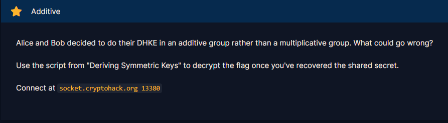

# Additive

#### Challenges: `Diffie-Hellman` - Cryptohack - Ngày viết: 11/12/2026

#### 1. Overview

* 
* `Mục tiêu`: Giải mã ciphertext
* `Lỗ hỗng`: Sử dụng nhóm cộng, thay vì nhóm nhân

#### 2. Exploit chain

* Nói một cách đơn giản thì khóa công khai $A$ được tính bằng cách: $A = ag \pmod p \to a = A * g^{-1} \pmod p$
* Ta khôi phục được $a$, ta dễ dàng tìm lại shared key và giải mã ciphertext
* Script: [Đọc](solve.py)
* ```
  crypto{cycl1c_6r0up_und3r_4dd1710n?}
  ```
