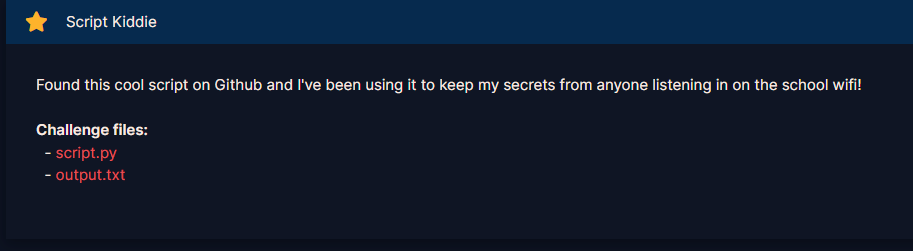
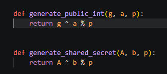

# Script Kiddie

#### Challenges: `Diffie-Hellman` - Cryptohack - Ngày viết: 11/12/2026

#### 1. Overview

* 
* `Mục tiêu`: Khai thác lỗ hỗng cài đặt giao thức, khôi phục flag
* `Lỗ hỗng`: `^`

#### 2. Exploit chain

* Lỗ hỗng của [script](script.py) đó là 
* `^` trong python là phép `xor`, chứ không phải mũ.
* Script: [Đọc ](solve.py)
* ```
  crypto{b3_c4r3ful_w1th_y0ur_n0tati0n}
  ```
