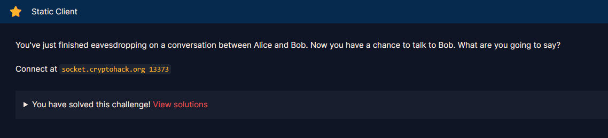
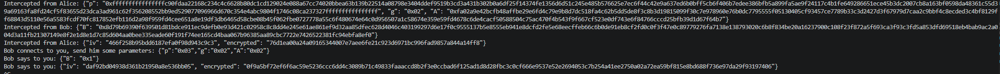
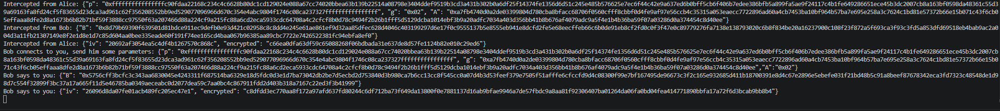

# Static Client

#### Challenges: Diffie-Hellman - Cryptohack - Ngày viết: 11/12/2026

#### 1. Overview

* 
* `Mục tiêu`: Khôi phục shared key để giải mã ciphertext
* `Kỹ thuật`: `Man In The Middle attack`

#### 2. Exploit chain

* Khi netcat đến server, ta sẽ được nhìn thấy Alice và Bob trao đổi thông tin với nhau. Và ta có 1 cơ hội để giao tiếp với Bob. Mình đã gửi thử $p = 3, g = 2, A = 2$ thì ta được như sau:
* 
* Giải mã:
* 
* Với lời nhắn của Bob như này. Ta dễ dàng nhận thấy khóa bí mật $b$ của Bob đã được tái sử dụng. Và ta đã thu thập được $A$ của Alice, nên ta chỉ cần gửi $g' = A$ là ta sẽ nhận được $B = g'^b = g^{ab} = S$, chính là shared key. Quá trình còn lại chỉ là giải mã cờ :v
* 
* Script: [Đọc](solve.py)
* ```
  crypto{n07_3ph3m3r4l_3n0u6h}
  ```
