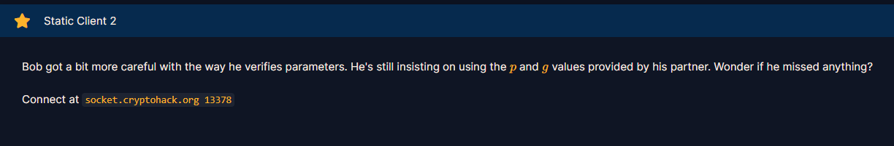
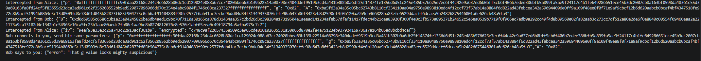

# Static Client 2

#### Challenges: `Diffie-Hellman` - Cryptohack - Ngày viết: 11/12/2026

#### 1. Overview

* 
* `Mục tiêu`: Giải mã ciphertext
* `Lỗ hỗng`: Số trơn

#### 2. Nền tảng cốt lõi

* Các bạn cần hiểu số trơn là gì: [Đọc](https://en.wikipedia.org/wiki/Smooth_number)

#### 3. Exploit chain

* Bài này chính là sự nâng cấp từ bài `Static Client`
* Nếu ta áp dụng cách cũ, Bob sẽ phản hồi ta tin nhắn sau:
* 
* Ở bài này, ta sẽ tạo ra payload cho phép khi ta nhận $B_{new}$, ta có thể tìm lại khóa bí mật $b$
* Với $p$ là 1 số nguyên tố trơn, ta dễ dàng tìm $b$ trong $B = g^b \pmod p$
* Payload ta sẽ có dạng như sau:
  * $p = new_p$ với $new_p$ là 1 số nguyên tố có $p-1$ rất trơn
  * $g = 2$
  * $A$ không quan trọng
* Script: [Đọc](solve.py)
* ```
  crypto{uns4f3_pr1m3_sm4ll_oRd3r}
  ```
