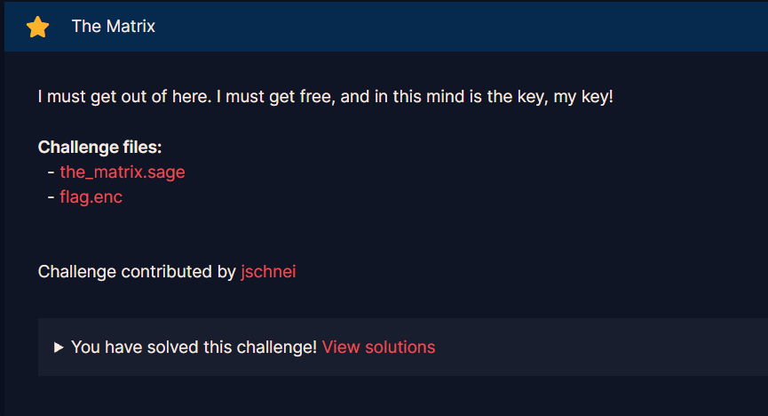

# The Matrix

#### Challenges: `Diffie-Hellman` - Cryptohack - Ngày viết: 11/13/2026

#### 1. Overview

* 
* Ở bài này, ta sẽ hiểu hơn bản chất bậc của phần tử là gì :v
* `Mục tiêu`: Khôi phục lại ma trận gốc
* `Lỗ hỗng`: Lộ bậc của ma trận

#### 2. Nền tảng cốt lõi

* Hiểu biết rõ cơ chế mã hóa RSA là điểm cộng lớn để hiểu được bài này.
* $\phi(N)$ chính là bậc của nhóm nhân modulo $N$
* $\text{ord}_2(mat)$ chính là bậc của ma trận $mat$
* $\text{ord}_2(mat)$ đóng vai trò tương tự như $\phi(N)$ trong tập hợp các ma trận khả nghịch

#### 3. Exploit chain

* Về cơ bản, ciphertext được tính như sau:
* $ciphertext = mat^e \pmod 2$
* Trong RSA, để giải mã ciphertext, ta cần biết khóa bí mật $d = e^{-1} \pmod {\phi(N)}$ .
* Bởi vì $\text{ord}_2(mat)$ đóng vai trò tương tự như $\phi(N)$, nên ta có $d = e^{-1} \pmod {\text{ord}_2(mat)}$
* Nhưng ta lại không có ma trận gốc $mat$ để tìm bậc. Nhưng ta có thể tính bậc của ma trận ciphertext hay chính là $\text{ord}_2(mat^e) = \frac{\text{ord}_2(mat)}{\gcd(\text{ord}_2(mat), e)}$
* Ta có thể kiểm tra thấy rằng $e$ chính là số nguyên tố. Những điều đó chưa đủ thuyết phục để nói rằng $\gcd(\text{ord}_2(mat), e) = 1$ để ép $\text{ord}_2(mat^e) = \text{ord}_2(mat)$, nên ta chỉ hy vọng rằng bậc của ma trận $mat$ nguyên tố cùng nhau với $e$, nếu không, ta không có cách nào để khôi phục lại được ma trận gốc :v
* Ta sẽ sử dụng chí nh bậc của ma trận $mat^e$ để tìm khóa bí mật $d$, sau đó giải mã ma trận ciphertext để đưa về ma trận gốc $mat$
* Script: [Đọc](solve.py)
* Và thức sự thì đúng là $\gcd(\text{ord}_2(mat), e) = 1$ :v
* ```
  crypto{there_is_no_spoon_66eff188}
  ```
