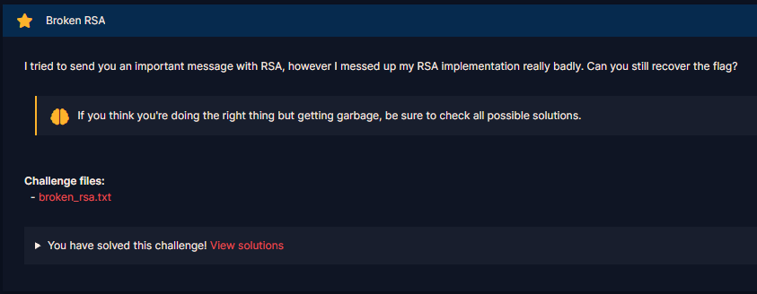
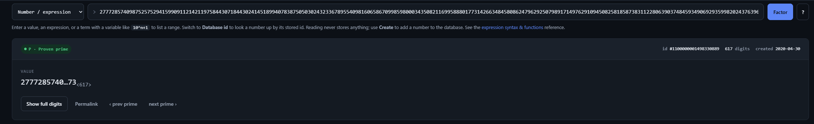
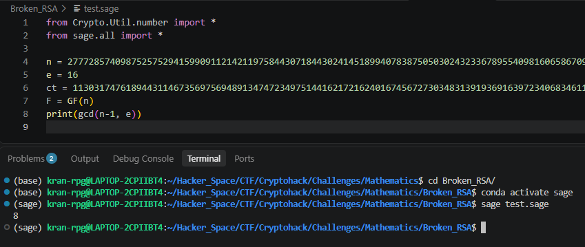

# Broken RSA

#### Challenges: `Mathematics` - Cryptohack - Ngày viết: 29/10/2026

#### 1. Overview

* 
* Đây là 1 bài khá là hay về trường hợp ngoại lệ của RSA :v
* `Mục tiêu`: Khôi phục flag từ ciphertext
* `Kỹ thuật`:Khôi phục nghiệm của đa thức **$f(x) = x^e - c$** trên vành đa thức thuộc trường hữu hạn  $\mathbb{F}_n[x]$ bằng hàm `roots()`trong sagemath

#### 2. Nền tảng cốt lõi

* Các bạn cần biết code sagemath :v
* Trường hữu hạn
* Hiện tượng đa nghiệm:Vì **$\gcd(e, n - 1) = g > 1$**, phép lũy thừa **$m \mapsto m^e \pmod n$** là hàm nhiều-về-một. Tồn tại tối đa **$g$** bản rõ cùng sinh ra một ciphertext **$c$**
* Mối liên hệ với Căn của đơn vị **(Roots of Unity):** Nếu **$m_0$** là một nghiệm thỏa mãn **$m_0^e \equiv c \pmod n$**, mọi nghiệm khác đều có dạng **$m = m_0 \cdot \omega \pmod n$** với **$\omega^e \equiv 1 \pmod n$**
* Ta đưa biểu thức $m^e = c \pmod n$ thành đa thức trên trường hữu hạn $\mathbb{F}_n[m]$ có dạng $f(m) = m^e - c $ và đi tìm mọi nghiệm $m$ khả dĩ và chọn ra $m$ phù hợp nhất

#### 3. Exploit chain

* Khi phân tích số $n$, ta biết rằng $n$ là 1 số nguyên tố
* 
* Khi đó, ta dễ dàng tính được $\phi(n)$ nhưng vấn đề xuất hiện ở giá trị $e$
* 
* Bởi vì $e = 16$ và $\phi(n)$ cũng là 1 số chẵn, nên $\gcd(e, \phi(n)) = 8 > 1$, nên không tồn tại nghịch đảo $d$ trên trường hữu hạn $\phi(n)$. Điều này dẫn đến có nhiều giá trị $m$ ($8$ nghiệm) khi mũ $e$ sẽ cho ra cùng 1 kết quả
* Ta đưa về đa thức trên trường hữu hạn $\mathbb{F}_n[m]$ có dạng $f(m) = m^e - c$ và tìm mọi nghiệm $m$ khả dĩ, với 8 nghiệm $m$ khác nhau, trong đó, chắc chắn sẽ có 1 nghiệm $m$ cho ra bản rõ gốc ban đầu flag
* Script: [Đọc](solve.sage)
* ```
  b"Hey, if you are reading this maybe I didn't mess up my code too much. Phew. I really should play more CryptoHack before rushing to code stuff from scratch again. Here's the flag: crypto{m0dul4r_squ4r3_r00t}"
  ```
