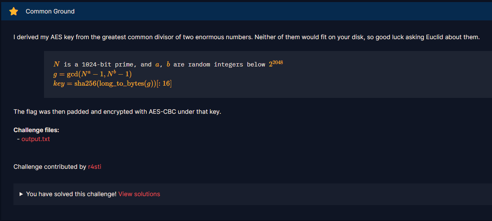

# Common Ground

#### Challenges: `Mathematics` - Cryptohack - Ngày viết: 29/10/2026

#### 1. Overview

* 
* Đây là 1 bài khá là hay về bổ đề ước chung của lũy thừa trong lập trình thi đấu :v
* `Mục tiêu`: Khôi phục key để giải mã ciphertext
* `Kỹ thuật`: Bổ đề ước chung của lũy thừa - nâng số mũ, ước chung giữa các đa thức

#### 2. Nền tảng cốt lõi

* Bổ đề ước chung của lũy thừa - nâng số mũ: [Đọc](https://www.scribd.com/document/519486122/B%E1%BB%95-%C4%91%E1%BB%81-nang-s%E1%BB%91-m%C5%A9)

#### 3. Exploit chain

* Ta có 1 bổ đề quan trọng để giải bài này như sau:

$$
\gcd(a^m - 1, \; a^n - 1) = a^{\gcd(m, n)} - 1
$$

* Quy trình:
  * Tìm ước chung lớn nhất của 2 số $a$ và $b$
  * Ta tìm $g$
  * Khôi phục lại $key$
  * Giải mã ciphertext
* Script: [Đọc](solve.py)
* ```
  crypto{n0_r34$0n_t0_b05h3r_w1th_l4rG3_GCD}
  ```
