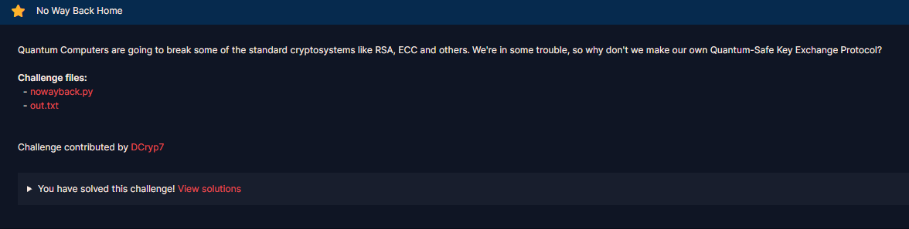

# No Way Back Home

#### Challenges: `Mathematics` - Cryptohack - Ngày viết: 29/10/2026

#### 1. Overview

* 
* `Mục tiêu`: Khôi phục lại trạng thái key để giải mã ciphertext
* `Kỹ thuật`: Nghịch đảo modular, định lý số dư trung hoa

#### 2. Nền tảng cốt lõi

* Các bạn cần biết điều kiện tồn tại nghịch đảo và cách sử dụng nghịch đảo module
* Định lý số dư trung hoa

#### 3. Exploit chain

* Mã nguồn server: [Đọc](nowayback.py)
* Trong [file out.txt](out.txt) cho ta biết được 5 giá trị là $p,q,vka,vkb,vkakb$
* Với mỗi giá trị được tính như sau:
  * $p \text{ là 1 số nguyên tố}$
  * $q \text{ là 1 số nguyên tố}$
  * $vka = v \cdot k_a \pmod {p \cdot q}$
  * $vkb = v \cdot k_b \pmod {p \cdot q}$
  * $vkaka = v \cdot k_a \cdot k_b \pmod {p \cdot q}$
  * với $v = p \cdot r \text{ (với r là 1 số ngẫu nhiên)}$
* Nếu như ta giải theo cách thông thường là tìm nghịch đảo $vka^{-1}$ rồi tìm được $k_b$ thì các bạn lầm to =))))
* Bởi vì $\gcd(vka, n) = \gcd(p \cdot r \cdot k_a, p \cdot q) = p\neq 1 (\gcd(k_a, n) = 1 \to \gcd(k_a, q) = 1, \gcd(r, q) = 1)$ nên $vka$ không khả nghịch trên module $n$ :v
* Quy trình sẽ là như sau:
  * Phân rã biểu thức đồng dư $v = p \cdot r \pmod n$ thành 2 biểu thức trên module $p$ và $q$, khi đó ta có
  * $v_p = 0 \pmod p$
  * $v_q = a_{pr} \pmod q$
  * Khi xét các biểu thức $vka,vkb,vkakb$ trên trường hữu hạn $F_q$, bởi vì $\gcd(q, r) = 1, \gcd(q, k_a) = 1, \gcd(q, k_b) = 1$, nên $vka,vkb,vkakba$ khả nghịch trên module $q$
  * Nên $v_q$ sẽ bằng:

$$
\frac{vka \cdot vkb}{vkakb} = \frac{v \cdot k_a \cdot v \cdot k_b}{v \cdot k_a \cdot k_b} = v_q \pmod q
$$

* Ta có được hệ như sau:

$$
\begin{cases}
v_p = 0 \pmod p \\
v_q = \frac{vka \cdot vkb}{vkakb} \pmod q
\end{cases}
$$

* Ta tìm nghiệm $v$ bằng định lý số dư trung hoa và sau đó là quy trình giải mã ciphertext :v
* Script: [Đọc](solve.sage)
* ```
  crypto{1nv3rt1bl3_k3y_3xch4ng3_pr0t0c0l}
  ```
