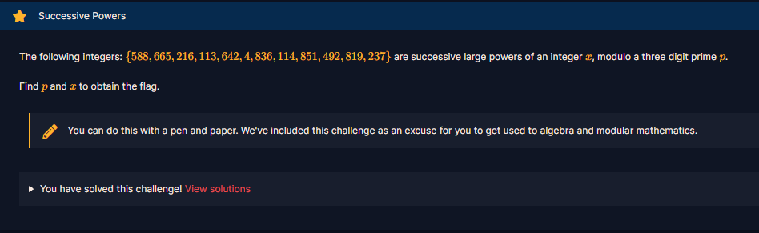
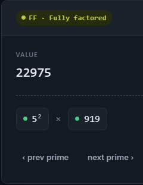

# Successive Powers

#### Challenges: `Mathematics` - Cryptohack - Ngày viết: 28/10/2026

#### 1. Overview

* 
* Bài này khá là cơ bản trong đại số module :v
* `Mục tiêu`: Tìm p và x
* `Kỹ thuật`: Giải hệ phương trình module, brute force

#### 2. Nền tảng cốt lõi

* Các bạn cần hoàn thành Course: Modular Arithmetic trước khi giải.

#### 3. Exploit chain

##### 3.1. Cách 1 - Giải bằng giấy và bút =))))

* Ta có dãy số $(588, 665, 216, 113, 642, 4, 836,114,851,492,819,237)$
* Dãy số này có ý nghĩa như sau:

$$
\left\{ \begin{array}{cl}
x^{n} = 588 \text{ mod p}\\
x^{n+1} = 665 \text{ mod p}\\
...\\
x^{n+11} = 237\text{ mod p}
\end{array} \right.
$$

* Ta có $x^{n+1} = x^n \cdot x = a_0x = a_1 \text{ mod p}$
* Và ta biết được rằng $113x = 642 \text{ mod p}$ và $114x = 851 \text{ mod p}$, nên ta dễ dàng suy ra $114x -113x = x = 851 - 642 = 209 \text{ mod p}$
* Đã có được $x$ ta thế vào 1 biểu thức có sẵn là $113 \cdot 209 =23,617 =642 \text{ mod p} \to 642 + kp = 23,617 \to kp = 22,975$
* Ta đưa số này lên [factordb](https://factordb.com/?query=22975) để phân tích thừa số nguyên tố hoặc sử dụng casino sử dụng chế độ $S=>D$để chuyển đổi giá trị $kp$ sang thừa số nguyên tố
* 
* $p$ là số nguyên tố nên chắc chắn $p = 919$
* ```
  crypto{919,209}
  ```

##### 3.2. Cách 2 - Brute Force p

* Ta đã biết $p$ có độ dài là 3 chữ số, bằng cách brute force $p$ và tính $x = a_{n+1} \cdot a_n^{-1} \text{ mod p (n = 0,...,10)}$, nếu mọi giá trị $x$ bằng nhau, ta in ra $x$ và $p$
* Script: [Đọc](solve.py)
* ```
  crypto{919,209}
  ```
