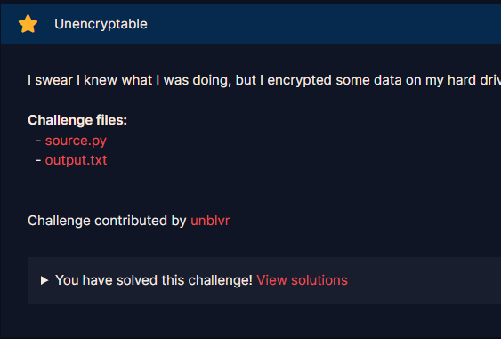
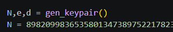
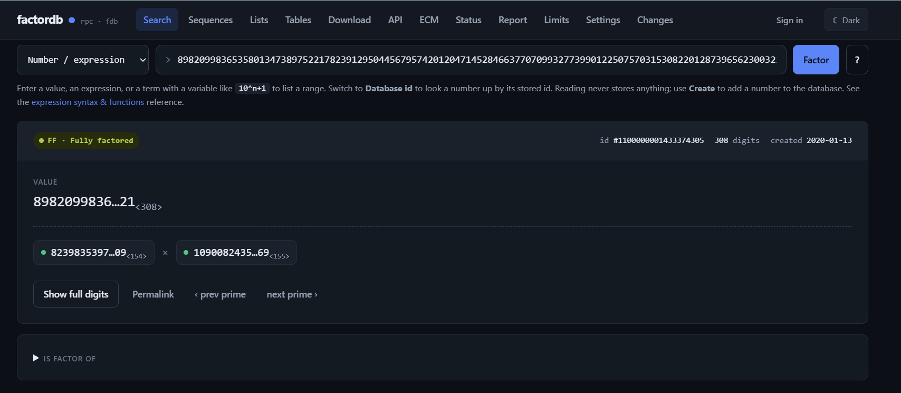
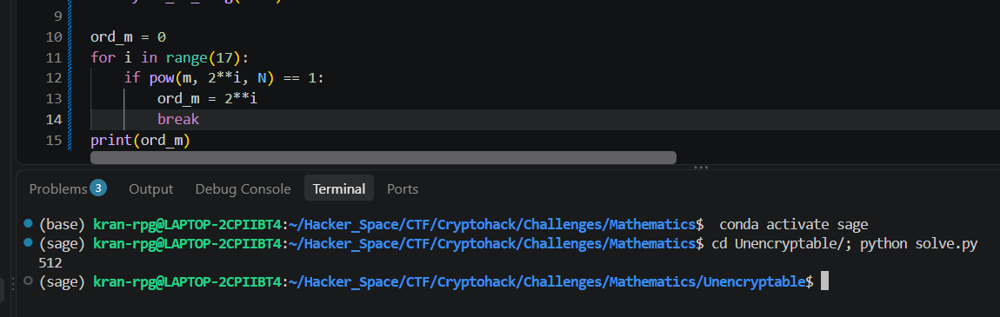
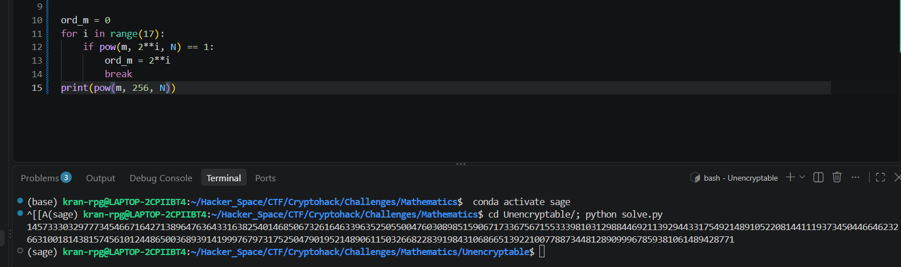

# Unencryptable

#### Challenges: Mathematics - Cryptohack - Ngày viết: 30/10/2026

#### 1. Overview

* 
* Đây là 1 bài rất là hay về lý thuyết số :v
* `Mục tiêu`: Khôi phục lại flag từ ciphertext
* `Kỹ thuật`: Căn bậc 2 không tầm thường của 1 trên modulo $N$

#### 2. Nền tảng cốt lõi

* Các bạn cần biết về căn bậc 2 không tầm thường của 1 trên module là hợp số
  * Nếu xét trên trường hữu hạn $F_p$,phương trình $x^2 = 1 \pmod p$ sẽ chỉ có đúng 2 nghiệm $x = \pm 1 \pmod p$
  * Nhưng khi xét trên vành hợp số $Z_N (N = p * q)$, theo định lý số dư trung hoa, phương trình $x^2 = 1 \pmod N$ sẽ có tới 4 nghiệm, nghiệm thỏa mãn $x^2 = 1 \pmod N, x \neq \pm 1 \pmod N$ sẽ được gọi là nghiệm không tầm thường

#### 3. Phân tích lỗ hỗng

* Mã nguồn server: [Đọc](source.py)
* Mã nguồn server cung cấp cho ta những thông tin sau:
  * $N$ đã được khai báo cố định là 1 hợp số.
  * 
  * $Flag$ được mã hóa bằng khóa công khai $(N_{new},e = 65537 = 2^{16} + 1)$
  * $DATA$ cũng được mã hóa bằng khóa công khai $(N_{new}, e)$
  * Bản rõ của $DATA$ bằng bản mã của $DATA$

#### 4. Ý tưởng khai thác

* Chúng ta có 2 cách để giải bài này :v

##### 4.1. Cách 1 - Sử dụng factordb

* Ta copy số $N$ lên trang factordb để phân tích cặp số $(p,q)$
* 
* Ta đã có được cặp số $(p,q)$, ta tìm $\phi(N)$, rồi giải mã $Flag$ như bình thường =)))))))
* Script hacker lord: [Đọc](hackerriel.py)
* ```
  crypto{R3m3mb3r!_F1x3d_P0iNts_aR3_s3crE7s_t00}
  ```

##### 4.2 Cách 2 - Phân tích nhân tử phương trình mã hóa DATA, khôi phục p,q

* Mặc dù chúng ta có giải theo đường tắc =))), nhưng hiểu được hàm ý tác giả ra đề, chúng ta mới học được 1 cái gì đó mới :v
* Phân tích biến $DATA$, ta có phương trình như sau:
* $m_{DATA}^e = m_{DATA} \pmod N \to m_{DATA}^{e-1} - 1 = 0  \pmod N$
* Nên, cấp của phần tử $m_{DATA}$ trên vành $Z_N$ sẽ chia hết cho $e - 1$
* $ord_{N}(m_{DATA}) | e - 1$
* Và giá trị $e - 1$ rất đặc biệt, nó bằng $2^{16}$ (đơn giản $e$ là số nguyên tố fermat), nên giá trị của $ord_{N}(m_{DATA}) \in (2^{0},2^{1},2^{2},2^{3},...,2^{16})$
* Và ta dễ dàng tìm được $ord_{N}(m_{DATA}) = 2^9 = 512$
* 
* Điều này có ý nghĩa rất quan trọng bởi vì số mũ là $2^9$
* Khi đó ta có phương trình sau:
* $m^{2^9}_{DATA} - 1 = 0 \pmod N \to (m^{2^8}_{DATA} - 1)(m^{2^8}_{DATA} + 1)  = 0 \pmod N$
* Ta gọi $x = m^{2^8}_{DATA}$
* $\to x^2 - 1 = 0 \pmod N \to (x - 1)(x + 1) = 0 \pmod N$
* Bởi vì cấp của phần tử $m_{DATA}$ là $2^9 = 512$, nên chắc chắn $m^{256} \neq 1$, ta kiểm tra thì thấy luôn $m^{256} \neq -1$
* 
* Nên căn bậc 2 của $x^2$ là nghiệm không tầm thường, nên $x \neq \pm 1 \pmod N$
* Vì $x \neq \pm 1 \pmod N$ nên cả $(x-1)$ và $(x+1)$ đều không chia hết cho $N$, nếu $x$ là nghiệm tầm thường (có nghĩa là $x = \pm 1 \pmod N$), khi đó, trong trường hợp $x=1 \pmod N$ thì $x-1= 0$ chia hết cho $N$, trường hợp $x = -1 \pmod N$ thì $x+ 1= 0$ chia hết cho $N$. Nên trong trường hợp $x \neq \pm 1 \pmod N$, bắt buộc một bên chia hết cho $p$, bên kia chia hết cho $q$. Khi đó, ta dùng thuật toán Euclid để khôi phục lại 1 thừa số của $N$:
* $p = \gcd(x-1,N) \text{ hoặc } p = \gcd(x+1,N)$
* Và $q  = N // p$, sau đó là giải mã cờ :v
* Script riel CTF player: [Đọc](solve.py)
* ```
  crypto{R3m3mb3r!_F1x3d_P0iNts_aR3_s3crE7s_t00}
  ```
