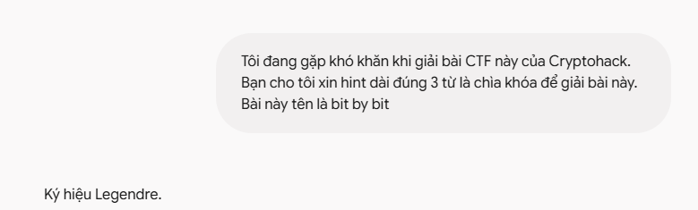
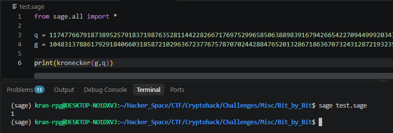

# Bit by Bit

#### Challenges: Misc - Cryptohack

#### 1. Overview

* Bài này là task của các anh lớn giao cho k25, nay mình giải thì mình mới thấy là bài này thực sự cơ bản nhưng không phải ai cũng giải được =))), mình phải đi xin hint bài này mới có thể tự giải.
* `Mục tiêu`: Giải mã các bit được mã hóa trong `c2`
* `Kỹ thuật`: Ký hiệu legendre

#### 2. Nền tảng cốt lõi

* Các bạn thực sự cần độ nhạy cao với toán =)))
* BIết được thặng dư bậc 2 của module q bất kỳ - thường là nguyên tố. Biết ký hiệu legendre
* Cần có khả năng đọc hiểu code python ở mức trung

#### 3. Phân tích lỗ hỗng

* Đề cho ta 1 file python ghi lại quá trình mã hóa ELgima của đoạn flag, và output của nó là file output. Chúng ta cần giải mã từ file output này.
* Ở phần padding, seed khởi đầu là `256`, số được trả về là `256^e mod q`với e là số bất kỳ
* Public key được tạo ra bằng cách lấy `g^x mod q`với x là số bất kỳ
* Hàm mã hóa của ta sẽ sử dụng đối số là `message`và `public key`để mã hóa. Trong hàm, hàm tiếp tục sinh ra 1 số `y`ngẫu nhiên, rồi mã hóa trả lại cho ta `c1 = g^y mod q`và `c2 = g^xy * me mod q`
* Trong file output, hiện tại với mỗi bit của cờ sẽ được mã hóa với cặp `x,y` khác nhau và với mỗi bit cờ ta có `public key`và cặp `c1,c2`
* Khi khai triển cả 3 `public key,c1c2` thì sẽ như sau:
  * `public key  = h = g^x mod q`
  * `c1 = g^y mod q`
  * `c2 = g^xy * me mod q`

#### 4. Ý tưởng khai thác

* Đây là 1 hệ mật mã mã hóa ELgima điển hình. Với dữ kiện trên, ta gần như chỉ có 1 hướng đi duy nhất là brute force tìm logarit để khôi phục `x hoặc y` để giải mã triệt tiêu được `g ^xy`để khôi phục lại `me`nếu như quá trình mã hóa được triển khai đúng
* Vì vậy mình đã chuyển sang kiểm tra xem, trong quá trình mã hóa, tạo sinh khóa có để lại lỗ hỗng nào không.
* Ở điểm đầu tiên mà mình thấy kì là padding. Padding sử dụng `seed = 256`, hay chính là `2^8`. Khi lấy bit cuối của flag ở dòng lắp vào padding
* ```Python
  while m:
      padding = get_padding()
      me = padding << 1 + m % 2
      h = public_key()
      (c1, c2) = encrypt(me, h)
      print(f'(public_key={hex(h)})')
      print(f'(c1={hex(c1)}, c2={hex(c2)})')
      m //= 2
  ```
* Mình đã phán đoán sai ở dòng `me = padding << 1 + m % 2` khi mà nghĩ rằng padding sẽ dịch bit sang trái 1 bit rồi gắn bit của flag vào bit cuối cùng bên phải.
* Sau đó mình có suy luận rằng `g`là 1 số chẵn, khi bit `0` của flag nhân với bất kỳ số nào cũng là bit `0`, đối với bit `1` thì với `g` là số chẵn, `g^xy` cũng là 1 số chẵn nên nhân với bit `1` sẽ thành bit `0`nhưng các bit liền kề sẽ tăng lên , ví dụ như dãy bit `00` nhân 2 bằng `00`, còn `01`nhân 2 bằng `10`. Với padding là 1 số có seed là `256` hay đổi sang bit là `1.0000.0000`thì khi mũ bất kì lên thì số chuỗi bit sau số 1 luôn là dãy bit `0` nên mình định chỉ cần kiểm tra xem các bit gần bit liền kề cuối bên phải là: nều full bit 0 và chỉ có 1 bit `1` sẽ là bit `0`, nếu xuất hiện nhiều hơn 1 bit `1`thì sẽ là bit `1`
* Điểm mù ở suy luận này là mình đang xét trên trường số thực =))), chứ không phải trường module
* Khi nhận ra điều này thì mình nhận ra suy luận nãy giờ của mình hoàn toàn sai và là không phải hướng giải của bài.
* Sau đó mình bí quá, mình có nhờ gemini xin hint =))))
* 
* Đúng với 3 chữ thì mình bắt đầu ngay. Dựa vào hint thì mình thử xét ký hiệu legendre đối với `c2` thì mình được như sau:
* 
* Có một bài Cryptohack đã từng sử dụng ký hiệu này để giải cờ là bài Adrian ở mục Course: Modular_math. Tại đó, lỗ hỗng được phát hiện khi có 1 số có thặng dư bậc 2 =))))
* Mình nghĩ lại bài này thì mình nghĩ có khi `g` cũng là thặng dư bậc 2 của `q`
* 
* Và quả thực là vậy =))))). Khi `g`là thặng dư bậc 2 của q, thì ta có như sau:
* 
* Và `g^xy` đã biến mất khỏi phép nhân, và chỉ còn lại thằng `me`
* Giá trị bit của cờ sẽ phụ thuộc vào giá trị ký hiệu legendre của `me`. Tại sao mình biết, mình đoán vậy =))))
* Khi nêu ý tưởng giải cho gemini thì hướng đi của mình hoàn toàn chính xác, nhưng có 1 điểm sai lầm khiến mình tư duy cách giải sai đó là `toán tử bitwise luôn được ưu tiên sử lý cuối cùng sau các phép cơ bản như cộng trừ nhân chia`
* Có nghĩa là biểu thức `me = padding << 1 + m % 2` này phải được hiểu là `me = padding << (1 + (m % 2))`
* `m % 2`chỉ có thể có giá trị `0` hoặc `1`nên `me` chỉ có thể có 2 trường hợp:
  * `me = padding << (1 + 0) = padding * 2`
  * `me = padding << (1 + 1) = padding * 2^2`
* Khi đưa vào biểu thức ký hiệu legendre, ta có như sau:
  * `TH1: bit cờ là bit 0`:
  * `TH2: bit cờ là bit 1`:
* Vậy trong mọi trường hợp `x,y`, nếu bit cờ bị mã hóa là bit `0` thì giá trị ký hiệu legendre luôn là `-1`, hay là không có thặng dư bậc 2. Còn nếu có thặng dư bậc 2 là trường hợp bit cờ mã hóa là bit `1`

#### 5. Exploit chain

* Quy trình:

  * Lưu hết các `public key, c1,c2`
  * Trích xuất cách giá trị `c2`,xét ký hiệu legendre, nếu bằng `1`, cộng 1 bit `1`, nếu khác `1`, cộng 1 bit `0`
* Script: [Đọc](solve.sage)
* ```
  crypto{s0m3_th1ng5_4r3_pr3served_4ft3r_encrypti0n}
  ```
