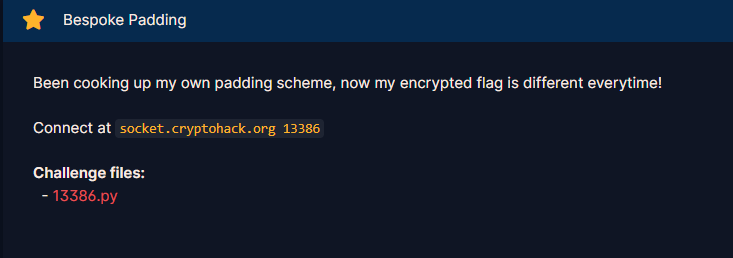

# Bespoke Padding

#### Challenges: RSA - Cryptohack - Ngày viết: 11/13/2026

#### 1. Overview

* 
* `Mục tiêu`: Khôi phục lại bản rõ flag
* `Lỗ hỗng`: Quan hệ tuyến tính của $m$ , Franklin Reiter's Attack.

#### 2. Exploit chain

* Mã nguồn server: [Đọc](13386.py)
* Flag sau khi pad có dạng : $pad = am + b$
* Khi được mã hóa, ciphertext có dạng: $C = (am + b)^e \bmod N$
* Ta sẽ lấy 2 bản mã $C_1$ và $C_2$, ta gọi $m$ là nghiệm cần tìm, khi ấy, ta có 2 đa thức ẩn $x$ trên vành $\mathbb{Z}_N[x]$

$$
g_1(x) = (a_1 x + b_1)^e - C_1 = (x - m) \cdot Q_1(x)
$$

$$
g_2(x) = (a_2 x + b_2)^e - C_2 = (x - m) \cdot Q_2(x)
$$

* Ta tìm ước chung lớn nhất của 2 đa thức. Bởi vì $a1, b1, a2, b2$ là các số ngẫu nhiên, nên gần như chắc chắn rằng $Q_1(x)$ và $Q_2(2)$ nguyên tố cùng nhau. Ta tìm ra được ước chung là $(x - m)$
* Script: [Đọc](solve.py)
* ```
  crypto{linear_padding_isnt_padding}
  ```
