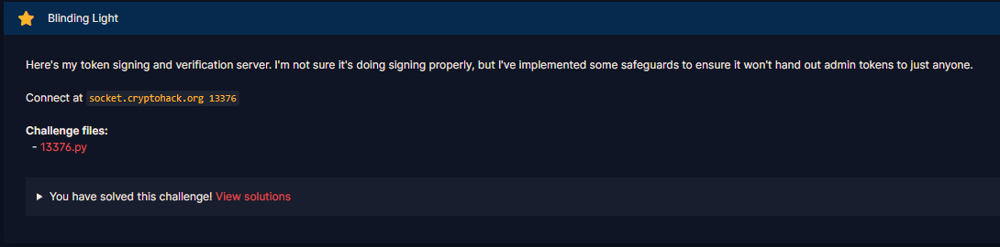
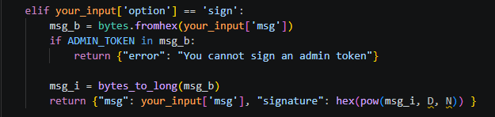

# Blinding Light

#### Challenges: RSA - Cryptohack - Ngày viết: 11/15/2026

#### 1. Overview

* 
* Đây là 1 dạng bài tương đồng với `rsa_oracle` bên picoCTF (nếu bạn có làm :v), lỗ hỗng có tên là `RSA Multiplicative Homomorphic` hoặc gần gũi hơn là `Blinding Attack` trên RSA.
* `Mục tiêu`: Lấy được chữ ký của `ADMIN_TOKEN`để lấy được flag
* `Lỗ hỗng`: Oracle cho phép ký bất kỳ plaintext nào và chỉ ngoại trừ ADMIN_TOKEN

#### 2. Nền tảng cốt lõi

* Các bạn nên làm bài rsa_oracle của PicoCTF trước khi làm bài này để hiểu hơn :v

#### 3. Phân tích lỗ hỗng

* Mã nguồn server: [Đọc](13376.py)
* 
* Server cho phép ta ký bất kỳ plaintext và chỉ loại trừ `ADMIN_TOKEN`, điều này dẫn đến cuộc tấn công số học trên dạng mô hình Oracle kiểu này.

#### 4. Ý tưởng khai thác

* Chúng ta sẽ gửi 2 bản rõ lên server để ký, lần lượt là `2` và `2 * bytes_to_long(ADMIN_TOKEN)`để nhận về `2^d mod N`và `2^d * bytes_to_long(ADMIN_TOKEN)^d mod N`
* Ta tìm nghịch đảo của `2^d mod N`là `2^-d mod N`, sau đó nhân với `2^d * bytes_to_long(ADMIN_TOKEN)^d mod N` để thu được `bytes_to_long(ADMIN_TOKEN)^d mod N`. Ta đã lấy được chữ ký trên `ADMIN_TOKEN` thành công :v

#### 5. Exploit chain

* Quy trình:
  * Gửi `2`lên để ký
  * Gửi `2 * bytes_to_long(ADMIN_TOKEN)`để ký
  * Tính chữ ký `ADMIN_TOKEN` =`bytes_to_long(ADMIN_TOKEN)^d mod N`
  * Gửi chữ ký `ADMIN_TOKEN` lên server
* Script: [Đọc](solve.py)
* ```
  crypto{m4ll34b1l17y_c4n_b3_d4n63r0u5}
  ```
