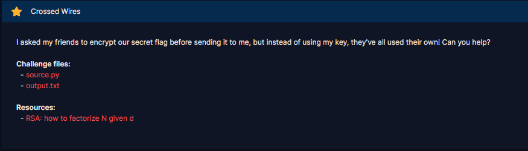

# Crossed Wires

#### Challenges: RSA - Cryptohack - Ngày viết: 11/3/2026

#### 1. Overview

* 
* Đây là 1 bài khá là hay khi bài này cho phép ta phân tích thừa số nguyên tố $N$ khi biết khóa $d$ và $e$ tương ứng
* `Mục tiêu`: Khôi phục flag khi flag được mã hóa bằng nhiều số $e$ khác nhau và ta biết được khóa $d$ của $N$

#### 2. Nền tảng cốt lõi

* Thuật toán phân tích thừa số $N$ khi có $e, d$: [Đọc](https://www.di-mgt.com.au/rsa_factorize_n.html)

#### 3. Exploit chain

* Mã nguồn server: [Đọc](source.py)
* Chúng ta có 2 cách giải cho bài này

##### 3.1. Cách 1 - Factordb

* Ta đưa $N$ lên factordb và phân tích thừa số nguyên tố của $N$
* Sau đó là tìm các khóa $d$ tương ứng với từng $e$ của friend list
* Giải mã flag

##### 3.2. Cách 2 - Sử dụng thuật toán phân tích thừa số N khi có e, d

* Về ý tưởng thuật toán, nền tảng là tìm nghiệm không tầm thường của phương trình đồng dư: $x^2 - 1\equiv 0 \mod N$
* Nếu $x^2 - 1 = 0 \mod N$ nhưng $x \neq \pm1 \mod N$ thì ta có:
* $(x + 1)(x - 1) = k\cdot p\cdot q$. Bởi vì $x \neq \pm1 \mod N$ thì cả $(x+1)$ và $(x-1)$ không chia hết cho $N$, nên bắt buộc 1 bên phải chia hết cho $p$, bên còn lại chia hết cho $q$. Lúc này ta chỉ cần thực hiện $\gcd(x - 1, N)$ là có thể lấy được ra $q$
* Sau khi lấy được $q,p$, quy trình còn lại giống ở cách 1 :v
* Script cách 1, cách 2: [Đọc](solve.py)
* ```
  crypto{3ncrypt_y0ur_s3cr3t_w1th_y0ur_fr1end5_publ1c_k3y}
  ```
* Một điều lưu ý là để có thể tìm được căn bậc 2 của $x^2$, thì số mũ phải là số chẵn. Nên chúng ta mới phân tách $e\cdot d -  1 = 2^t \cdot r$ theo như resource.

#### 4. Ngoài lề

* Sau khi giải được bài này thì mình có đọc thấy 1 solution rất là hay của [Drago](https://cryptohack.org/user/Drago/)
* Theo như mã nguồn server thì flag được mã hóa như sau: $m^{k_1k_2k_3k_4k_5} = c \pmod N$
* Ta đặt $x = k_1k_2k_3k_4k_5$, khi đó $c$ trờ thành: $m^x = c \pmod N \text{(giống RSA bình thường)}$
* Để giải mã được $c$, ta cần tìm $y$ sao cho $xy = 1 \pmod {\phi(N)}$, bởi vì ta không hề biết gì về $\phi(N)$ nhưng chúng ta có $e, d$ và ta có công thức $ed -1 = k \cdot \phi(N)$
* Nên ta có được $xy = 1 \pmod {ed - 1} \to y = x^{-1} \pmod {ed - 1}$ và ta tìm được $y$
* Lý do tại sao tìm nghịch đảo trên modulo $ed -1$ vẫn được chấp nhận vì
* $xy = 1 \pmod {ed - 1} \to xy - 1 = t \cdot (ed - 1) \to xy - 1 = t \cdot k \cdot \phi(N)$
* Ta lấy modulo $\phi(N)$
* $\to xy - 1 = 0 \pmod {\phi(N)}$
* Và ta giải bài này mà không cần tính $\phi(N)$ =)))))
