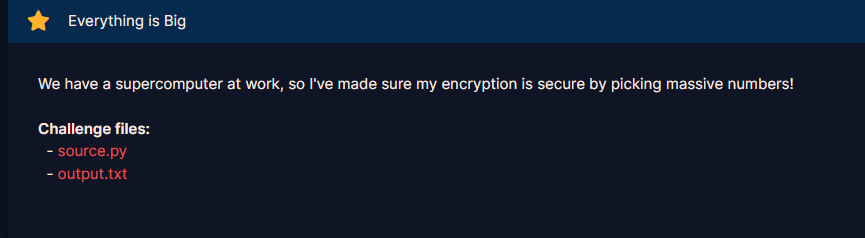

# Everything is Big

#### Challenges: `RSA` - Cryptohack - Ngày viết: 23/10/2026

#### 1. Overview

* 
* Đây là 1 bài đảo ngược quá trình sinh key, khi chọn khóa bí mật trước, sau đó mới sinh ra khóa công khai =))). Và cũng là 1 bài điển hình sử dụng wiener attack để khôi phục $d$ =)))
* `Mục tiêu`: Khôi phục khóa $d$, giải mã $ciphertext$
* `Lỗ hỗng`: Khóa bí mật $d$ nhỏ
* `Kỹ thuật`: Wiener's attack

#### 2. Nền tảng cốt lõi

* Wiener's attack: [Đọc](https://en.wikipedia.org/wiki/Wiener%27s_attack)
* Write-up bài Small Trouble trên PicoCTF: [Đọc](https://github.com/KranBoring/CTF-Solutions/blob/main/PicoCTF/Medium/Small_Trouble/write-up.md)

#### 3. Exploit chain

* Điều kiện để tấn công wiener thành công cần phải thỏa mãn:
* 
* $N$ có độ lớn 2048 bits, $d$ có độ lớn 256 bits. Ta $\log_{2}$ cả 2 vế:
* $\log_2d \lt \log_2\frac{1}{3}N^{1/4} \to 256 \lt \log_2\frac{1}{3} + \frac{1}{4}\log_2N \to 256 \lt -1.5849... + \frac{1}{4} \cdot 512 \to 256 \lt 510.415... \text{ (thỏa mãn)}$
* Điều kiện thỏa mãn, ta thực hiện wiener attack để khôi phục khóa $d$, sau đó giải mã $ciphertext$
* Script: [Đọc](solve.sage)
* ```
  crypto{s0m3th1ng5_c4n_b3_t00_b1g}
  ```
