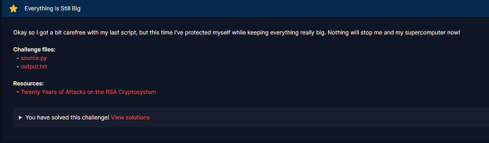

# Everything is Still Big

#### Challenges: RSA - Cryptohack - Ngày viết: 11/4/2026

#### 1. Overview

* 
* Đây là bài đầu tiên mình sử dụng Boneh–Durfee attack vào RSA :v
* `Mục tiêu`: Phá giải RSA để khôi phục flag
* `Lỗ hỗng`: Khóa bí mật $d$ sinh nhỏ
* `Kỹ thuật`: Boneh–Durfee attack

#### 2. Nền tảng cốt lõi

* Các bạn xem qua tài liệu có nhắc đến phương pháp Boneh–Durfee attack ở trang 4: [Đọc](https://www.ams.org/notices/199902/boneh.pdf)
* Mã nguồn `Boneh–Durfee attack`mình sử dụng: [Đọc](https://github.com/maximmasiutin/rsa-boneh-durfee/blob/master/boneh_durfee.sage)

#### 3. Exploit chain

* Cơ bản,`Boneh–Durfee attack`được cải tiến từ `wiener's attack`, cho phép khôi phục khóa $d$ nếu $d < N^{0.292}$
* Vì $\frac{1}{3}N^{0.25} < d < N^{0.26}$, nên ta đặt $delta = 0.26$ để cho thuật toán `Boneh–Durfee attack`hoạt động nhanh hơn (hạn chế định thức ma trận Lattice phình to, đồng thời giảm chiều của mạng)
* Ngoài ra, ta còn 1 cách nữa là sử dụng `factordb`để phân tích thừa số $N$ =))))
* Script: [Đọc](solve.py)
* ```
  crypto{bon3h5_4tt4ck_i5_sr0ng3r_th4n_w13n3r5}
  ```
