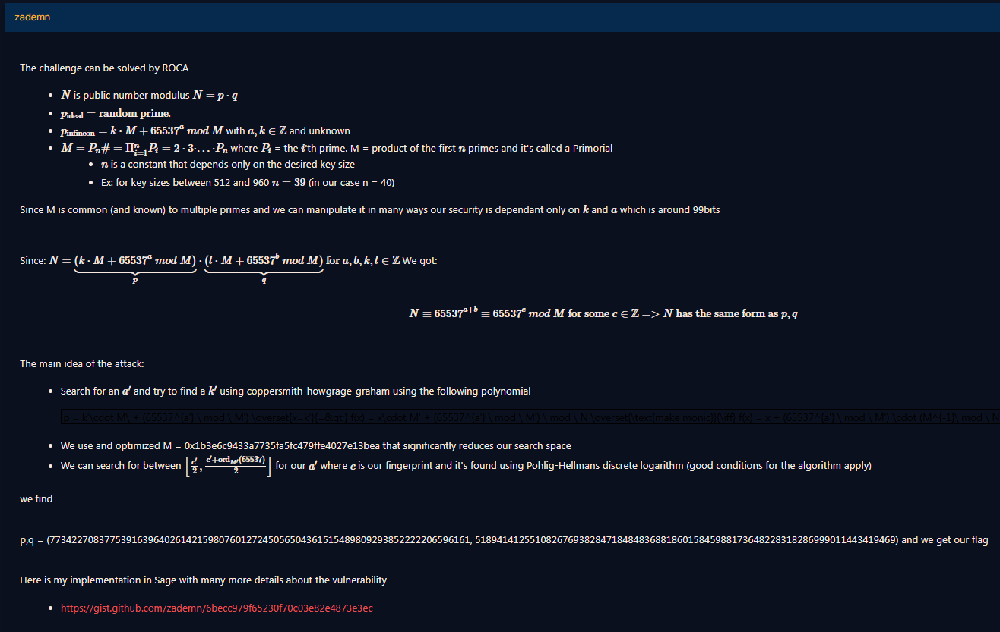
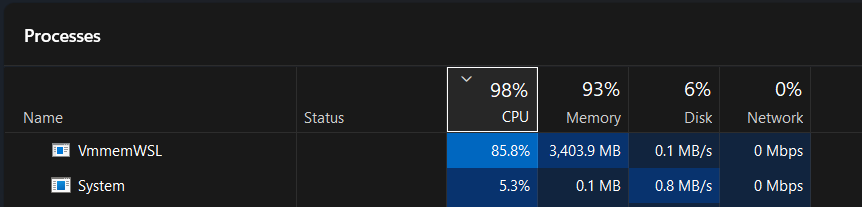

# Fast Primes

#### Challenges: RSA - Cryptohack - Ngày viết: 11/12/2026

#### 1. Overview

* 
* Mình chả hiểu tại sao bài này được đánh giá chỉ có 75 điểm :v, trong khi đó, để có thể giải được cần phải có kiến thức của cả bậc nhân, số trơn , nghiệm nguyên nhỏ coppersmith,... để có thể giải được bài này :v. Ngoài ra, bài này được lấy cảm hứng từ lỗ hỗng có thật ở năm 2017 là `ROCA`
* `Mục tiêu`: Phân tích quá trình sinh số Modulus $N$, khai thác lỗ hỗng dấu vân tay trên $N$ để phân tích được $N$, khôi phục bản rõ
* `Kỹ thuật`: Logarit rời rạc, tìm lại số mũ bằng Pohlig–Hellman + CRT, định lý coppersmith, tính chất của cấp nhân trên vành số modulo.

#### 2. Nền tảng lý thuyết

* Định nghĩa cấp của một số $a$ modulo $p$ : [Đọc](<https://giapppp.notion.site/Mathematic-in-Cryptography-01a27fda51a943d2b04fbe840e5dd26b#:~:text=%C4%90%E1%BB%8Bnh%20ngh%C4%A9a%209%3A-,Ta,-%C4%91%E1%BB%8Bnh%20ngh%C4%A9a%20c%E1%BA%A5p>) (Tính chất cần lưu ý là hệ quả 7)
* Method log trong sagemath đã tích hợp sẵn thuật toán `Pohlig–Hellman + CRT`
* Định lý Coppersmith: [Đọc](https://en.wikipedia.org/wiki/Coppersmith_method)
* Định nghĩa primorial (giai thừa số nguyên tố) : [Đọc](https://vi.wikipedia.org/wiki/Giai_th%E1%BB%ABa_nguy%C3%AAn_t%E1%BB%91)

#### 3. Phân tích lỗ hỗng / Ý tưởng khai thác

* Mã nguồn server: [Đọc](fast_primes.py)
* Số nguyên tố của các Modulus $N$ có cấu trúc đặt biệt như sau:
* $p = k * M + (e^{a} \bmod M)$ với $a$ nằm trong trong khoảng từ $2^{20} \to 2^{62}$ và $k$ nằm trong khoảng $2^{28} \to 2^{29}$
* $M = primorial(40)$
* Ta có $N = q * p = (k_1 * M + (e^{a} \bmod M)) * (k_2 * M + (e^{b} \bmod M)) \equiv e^{a + b} \bmod M$
* Ta dễ dàng tìm được $a + b$ vì $M$ siêu trơn
* Ta vét cạn $a \in [0, a+b]$ để tìm nghiệm nhỏ của phương trình $f(x) = x * M + (e^a \bmod M)$ với hệ số $\beta = 0.48$ để tìm theo modulus $p$, nếu hệ số $a$ được chọn đúng, phương trình đồng dư có dạng : $f(x) = x * M + p_0 \equiv 0 \pmod p$, method small_roots sẽ có thể tìm ra nghiệm $x = k$ và ta tìm được $p$
* Từ đoạn này trở đi, mình đang tham khảo cách giải của [zademn](https://cryptohack.org/user/zademn/).
* 
* Với cách giải của mình. Mình đã treo máy gần 2 tiếng đồng hồ vẫn chưa tìm ra $a$ đúng để giải ra $k$ :v
* Khi tham khảo cách giải của zademn, kết hợp với phân tích toán học của gemini. Ta có thể giảm không gian $a+b$ xuống ngưỡng đủ nhanh như sau:
  * Theo định lý coppersmith, với $p \approx N^{0.5}$ ($\beta = 0.5$) , method `small_roots`sẽ tìm được các nghiệm $x_0 < N^{\beta^2/d} = N^{1/4}$. Do $x_0 * M + p_0 = p \to x_0 * M \approx p \to x_0 \approx \frac{p}{M} \approx \frac{N^{1/2}}{M}$
  * $\to \frac{N^{1/2}}{M} < N^{1/4} \to M > N^{1/4} \to \log_2(M) > \frac{\log_2(N)}{4}$
  * Khi code để tìm $\log_2(N)$ thì ta dễ dàng biết được $N$ có độ lớn 512 bits. Khi đó, điều kiện để tìm được $k$ là $M$ có độ dài bit lớn hơn 128
  * Vấn đề là ở bước tính logarit rời rạc khôi phục lại $a+b$, ta đặt $c = a + b$, khi đó ta có $e^{c} \bmod M \to c \bmod {\text{ord}_M(65537)}$ , giá trị $N = e^c \bmod M$ tuần hoàn với chu kỳ ${\text{ord}_M(65537)} \approx 2^{61}$, bất khả thi để vét cạn trong thời gian tính bằng giờ.
  * Ta sẽ tối ưu $M \to M'$ với $M' | M$ sao cho:
  * 1.Đủ lớn để Coppersmith hội tụ: $\log_2(M') > \frac{\log_2(N)}{4}$ (thực tế chọn $> 130 - 140$ bits để tạo biên an toàn)
  * 2.Chu kỳ mới $\text{ord}_{M'}(65537) = \text{lcm}\big(\{\text{ord}_{P_i}(65537) \mid P_i \mid M'\}\big)$ nhỏ nhất có thể.
  * Vì $M' \mid M$ nên chu kỳ mới cũng phải là một ước của chu kỳ ban đầu: $\text{ord}_{M'}(65537) \mid \text{ord}_M(65537)$.
  * Cách tìm $M'$ tối ưu (Lật ngược bài toán): Thay vì duyệt mò $2^{40}$ tập con của 40 số nguyên tố để ghép thành $M'$, ta sẽ duyệt qua các ước $K$ của $\text{ord}_M(65537)$ theo thứ tự tăng dần:
    * Cố định một giá trị $K \mid \text{ord}_M(65537)$ làm ngưỡng trần cho chu kỳ mới.
    * Theo tính chất của bội chung nhỏ nhất, nếu chọn tất cả các số nguyên tố $P_i$ thỏa mãn $\text{ord}_{P_i}(65537) \mid K$, thì tích của chúng là:

      $$
      M'(K) = \prod_{\text{ord}_{P_i}(65537) \mid K} P_i
      $$

      sẽ luôn đảm bảo $\text{ord}_{M'}(65537) \mid K$ (tức chu kỳ thực tế $\le K$), đồng thời tối đa hóa được độ dài bit của $M'$ ứng với mức trần $K$ đó.
    * Duyệt $K$ từ nhỏ đến lớn, ước $K$ đầu tiên cho ra $M'(K)$ có độ dài $> 130\text{–}140$ bits chính là cấu hình tối ưu nhất
  * Khi đã tối ưu được $M'$, ta tìm lại số mũ $c$ theo $M'$, lúc này $c$ đã được tối ưu nhỏ nhất có thể và có chu kỳ $\text{ord}_{M'}(65537)$ nhỏ nhất
  * Sau đó, ta giải phương trình đồng dư theo $M'$, tìm nghiệm nhỏ bằng thuật toán coppersmith.
  * Do vai trò của $q$ và $p$ đối xứng với nhau, thay vì vét cạn $a \in \left[ c, \; c + \text{ord}_{M'}(65537) \right]$, ta chỉ cần vét cạn trong khoảng $a \in \left[ \frac{c}{2}, \; \frac{c + \text{ord}_{M'}(65537)}{2} \right]$, khi $a$ chọn đúng, quá trình tìm lại $p$ tương tự như trên.

#### 4. Exploit chain

* Quá trình:

  * Tối ưu $M'$
  * Tìm dấu vân tay*$c \equiv \log_e(N) \pmod{M'}$
  * Vét cạn $a$ trong đoạn $\left[\frac{c}{2}, \frac{c + \text{ord}_{M'}(e)}{2}\right]$,với mỗi $a$, dựng đa thức monic $f(x) = x + (e^a \bmod M') \cdot (M')^{-1} \pmod N$ và gọi `small_roots` với $\beta = 0.48$.
  * Khi `small_roots` trả về nghiệm $x_0$, khôi phục $p = M' \cdot x_0 + (e^a \bmod M')$ và kiểm tra $N \bmod p == 0$
  * Tìm lại $p$ của $N$, ta dễ dàng tìm được khóa bí mật $d$, khôi phục lại được flag
* Script: [Đọc](solve.py)
* Script của mình đã được tối ưu hết mức có thể khi mà gọi 16 tiến trình con (bằng với số nhân CPU của mình) để chia các khoảng $a$ cần tính ra nhỏ để vét cạn. Nếu chạy script của mình thì CPU của các bạn sẽ chạy lên đến mức 100% , nên cần lưu ý trong quá trình chạy script của mình :v
* 
* ```
  log2(M') = 141, chu kỳ = 1201200
  p = 77342270837753916396402614215980760127245056504361515489809293852222206596161
  Flag :crypto{p00R_3570n14}
  Thời gian chạy: 22.81
  ```

#### 5. Reference

* Định nghĩa cấp của một số $a$ modulo $p$ : [Đọc](<https://giapppp.notion.site/Mathematic-in-Cryptography-01a27fda51a943d2b04fbe840e5dd26b#:~:text=%C4%90%E1%BB%8Bnh%20ngh%C4%A9a%209%3A-,Ta,-%C4%91%E1%BB%8Bnh%20ngh%C4%A9a%20c%E1%BA%A5p>) (Tính chất cần lưu ý là hệ quả 7)
