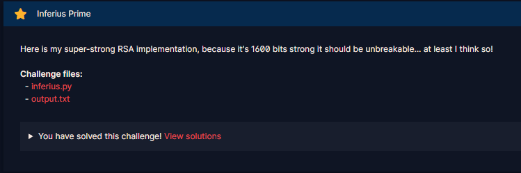

# Inferius Prime

#### Challenges: `RSA` - Cryptohack - Ngày viết: 11/3/2026

#### 1. Overview

* 
* `Mục tiêu`: Phá giải RSA 1600 bits, khôi phục flag
* `Lỗ hỗng`: Nhầm lẫn giữa bytes và bits

#### 2. Exploit chain

* Mã nguồn server: [Đọc](inferius.py)
* Về cơ bản, RSA ở bài này chỉ có 200 bits :v. Ta chỉ cần lên [factordb](https://factordb.com/) để phân tích thừa số là đã giải được bài này =)))
* Script: [Đọc](solve.py)
* ```
  crypto{N33d_b1g_pR1m35}
  ```
