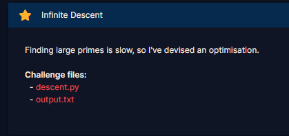

# Infinite Descent

#### Challenges: RSA - Cryptohack - Ngày viết: 11/5/2026

#### 1. Overview

* 
* `Mục tiêu`: Khôi phục flag khi RSA cấu hình sai
* `Lỗ hỗng`: Cặp thừa số nguyên tố của $N$ gần bằng nhau
* `Kỹ thuật`: Fermat's attack

#### 2. Nền tảng cốt lõi

* Fermat's attack: [Đọc](<https://viblo.asia/p/mat-ma-rsa-phan-4-r1QLx6EO4Aw#:~:text=challenge%20Square%20Eyes-,4.%20Fermat%20attack,-Trong%20tr%C6%B0%E1%BB%9Dng%20h%E1%BB%A3p>)

#### 3. Exploit chain

* Mã nguồn server: [Đọc](descent.py)
* Xuất phát điểm của cả $q$ và $p$ đều là $r$ dài 2048 bits, điểm khác biệt đó là $p$ được cộng ngẫu nhiên 1 số dài 512 bits cho đến khi $p$ là số nguyên tố và tương tự với $q$ khi cộng với số dài 256 bits
* Ta nhận ra ngay rằng 512 bits, 256 bits so với 2048 bits rất là nhỏ. $p$ và $q$ có giá trị rất gần nhau. Điều kiện để ta thực hiện Fermat's attack là $\left|q - p  \right| < N^{1/4}$
* Vì $N$ dài 4096 bits, nên căn bậc 4 của $N$ sấp sĩ 1024 bits. Hoàn toàn vượt qua 512 bits khi lấy $p - q (p > q)$. Nên thõa mãn điều kiện thực hiện fermat attack và tìm ra được $q$ và $p$ ngay lập tức
* Script: [Đọc](solve.py)
* ```
  crypto{f3rm47_w45_4_g3n1u5}
  ```
