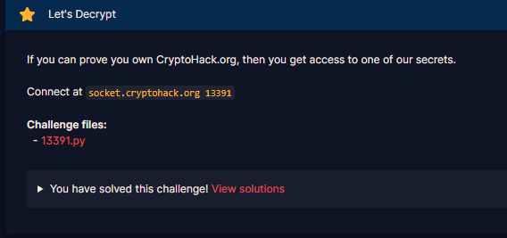
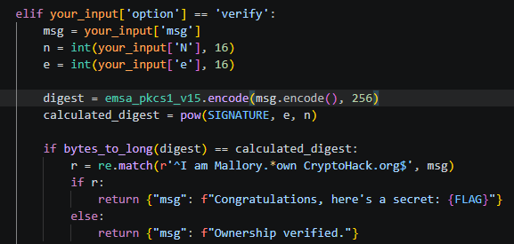

# Let's Decrypt

#### Challenges: RSA - Cryptohack - Ngày viết: 11/15/2026

#### 1. Overview

* 
* Đây là 1 lỗ hỗng dựa trên lỗ hỗng có thật là `DSKS`. Và trong chính nội dung của cờ cũng ghi rõ tên lỗ hỗng này :v
* `Mục tiêu`: Giả mạo khóa công khai để giả danh admin của Cyptohack
* `Lỗ hỗng`: Duplicate Signature Key Selection (DSKS)

#### 2. Nền tảng cốt lõi

* Các bạn cần hiểu được mục đích cốt lõi của việc ký dữ liệu là như nào :v
* DSKS: [Đọc](https://www.agwa.name/blog/post/duplicate_signature_key_selection_attack_in_lets_encrypt)

#### 3. Phân tích lỗ hỗng

* Mã nguồn server: [Đọc](13391.py)
* 
* Ở bước `verify`: Chúng ta được tùy ý gửi lên `(msg, N, e)`, và điều này dẫn đến cặp khóa công khai `(N, e)` hoàn toàn nằm trong quyền kiểm soát của người ký

#### 4. Exploit chain

* Để có thể lấy được cờ, msg ta gửi lên phải match với ``^I am Mallory.*own CryptoHack.org$``, ta đặt $msg_{fake} =$`I am Mallory and I own CryptoHack.org`, và $digest_{fake} = \text{emsa\_pkcs1\_v15}(msg_{fake})$
* Chúng ta sẽ giải mạo cặp khóa công khai `(N, e)` sao cho $SIGNATURE^{e_{fake}} \bmod {N_{fake}} = \text{bytes\_to\_long}(digest_{fake})$
* Cấu trúc emsa_pkcs1_v15 là hoàn toàn tất định với cấu trúc: $\text{EM} = \texttt{0x00} \parallel \texttt{0x01} \parallel \text{PS} \parallel \texttt{0x00} \parallel T$
  * **`0x00`** : Byte đầu tiên đảm bảo giá trị số nguyên của khối luôn nhỏ hơn Modulus **$N$**.
  * **`0x01`** : Byte định danh Block Type `01` — báo hiệu đây là khối dùng cho **Chữ ký số (Signature)**.
  * **`PS` (Padding String)** : Chuỗi các byte **`0xFF`** lặp lại (tối thiểu 8 bytes) để lấp đầy khối cho đủ độ dài `emLen` (256 bytes).
  * **`0x00`** : Byte phân tách (separator) đánh dấu kết thúc phần đệm `0xFF`.
  * **`T` (`DigestInfo` — cấu trúc ASN.1 DER)** : Gồm mã định danh thuật toán băm (**OID** của SHA-256: `3031300d060960864801650304020105000420`) ghép nối tiếp với 32 bytes kết quả băm `SHA256(M)`.
* Ta đặt $e_{fake} = 1$ và $N_{fake} = SIGNATURE - \text{bytes\_to\_long}(digest_{fake})$ . Khi đó, server sẽ hoạt động như sau:

$$
SIGNATURE^{1} \bmod {(SIGNATURE - digest_{fake})} = digest_{fake}
$$

* Khi đó, server sẽ xác thực thành công ở if đầu tiên, sau đó là `r` match thành công và trả về kết quả `True`, và ta lấy được cờ.
* Script: [Đọc](sovle.py)
* ```
  Congratulations, here's a secret: crypto{dupl1c4t3_s1gn4tur3_k3y_s3l3ct10n}
  ```

#### 5. Reference

* DSKS: [Đọc](https://www.agwa.name/blog/post/duplicate_signature_key_selection_attack_in_lets_encrypt)
