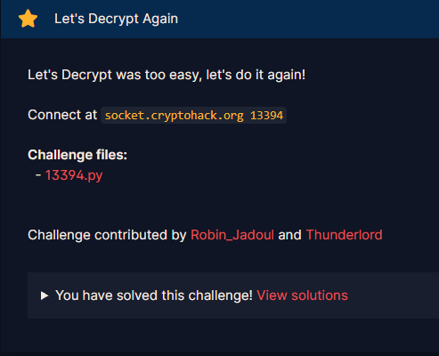
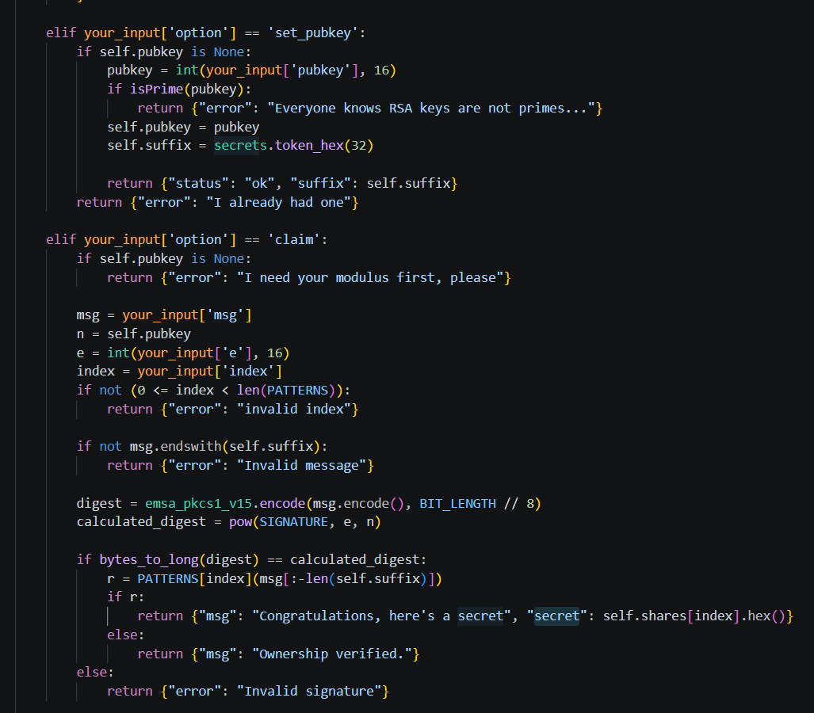

# Let's Decrypt Again

#### Challenges: RSA - Cryptohack - Ngày viết: 11/16/2026

#### 1. Overview

* 
* Đây là phần bài tiếp theo của `Let's Decrypt`. Và bài này để có thể giải, ta cần phải biết tạo ra `N` có cấu trúc yếu mới, cũng như là khai thác lỗ hỗng `DSKS` mới có thể giải được bài này.
* `Mục tiêu`: Bypass được qua 3 vòng xác thực để thu về 3 secret, xor với nhau để thu được cờ
* `Lỗ hỗng`: Cho phép người dùng kiểm soát hoàn toàn cặp khóa công khai $N,e$
* `Kỹ thuật`: Tạo khóa công khai $N$ trơn để khả giải phương trình $\sigma^{e_i} \equiv m_i \pmod N$

#### 2. Nền tảng cốt lõi

* Biết số nguyên tố trơn là gì. Biết cách tạo ra 1 số nguyên tố trơn
* Thành thạo sử dụng sagemath
* Hiểu rõ cơ chế của DSKS

#### 3. Phân tích lỗ hỗng

* Mã nguồn server: [Đọc](13394.py)
* 
* Server cố định khóa công khai $N$ qua cả 3 vòng và SIGNATURE của server cố định là $\sigma$ Và ta cần gửi Tuple $msg_i, e_i, index_i$, server sẽ xác thực giống như ở bài trước đó.

#### 4. Ý tưởng khai thác

* Ở bài này, ta không thể làm theo cách cũ là gửi $e = 1, N = \sigma - digest$, bởi vì $N$ đã bị cố định ở bước `set_pubkey`
* Bằng cách tạo ra $N$ rất trơn. Bởi vì $N$ trơn nên ta dễ dàng giải được phương trình đồng dư: $\sigma^{e_i} \equiv msg_i \pmod N$ và tìm ra được $e_i$ của cả 3 lần xác thực 

#### 5. Exploit chain

* Quy trình:
  * Tạo ra 1 số nguyên tố trơn $p$ và $N = p^2$ để bypass vòng kiểm tra số nguyên tố
  * Ta lấy signature của server và set_public key là $N$
  * Ở mỗi bước xác thực và bypass, tổng cộng có 3 vòng. Ta giải phương trình đồng dư cho từng msg để tìm ra $e$ tương ứng.
  * Gửi lần lượt $(msg, e, index)$ lên server
* Script: [Đọc](solve.py)
* ```
  crypto{let's_decrypt_w4s_t0o_ez_do_1t_ag41n}
  ```
