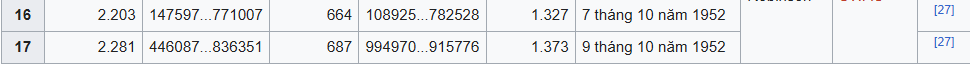
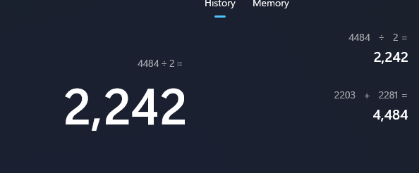

# Marin's Secrets

#### Challenges: RSA - Cryptohack - Ngày viết: 11/5/2026

#### 1. Overview

* 
* Đây là 1 bài khá là hay về số nguyên tố Mersenne
* `Mục tiêu`: Khôi phục flag khi $N$ được cấu thành từ 2 số nguyên tố secret
* `Kỹ thuật`: Phân tích toán học

#### 2. Nền tảng cốt lõi

* Bạn cần biết số nguyên tố Mersenne là gì: [Đọc](https://vi.wikipedia.org/wiki/S%E1%BB%91_nguy%C3%AAn_t%E1%BB%91_Mersenne)
* Danh sách các số nguyên tố Mersenne được biết cho đến hiện tại: [Đọc](https://vi.wikipedia.org/wiki/Danh_s%C3%A1ch_s%E1%BB%91_nguy%C3%AAn_t%E1%BB%91_Mersenne_v%C3%A0_s%E1%BB%91_ho%C3%A0n_h%E1%BA%A3o)

#### 3. Exploit chain

* Mã nguồn server: [Đọc](marin.py)
* Khi đọc mã nguồn là mình biết ngay rằng số nguyên tố được tạo ra ở hàm `get_prime`là số nguyên tố mersenne. Bởi vì số nguyên tố dạng này rất hiếm nên mình tra ngay danh sách các số nguyên tố mersenne.
* Mình tính thử độ dài bits của $q, p$ bằng cách tính $\log_2(N)/2$ , kết quả là `2242`
* Bởi vì $N = (2^{k1} - 1) \cdot (2^{k2} - 1)$ nên $\log_2(N)/2 = \log_2(2^{k1} - 1) \cdot (2^{k2} - 1) \approx \log_2(2^{k1+k2})/2 = \frac{k1+k2}{2} = 2242$
* Ta tra bảng và tìm được 2 ứng cử viên $q,p$ sau:
* 
* $k1 = 2203, k2 = 2281$
* 
* Giá trị trung bình của $k1, k2$ bằng hoàn toàn với độ dài bits của $q,p$, nên ta gần như chắc chắn rằng $p = (2^{2203} - 1)$ và $q = (2^{2281} - 1)$
* Script: [Đọc ](solve.py)
* ```
  crypto{Th3se_Pr1m3s_4r3_t00_r4r3}
  ```
