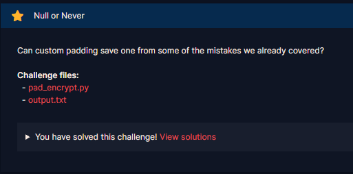
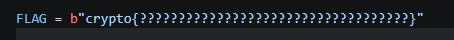

# Null or Never

#### Challenges: RSA - Cryptohack - Ngày viết: 11/13/2026

#### 1. Overview

* 
* `Mục tiêu`: Khôi phục flag
* `Lỗ hỗng`: Biết được độ dài flag, biết được cấu trúc padding, cấu trúc padding tự chế

#### 2. Phân tích lỗ hỗng

* Mã nguồn server: [Đọc](pad_encrypt.py)
* Trước khi mã hóa, flag đã được đệm bằng các bytes 0. và có độ dài sau khi đệm là 100 bytes.

#### 3. Ý tưởng khai thác

* 
* Dựa vào độ dài flag, ta có thể biết được rằng cấu trúc được mã hóa như sau:
* $flag | padding(\text{Đã biết})$
* Nên ta có mối quan hệ giữa pad_flag và flag như sau:
* Ta hiểu rằng các bytes đang được biểu diễn theo quy ước Big-endian:
* $M_{pad} = M*2^{8k}$ với $k$ là độ dài pad
* Bởi vì ta đã có độ dài flag, và độ dài flag sau khi pad là 100 bytes, ta dễ dàng tìm được $k$
* Khi đó $C = (M * 2^{8k})^3 \bmod N = M^3 * 2^{24k} \bmod N -> C * 2^{-24k} = C' = M^3 \bmod N$
* Bởi vì $M^3 < N$ nên ta lấy căn bậc 3 là ta lấy được flag

#### 4. Exploit chain

* Quy trình:
  * Tính độ dài flag
  * Tính độ dài pad
  * Tính nghịch đảo $2^{24k}$ trên vành số modulus $N$
  * Tính $C'$
  * Căn bậc 3 $C'$
* Script: [Đọc](solve.py)
* ```
  crypto{n0n_574nd4rd_p4d_c0n51d3r3d_h4rmful}
  ```
