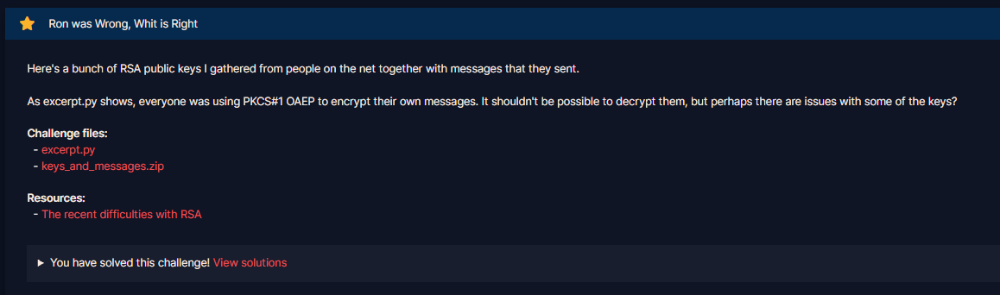

# Ron was Wrong, Whit is Right

#### Challenges: RSA - Cryptohack - Ngày viết: 11/12/2026

#### 1. Overview

* 
* `Mục tiêu`: Phân tích thừa số nguyên tố `N`, khôi phục flag
* `Lỗ hỗng`: Tái sử dụng số nguyên tố
* `Kỹ thuật`: Tìm ước chung giữa 2 số Modulus `N`

#### 2. Nền tảng cốt lõi

* Lỗ hỗng này áp dụng được khi mà 2 số Modulus `N` chia sẻ chung 1 ước nguyên tố
* Xem thêm phần resource do Cryptohack cung cấp: [Đọc](<https://sbseminar.wordpress.com/2012/02/16/the-recent-difficulties-with-rsa/#:~:text=factorization%20is%20hard.-,The%20attack,-The%20point%20of>)

#### 3. Exploit chain

* Bằng cách thu thập toàn bộ 50 `N` khác nhau do bài cung cấp. Ta tìm ước chung lớn nhất cho từng cặp `N`. Khi ước chung lớn hơn 1, ta có thể phân tích thừa số nguyên tố của 2 `N` trong cặp `N` đã tính.
* Script: [Đọc](solve.py)
* ```
  crypto{3ucl1d_w0uld_b3_pr0ud} If you haven't already, check out https://eprint.iacr.org/2012/064.pdf
  ```
