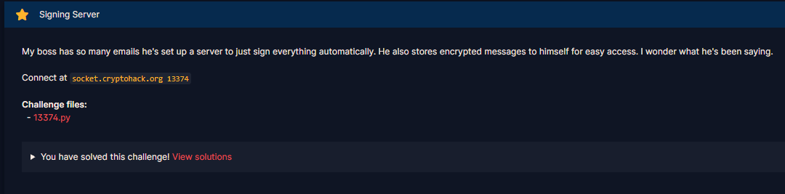

# Signing Server

#### Challenges: RSA - Cryptohack - Ngày viết: 11/13/2026

#### 1. Overview

* 
* `Mục tiêu`: Khai thác lỗi oracle không xác thực dữ liệu, cho phép giải mã secret bằng chính khóa bí mật của server

#### 2. Exploit chain

* Mã nguồn server: [Đọc](13374.py)
* Về cơ bản, chúng ta chỉ cần gửi `get_secret`để lấy ciphertext, sau đó gửi ciphertext lên server ở bước `sign` để giải mã lại cờ :V
* Script: [Đọc](solve.py)
* ```
  crypto{d0n7_516n_ju57_4ny7h1n6}
  ```
