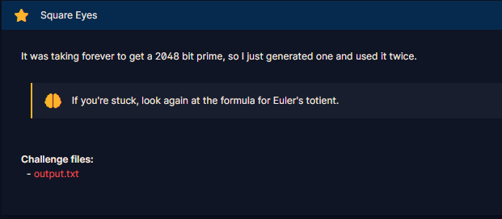

# Square Eyes

#### Challenges: RSA - Cryptohack - Ngày viết: 11/3/2026

#### 1. Overview

* 
* `Mục tiêu`: Khôi phục flag
* `Lỗ hỗng`: $N = q^2$ =)))))

#### 2. Exploit chain

* Bình thường RSA chỉ sinh số $N$ dài 2048 bits. Nhưng bài này chúng ta sinh RSA $N$ lên đến 4096 bits :v. Bởi vì sinh 1 số nguyên tố dài 2048 bits rất là lâu, nên ở bài này, tác giả đã sử dụng số nguyên tố đó 2 lần (là lấy $q \cdot q$) để sinh số $N$
* Script: [Đọc](solve.py)
* ```
  crypto{squar3_r00t_i5_f4st3r_th4n_f4ct0r1ng!}
  ```
* Nếu các bạn không hiểu tại sao lại tính $\phi(n) = (q-1) \cdot q$ thì công thức tính tổng quát là $\phi(n) = p_1^{k_1-1}(p_1 - 1)p_2^{k_2-1}(p_2 - 1)...p_r^{k_r-1}(p_r - 1)$ với $n = p_1^{k_1}p_2^{k_2}...p_r^{k_r}$
