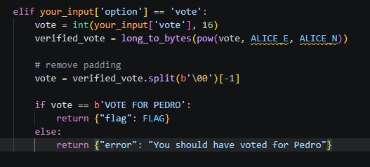

# Vote for Pedro

#### Challenges: RSA - Cryptohack - Ngày viết: 11/15/2026

#### 1. Overview

* 
* Đây là bài đầu tiên mà mình khai thác lỗi đệm kiểu `Bleichenbacher` (Low-Exponent Signature Forgery). Bài này khá là hay :v
* `Mục tiêu`: Giả mạo chữ ký của Alice cho thông điệp `b"VOTE FOR PEDRO"`
* `Lỗ hổng`: Số mũ công khai nhỏ (`e = 3`) và kiểm tra padding lỏng lẻo (chỉ cắt phần sau byte `\x00` cuối cùng)
* `Kỹ thuật`: Khai căn bậc 3 trên vành số nguyên modulo lũy thừa của `2` ($\mathbb{Z}_{2^k}$)

#### 2. Nền tảng cốt lõi

* Cần nắm vững số học đồng dư và cách khai căn trên vành $\mathbb{Z}_{2^k}$ (Hensel Lifting). Nếu không, sẽ khá ngợp để hiểu được bài này :v

#### 3. Phân tích lỗ hổng

* Mã nguồn server: [Đọc](13375.py)
* 
* Server xác thực bằng cách tính `long_to_bytes(pow(vote, ALICE_E, ALICE_N))` với `ALICE_E = 3`, sau đó cắt lấy phần nằm sau byte `\x00` cuối cùng bằng `.split(b'\x00')[-1]`.
* Do server không kiểm tra độ dài hay định dạng phần đệm phía trước, ta chỉ cần tìm một số nguyên $x$ (gửi dưới dạng hex vào biến `vote`) sao cho:
  1. $x^3 \equiv \text{bytes\_to\_long}(\text{b'\x00VOTE FOR PEDRO'}) \pmod{2^{120}}$ (để 15 byte cuối cùng khớp với chuỗi mục tiêu).
  2. $x^3 < N_{\text{ALICE}}$ (để phép chia dư $\bmod N_{\text{ALICE}}$ không làm thay đổi giá trị của $x^3$).

#### 4. Ý tưởng khai thác / Exploit chain

* Chuỗi mục tiêu `target = b'\x00VOTE FOR PEDRO'` dài 15 bytes ($120\text{ bits}$). Ký tự cuối cùng là `'O'` (`0x4f` = $79$, số lẻ) nên $\gcd(\text{target}, 2^{120}) = 1$.
* Chọn vành $\mathbb{Z}_n$ với $n = 2^{\text{len(target)} \times 8} = 2^{120}$. Vì $\phi(2^{120}) = 2^{119}$ thỏa mãn $\gcd(\phi(n), 3) = 1$, luôn tồn tại duy nhất một căn bậc 3 $x \equiv \text{target}^{1/3} \pmod{2^{120}}$.
* Nghiệm $x$ tìm được dài khoảng $120\text{ bits} \implies x^3$ dài khoảng $360\text{ bits} \ll N_{\text{ALICE}}$ ($2048\text{ bits}$), đảm bảo không bị tràn modulo.
* Khi gửi $x$ lên server, server tính $x^3 \bmod N_{\text{ALICE}} = x^3$, chuyển sang bytes sẽ ra dạng `[các byte rác] + b'\x00VOTE FOR PEDRO'`. Hàm `.split(b'\x00')[-1]` loại bỏ toàn bộ phần rác ở đầu, giữ lại đúng `b'VOTE FOR PEDRO'` và trả về flag.
* Script: [Đọc](solve.py)
* ```text
  crypto{y0ur_v0t3_i5_my_v0t3}
  ```
* **Tại sao lại xuất hiện `[bytes rác]` ở đầu chuỗi?**
  * Nghiệm $x = \text{vote}_{fake}^{\frac{1}{3}}$ tìm được trên vành $\mathbb{Z}_{2^{120}}$ có độ dài khoảng $120\text{ bits}$.
  * Theo định nghĩa đồng dư $x^3 \equiv \text{target} \pmod{2^{120}}$, trên tập số nguyên $\mathbb{Z}$ ta có:
    $$
    x^3 = k \cdot 2^{120} + \text{target}
    $$
  * Khi server tính $x^3 \bmod N_{\text{ALICE}}$, do $x^3$ dài khoảng $360\text{ bits} \ll 2048\text{ bits}$ nên phép mod $N_{\text{ALICE}}$ không xảy ra. Phần thương $k$ (dài khoảng $240\text{ bits} \approx 30\text{ bytes}$) bị dịch trái $120\text{ bits}$ nên nằm ở các byte cao nhất (bên trái) tạo thành các byte rác, còn phần dư $\text{target}$ (`b'\x00VOTE FOR PEDRO'`) nằm cố định ở 15 byte cuối cùng (bên phải).
  * Nhờ byte `\x00` chặn ngay trước `VOTE FOR PEDRO`, lệnh `.split(b'\x00')[-1]` của server sẽ cắt bỏ toàn bộ phần thương $k$ phía trước (kể cả khi trong $k$ vô tình có chứa thêm byte `0x00` ngẫu nhiên) và chỉ giữ lại đúng `b'VOTE FOR PEDRO'`.
