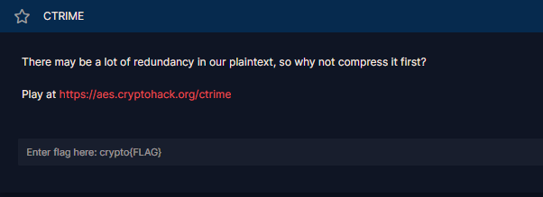
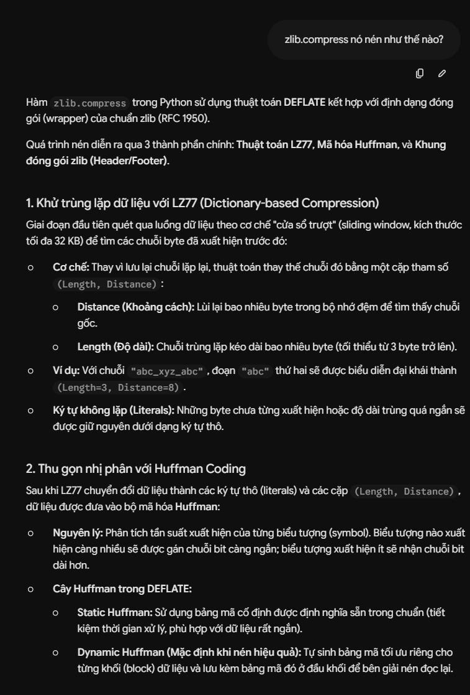

# CTRIME

#### Challenges: `Symmetric Ciphers` - Cryptohack - Ngày viết: 22/10/2026

#### 1. Overview

* 
* Đây là bài sẽ cho chúng ta thấy, chỉ cần làm rò rỉ 1 chút thông tin về plaintext, hacker hoàn toàn có thể phá giải và đọc thông tin của chúng :v
* `Mục tiêu`: Khôi phục plaintext flag từ rò rỉ
* `Lỗ hỗng`: Rò rỉ độ dài khóa
* `Kỹ thuật`: Backtracking, tận dụng độ dài khóa không đổi khi nén để tìm ra ký tự plaintext

#### 2. Nền tảng cốt lõi

* Các bạn cần hiểu hàm nén python `zlib`thực sự làm gì.
* 
* Khi `zlib`nén dữ liệu, dữ liệu sau khi nén được tối ưu đến từng bit của file
* Các bạn cần biết backtracking (học cấu trúc dữ liệu và giải thuật) trước khi code bài này giống mình.
* Backtracking: [Đọc](<https://en.wikipedia.org/wiki/Backtracking#:~:text=of%20CPU%20time.-,Examples,-edit>)

#### 3. Phân tích lỗ hỗng

* Mã nguồn server:
* ```Python
  from Crypto.Cipher import AES
  from Crypto.Util import Counter
  import os
  import zlib


  KEY = ?
  FLAG = ?


  @chal.route('/ctrime/encrypt/<plaintext>/')
  def encrypt(plaintext):
      plaintext = bytes.fromhex(plaintext)

      iv = int.from_bytes(os.urandom(16), 'big')
      cipher = AES.new(KEY, AES.MODE_CTR, counter=Counter.new(128, initial_value=iv))
      encrypted = cipher.encrypt(zlib.compress(plaintext + FLAG.encode()))

      return {"ciphertext": encrypted.hex()}
  ```
* Server cho phép ta gửi 1 plaintext lên server, plaintext sau đó được nén chung với flag bằng AES CTR với nonce tạo bằng hàm Counter với iv là giá trị ngẫu nhiên 16 bit
* Việc nén Plaintext và Flag với nhau sẽ làm rò rỉ (hay là bị lộ) độ dài flag và chúng ta có thể tận dụng thông tin rò rỉ này để khôi phục flag

#### 4. Ý tưởng khai thác

* Bằng cách ghép plaintext đã biết là format cờ kết hợp với ký tự ngẫu nhiên, nếu như ký tự ngẫu nhiên đó chính là ký tự tiếp theo của cờ, hàm nén sẽ nén với tỷ lệ cao hơn làm cho độ dài của của dữ liệu sau khi nén không đổi, nếu như ký tự ngẫu nhiên không phải là ký tự tiếp theo của cờ, hàm nén sẽ không thể nén và giữ nguyên giá trị thô, làm cho độ dài dữ liệu sau nén bị tăng lên 1 bytes
* Để tránh trường hợp ký tự đúng được thêm vào sau nén vẫn tăng lên thêm độ dài 1 bytes bởi vì không đủ vị trí nén để lưu trữ, ta đệm thêm padding là những ký tự chắc chắn không xuất hiện trong cờ, để mà khi padding đủ dài để sang 1 bytes mới, ký tự đúng sẽ không làm tăng thêm độ dài sau nén nữa, và ký tự sai vẫn sẽ tăng 1 bytes như giải thích ở trên.
* Các ký tự ngẫu nhiên sẽ được kiểm tra tất cả và chọn ra ký tự có độ dài bytes trả về sau nén là nhỏ nhất (tỷ lệ nén cao nhất -> Xác suất ký tự đúng cao nhất), nếu như có nhiều ký tự cùng có tỷ số nén như nhau, ta chia luồng ra và chạy tất cả trường hợp và sử dụng thuật toán quay lui nếu như 1 luồng chạy đã bị kẹt và cần phải quay đầu.

#### 5. Exploit chain

* Quy trình:

  * Ta gọi hàm dfs để bắt đầu quá trình quay lui và tìm chiều sâu cho đến khi return flag
  * Mỗi phiên của flag hiện tại, ta sẽ tìm danh sách các ký tự có tỷ số nén cao nhất để làm các ký tự thử.
  * Và ta bắt đầu gọi tiếp các hàm dfs con và lặp lại cho đến khi hàm trả về 1 cờ hoàn chỉnh.
* Script: [Đọc](solve.py)
* Kết quả:
* ```
  crypto{
  crypto{C
  crypto{CR
  crypto{CRI
  crypto{CRIM
  crypto{CRIME
  crypto{CRIME_
  crypto{CRIME_5
  crypto{CRIME_57
  crypto{CRIME_571
  crypto{CRIME_571l
  crypto{CRIME_571ll
  crypto{CRIME_571ll_
  crypto{CRIME_571ll_p
  crypto{CRIME_571ll_p4
  crypto{CRIME_571ll_p4y
  crypto{CRIME_571ll_p4y5
  crypto{CRIME_571ll_p4y5}
  Flag: crypto{CRIME_571ll_p4y5}
  ```
* ```
  crypto{CRIME_571ll_p4y5}
  ```
