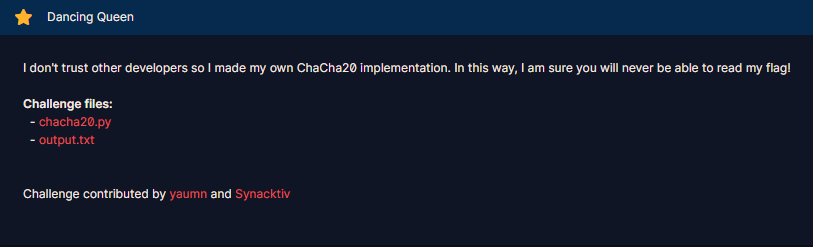

# Dancing Queen

#### Challenges: `Symmetric Ciphers` - Cryptohack - Ngày viết: 23/10/2026

#### 1. Overview

* 
* Đây là bài đầu tiên mình thực sự đi sâu vào thuật toán mã hóa chacha20 =))))
* `Mục tiêu`: Khôi phục key để giải mã flag
* `Lỗ hỗng`: Cấu hình sai thuật toán mã hóa chacha20. Dẫn đến có thể khôi phục khóa

#### 2. Nền tảng cốt lõi

* Các bạn cần hiểu quy trình mã hóa ChaCha20 là gì. [Đọc](<https://datatracker.ietf.org/doc/html/rfc8439#:~:text=interchangeably.%0A%0A2.-,The%20Algorithms,-The%20subsections%20below>)
* Mã hóa ChaCha20 thuật loại mã hóa dòng - Stream cipher. Các bạn nắm các ý chính sau:
  * Thông số cần thiết cho quá trình sinh keystream là:

    * Key `(32 bytes)`
    * IV `(12 bytes)`
    * Nonce
  * Ở bước đầu, ChaCha20 khởi tạo ma trận trạng thái ban đầu:
  * 
  * 16 ô của ma trận được lấp theo thứ tự tiêu chuẩn **IETF RFC 8439**. Mỗi ô chứa 4 bytes theo định dạng Little-Endian
  * Với hàng 1 `(w0-w3)`là hằng số cố định
  * Với hàng 2 và hàng 3 được nạp từ `Key`và nạp tuần tự 4 bytes theo định dạng `Little-Endian`
  * Với hàng 4, `w12`là giá trị bộ đếm counter 4 bytes và `w13-w15`là giá trị IV được nạp tuần tự 4 bytes theo định dạng `Little-Endian`
  * Ở bước 2, ChaCha20 sẽ bắt đầu biến đổi ma trận với mục tiêu là sinh ra ma trận giả ngẫu nhiên, tạo ra dòng keystream giả ngẫu nhiên để mã hóa dữ liệu.
  * Mọi phép biến đổi ma trận đều sử dụng hàm `Quarter Round - QR`để biến đổi ma trận.
  * ```Python
    def QR(a, b, c, d):
    	a += b % 2**32; d ^= a; d <<<= 16;
    	c += d % 2**32; b ^= c; b <<<= 12;
    	a += b % 2**32; d ^= a; d <<<= 8;
    	c += d % 2**32; b ^= c; b <<<= 7;
    ```
  * Ma trận được chạy qua 20 vòng biến đổi, 20 vòng biến đổi được chia thành 10 vòng biến đổi kép:
  * ```Python
    QR(w0, w4, w8, w12)
    QR(w1, w5, w9, w13)
    QR(w2, w6, w10, w14)
    QR(w3, w7, w11, w15)
    QR(w0, w5, w10, w15)
    QR(w1, w6, w11, w12)
    QR(w2, w7, w8, w13)
    QR(w3, w4, w9, w14)
    ```
  * Ở bước cuối cùng, ma trận sau khi biến đổi sẽ cộng với ma trận trạng thái ban đầu để sinh ra ma trận cuối cùng để lấy keystream.
  * 
  * Và ở bước cuối cùng này có 1 ý nghĩa rất quan trọng, nó khiến cho ma trận cuối cùng không thể bị đảo ngược nếu như ta thu được keystream hàm sinh

#### 3. Phân tích lỗ hỗng

* Mã nguồn server: [Đọc](chacha20.py)
* Với thuật toán chacha20 do server cung cấp, thuật toán mã hóa đã thiếu 1 bước quan trọng cuối cùng, đó chính là bước cộng ma trận ban đầu và ma trận sau khi biến đổi.

#### 4. Ý tưởng khai thác

* Vì không có bước cuối cùng và server đã lấy keystream từ chính ma trận biến đổi, chỉ cần ta biết được 1 block keystream, ta có thể đảo ngược hàm QR và khôi phục lại ma trận trạng thái ban đầu và trích xuất key từ nó. Sau đó giải mã được ciphertext bằng chính hàm decrypt do server cung cấp.

#### 5. Exploit chain

* Quy trình:
  * Viết hàm đảo ngược quy trình biến đổi ma trận của chacha20
  * Biến đổi keystream thành ma trận
  * Đảo ngược ma trận keystream, khôi phục lại ma trận ban đầu
  * Trích xuất key từ ma trận ban đầu
  * Giải mã ciphertext
* Script: [Đọc](solve.py)
* ```
  crypto{M1x1n6_r0und5_4r3_1nv3r71bl3!}
  ```

#### 6. Reference

* ChaCha20 : [Đọc](<https://datatracker.ietf.org/doc/html/rfc8439#:~:text=interchangeably.%0A%0A2.-,The%20Algorithms,-The%20subsections%20below>)
* PyCryptodome: [Đọc](https://www.pycryptodome.org/src/cipher/chacha20#module-Crypto.Cipher.ChaCha20)
