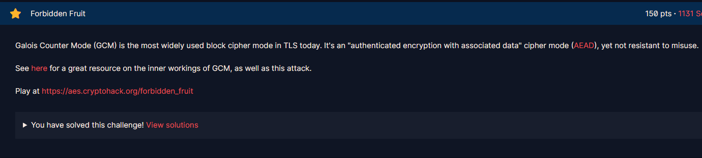

# Forbidden Fruit

#### Challenges: `Symmetric Ciphers` - Cryptohack - Ngày viết: 11/16/2026

#### 1. Overview

* 
* Đây là 1 trong những bài đầu tiên mà mình đã thực sự chạm tới tầng tri thức mới của Crypto :v. Và để có thể giải và hiểu được bản chất của bài này đòi hỏi mình đã phải đọc tài liệu rất lâu mới ngấm được. Thì ở write-up này, mình sẽ cố gắng giải thích 1 cách dễ hiểu nhất về bài này.
* `Mục tiêu`: Gửi $(nonce, ciphertext, tag, associated\_data)$ với nội dung khi giải mã là `give me the flag`
* `Lỗ hổng`: Nonce reuse
* `Kỹ thuật`: `Forbidden Attack`

#### 2. Nền tảng cốt lõi

* Các bạn cần phải biết quy trình mã hóa của AES-GCM là gì. [Đọc](https://en.wikipedia.org/wiki/Galois/Counter_Mode)
* Nói 1 cách đơn giản, về mặt dữ liệu, AES-GCM và AES-CTR dùng chung 1 cách mã hóa dữ liệu. Điểm khác biệt giữa AES-GCM và AES-CTR là AES-GCM có thể xác thực người gửi dữ liệu. Có nghĩa là AES-CTR sẽ không biết rằng dữ liệu có đúng là do người gốc gửi đi hay không? Hay là 1 mảnh dữ liệu đã bị sửa đổi, giả mạo ,.... AES-GCM cho phép server kiểm tra dữ liệu có toàn vẹn hay không. Điều này dẫn đến một khi ciphertext bị chỉnh sửa dữ liệu dù chỉ 1 bit, hàm verify server sẽ phát hiện dữ liệu đã bị sửa đổi, và từ chối tiếp nhận ciphertext giả mạo này.
* Đương nhiên, ta cũng có thể làm giả chữ ký (Authentication Tag) tương ứng với ciphertext giả. Nhưng nếu cấu hình của AES-GCM chuẩn thì không có cách nào để tạo ra chữ ký (Authentication Tag) giả được. Và AES-GCM đã xử lý tốt việc chặn các cuộc tấn công Man-in-the-middle mà AES-CTR mắc phải.
* Ngoài ra, AES-GCM tách biệt hoàn toàn 2 công việc là việc mã hóa dữ liệu và xác thực tính toàn vẹn của dữ liệu. Mã hóa dữ liệu thì mã hóa giống như AES-CTR, còn xác thực tính toàn vẹn của dữ liệu, AES-GCM sẽ sinh ra 1 loại khóa là khóa xác thực $H$`(khác khóa bí mật nhé, khóa xác thực H được sinh ra từ chính khóa bí mật)`. Các bạn cùng nhìn xem quy trình mã hóa của AES-GCM và cách chữ ký (Authentication Tag) sinh ra và khóa xác thực $H$ được sử dụng để làm gì.
* 
* Trên wikipedia cũng nhắc rằng khóa xác thực $H = E_K(0^{128})$, và $H$ được sử dụng trong quá trình sinh ra chữ ký `(H được nhân với kết quả trước đó cộng(xor trên trường Galois là phép cộng) với ciphertext hiện tại)`. Và tất cả quá trình như nhân $H$, cộng $ciphertext$ từng khối,... được ký hiệu gói gọn lại là $GHASH_H(A, C)$ . Và chữ ký sẽ bằng $T = GHASH_H(A, C) \oplus E_K(Counter_0)$ với $Counter_0$ phụ thuộc vào $nonce$ ($K$ đã cố định)
* Thứ tự các khối đi vào hàm $GHASH$ gồm $A_{pad}$ (được pad \x00 để độ dài bội của 16) $\parallel$ $C_{pad}$ (tương tự $A_{pad}$) $\parallel$ khối độ dài 16 bytes (`len(A)` 64-bit $\parallel$ `len(C)` 64-bit,  tính theo bit)
* Các bạn cần làm quen, cũng như hiểu được các phép tính toán trên trường đa thức Galois $\mathbb{F}_{2^{128}}$, cũng như biết cách code sagemath.
* Đa thức bất khả quy chuẩn NIST trên trường Galois được sử dụng trong AES-GCM là: $x^{128} + x^7 + x^2 + x + 1$
* Chuẩn GCM quy định bit ngoài cùng bên trái (MSB của bytes đầu tiên - `cúp tiết NMMS ko biết MSB là gì thì mình cx chịu =))))`) là hệ số của $x^0$, ngược lại với cách quy đổi thông thường, nên khi chuyển từ bytes sang các phần tử trên $\mathbb{F}_{2^{128}}$ thì cần chú ý đảo chiều của thứ tự bit
* Cơ chế sửa đổi dữ liệu của AES-CTR, ta tận dụng tính chất xor để làm giả ciphertext với $C_{fake} = C_{riel} \oplus P_{riel} \oplus P_{fake}$

#### 3. Phân tích lỗ hỗng

* Mã nguồn server:
* ```Python
  from Crypto.Cipher import AES
  import os


  IV = ?
  KEY = ?
  FLAG = ?


  @chal.route('/forbidden_fruit/decrypt/<nonce>/<ciphertext>/<tag>/<associated_data>/')
  def decrypt(nonce, ciphertext, tag, associated_data):
      ciphertext = bytes.fromhex(ciphertext)
      tag = bytes.fromhex(tag)
      header = bytes.fromhex(associated_data)
      nonce = bytes.fromhex(nonce)

      if header != b'CryptoHack':
          return {"error": "Don't understand this message type"}

      cipher = AES.new(KEY, AES.MODE_GCM, nonce=nonce)
      encrypted = cipher.update(header)
      try:
          decrypted = cipher.decrypt_and_verify(ciphertext, tag)
      except ValueError as e:
          return {"error": "Invalid authentication tag"}

      if b'give me the flag' in decrypted:
          return {"plaintext": FLAG.encode().hex()}

      return {"plaintext": decrypted.hex()}


  @chal.route('/forbidden_fruit/encrypt/<plaintext>/')
  def encrypt(plaintext):
      plaintext = bytes.fromhex(plaintext)
      header = b"CryptoHack"

      cipher = AES.new(KEY, AES.MODE_GCM, nonce=IV)
      encrypted = cipher.update(header)
      ciphertext, tag = cipher.encrypt_and_digest(plaintext)

      if b'flag' in plaintext:
          return {
              "error": "Invalid plaintext, not authenticating",
              "ciphertext": ciphertext.hex(),
          }

      return {
          "nonce": IV.hex(),
          "ciphertext": ciphertext.hex(),
          "tag": tag.hex(),
          "associated_data": header.hex(),
      }
  ```
* Ở phần encrypt, server đã cố định $nonce$ cho tất cả các lượt encrypt. Điều này dẫn đến 1 lỗ hỗng kinh điển mà mọi mã hóa dòng - Stream Cipher mắc phải đó là lỗ hổng nonce reuse. Về mặt mã hóa dữ liệu, *chỉ cần gửi một bản rõ bất kỳ lên `encrypt` là rút ra được dòng khóa (keystream) để tự mã hóa chuỗi `give me the flag`* (vì server chặn trực tiếp từ khóa `flag`), nhưng bài này đòi hỏi chúng ta phải gửi 1 ciphertext và chữ ký tương ứng vượt qua cơ chế kiểm tra chữ ký gắt gao của server để lấy được cờ. Và ở mục encrypt đã chặn từ khóa `flag`, nên ta không thể mã hóa được chuỗi string `give me the flag`để bypass được server.
* Tuy nhiên, có 1 dữ liệu không được phép để lộ trong quá trình mã hóa và xác thực dữ liệu ngoài khóa bí mật $K$, ta còn có khóa xác thực $H$. Nếu như lộ khóa xác thực $H$, ta hoàn toàn có thể làm giả chữ ký (Authentication Tag) với điều kiện, ta phải biết được cặp khối bytes và nonce tương ứng $(E_K(Counter_0), nonce)$

#### 4. Ý tưởng khai thác/Exploit chain

* Bởi vì server đang sử dụng trùng lặp nonce để encrypt dữ liệu, nó dẫn chúng ta đến 1 kỹ thuật tấn công áp dụng trong trường hợp này là `Forbidden Attack`trên AES-GCM khi xuất hiện cặp ciphertext sử dụng chung nonce, và nằm trong mục lỗi `CWE-323`.
* Ta gửi cặp plaintext **$P_1, P_2$** lên server để thu về hai bộ dữ liệu tương ứng là **$(A_1, C_1, T_1)$** và **$(A_2, C_2, T_2)$**
* Bởi vì server sử dụng chung nonce, nên lớp mặt nạ $E_K(Counter_0)$ bảo vệ $H$ sẽ biến mất ngay lập tức bằng cách lấy tổng 2 $T$ - $T_1 \oplus T_2$
* Lập phương trình đa thức tìm H: Sau khi triệt tiêu $E_K(Counter_0)$, ta có:

$$
T_1 \oplus T_2 = GHASH_H(A_1,C_1) \oplus GHASH_H(A_2,C_2) \\
\to P(H) = GHASH_H(A_1,C_1) \oplus GHASH_H(A_2,C_2) \oplus T_1 \oplus T_2 = 0
$$

* Dùng sagemath để tìm lại khóa xác thực $H$. Ta trích xuất ngược $E_K(Counter_0) = GHASH_H(A_1,C_1) \oplus T_1$
* Từ cặp $(P_1, C_1)$đã biết, ta áp dụng mô hình tấn công AES-CTR để làm ra ciphertext giả: $C_{fake} = P_1 \oplus C_1 \oplus \text{b'give me the flag'}$
* Server sử dụng Header là $A = \text{b'Cryptohack'}$, nên ta giữ nguyên $associated\_data$
* Chữ ký hợp lệ cho $C_{fake}$ : $T_{fake} = GHASH_H(A_1, C_{fake}) \oplus E_K(Counter_0)$
* Ta gửi lên server bộ $(nonce, C_{fake}, T_{fake}, associated\_data)$ rồi nhận cờ.
* Script: [Đọc](solve.py)
* ```
  crypto{https://github.com/attr-encrypted/encryptor/pull/22}
  ```

#### 5. Reference

* Cách exploit chain: [Đọc](https://toadstyle.org/cryptopals/63.txt)
* Công thức để tính $GHASH_H(A,C)$: $\text{GHASH}_H(A, C) = X_1 \cdot H^n \oplus X_2 \cdot H^{n-1} \oplus \dots \oplus X_n \cdot H$, với mỗi $X_i$ là khối dữ liệu 16 bytes đầu vào
