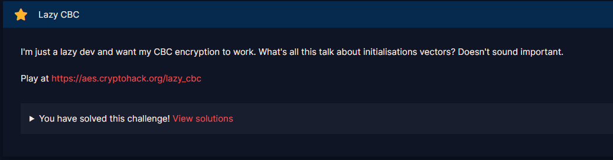
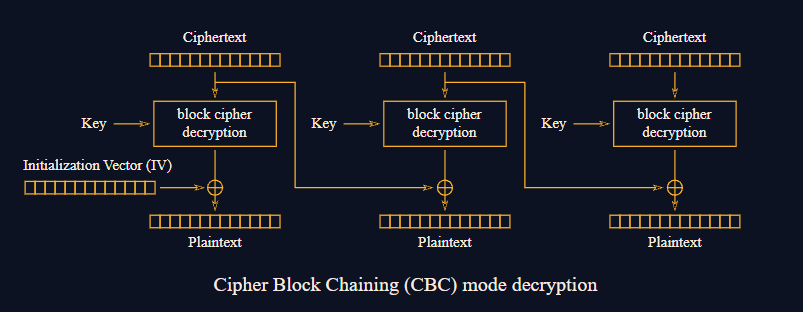

# Lazy CBC

#### Challenges: `Symmetric Ciphers` - Cryptohack - Ngày viết: 21/10/2026

#### 1. Overview

* 
* Mặc dù trong thực tế chơi CTF, chúng ta đã từng nghe nhiều về việc khi mã hóa AES CBC, chúng ta không được phép sử dụng iv và key giống nhau (nếu các bạn chưa nghe thì thôi =))). Đây là bài đầu tiên của mình khai thác lỗ hổng kiểu này =)))
* `Mục tiêu`: Khôi phục lại key của AES CBC khi iv và key giống nhau.
* `Lỗ hỗng`: Key và iv giống nhau

#### 2. Nền tảng cốt lõi

* Các bạn cần hiểu quá trình encrypt cũng như decrypt AES CBC.
* Hiểu về phép xor

#### 3. Phân tích lỗ hỗng

* Mã nguồn của server:
* ```Python
  from Crypto.Cipher import AES


  KEY = ?
  FLAG = ?


  @chal.route('/lazy_cbc/encrypt/<plaintext>/')
  def encrypt(plaintext):
      plaintext = bytes.fromhex(plaintext)
      if len(plaintext) % 16 != 0:
          return {"error": "Data length must be multiple of 16"}

      cipher = AES.new(KEY, AES.MODE_CBC, KEY)
      encrypted = cipher.encrypt(plaintext)

      return {"ciphertext": encrypted.hex()}


  @chal.route('/lazy_cbc/get_flag/<key>/')
  def get_flag(key):
      key = bytes.fromhex(key)

      if key == KEY:
          return {"plaintext": FLAG.encode().hex()}
      else:
          return {"error": "invalid key"}


  @chal.route('/lazy_cbc/receive/<ciphertext>/')
  def receive(ciphertext):
      ciphertext = bytes.fromhex(ciphertext)
      if len(ciphertext) % 16 != 0:
          return {"error": "Data length must be multiple of 16"}

      cipher = AES.new(KEY, AES.MODE_CBC, KEY)
      decrypted = cipher.decrypt(ciphertext)

      try:
          decrypted.decode() # ensure plaintext is valid ascii
      except UnicodeDecodeError:
          return {"error": "Invalid plaintext: " + decrypted.hex()}

      return {"success": "Your message has been received"}
  ```
* Mã nguồn server cho phép ta tương tác decrypt và encrypt, chức năng tương tự như 1 oracle
* AES mode được sử dụng là CBC và có key và iv sử dụng chung

#### 4. Ý tưởng khai thác

* Chúng ta sẽ khai thác theo chuẩn từng bước sau:

  * Gửi 3 khối bản rõ lên server để mã hóa
  * Ta nhận lại bản mã
  * Ở khối thứ 2 của bản mã, ta đặt thành các bytes 0
  * Ở khối thứ 3 của bản mã, ta đặt giống khối thứ 1
  * Ta gửi lên server để giải mã bản mã vừa chỉnh sửa
  * Ta nhận lại bản gốc
  * Ta lấy khối thứ nhất và khối thứ 3 xor với nhau
  * KEY đây rồi =)))
* Giải thích chi tiết hơn thì trước tiên ta cần phải biết quá trình giải mã của AES CBC
* 
* Khi ta chỉnh sửa lại ciphertext (bản mã) rồi sau đó mới gửi lên server, lúc này ciphertext có dạng: cipher_block_1 + "00" * 16 + cipher_block_1
* Và khi giải mã khối đầu tiên, kết quả thu về là:
* ```
  AES.decrypt(cipher_block_1,key) xor iv
  ```
* Khối thứ 3 sẽ là:
* ```
  AES.decrypt(cipher_block_1,key) xor 0
  ```
* Khi đó chỉ cần lấy 2 phần xor với nhau, ta sẽ thu được iv hay chính là key của bài này.
* 

#### 5. Exploit chain

* Quy trình:
  * Encrypt 3 khối bản mã bất kỳ
  * Thay đổi ciphertext ở khối thứ 2 thành 0 và khối thứ 3 thành khối thứ 1
  * Decrypt ciphertext
  * Lấy kết quả ở khối thứ 1 xor khối thứ 3
  * Ta gửi kết quả lên server để thu thập được cờ
* Script: [Đọc](solve.py)
* ```
  crypto{50m3_p30pl3_d0n7_7h1nk_IV_15_1mp0r74n7_?}
  ```

#### 6. Reference

* CBC - Recovering the key when the IV and the key are the same: [Đọc](https://bernardoamc.com/ecb-iv-as-key/)
