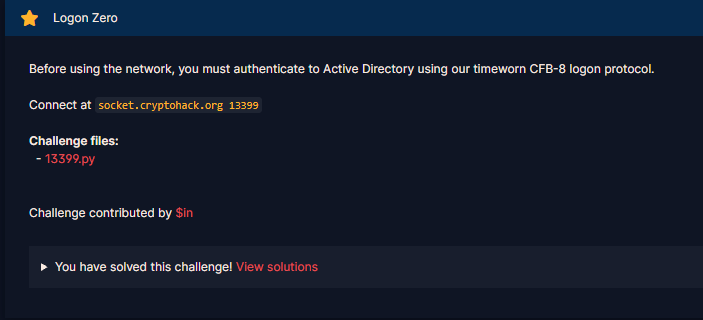

# Logon Zero

#### Challenges: `Symmetric Ciphers` - Cryptohack - Ngày viết: 22/10/2026

#### 1. Overview

* 
* Đây thực sự là 1 trong những bài hay nhất của Cryptohack mà mình từng làm =)))))
* `Mục tiêu`: Chiếm quyền admin để thu flag
* `Lỗ hỗng`: `CVE-2020-1472`
* `Kỹ thuật`: Part 1: Brute Force, Part 2: Cũng là brute force nhưng thanh lịch hơn =))))

#### 2. Nền tảng cốt lõi

* Các bạn cần phải đọc hiểu được luồng dữ liệu python
* AES CFB-8 là gì? [Đọc](<https://en.wikipedia.org/wiki/Block_cipher_mode_of_operation#:~:text=These%20modes%20will%20truncate%20the%20output%20of%20the%20underlying%20block%20cipher.>)
* CVE-2020-1472 là lỗ hỗng như thế nào? [Đọc](<https://www.huntress.com/threat-library/vulnerabilities/cve-2020-1472#:~:text=An%20attacker%20can%20exploit,taking%20over%20the%20domain.>)

#### 3. Phân tích lỗ hỗng

* Mã nguồn server: [Đọc](13399.py)
* Bài này được thiết kế lấy cảm hứng từ lỗ hỗng từng 1 thời khiến cho các doanh nghiệp chạy bằng server Microsoft phải toát mồ hôi hột bởi vì nó có thể khiến quyền admin rơi vào tay hacker vô cùng dễ dàng.
* Trước hết, lúc netcat để server, chúng ta cần xác thực tài khoản trước khi đi vào server.
* Class CFB8 thiết kế như 1 AES CFB-8 thông thường.
* Để có thể chiếm được quyền admin để đọc flag, ta cần nhập mật khẩu đúng để truy cập được. Server cho phép ta đổi mật khẩu của tài khoản admin và có thể reconect đến server để đổi key trong class CFB8.
* Cách đổi mật khẩu của server không phải là đổi 1-1, mà ta sẽ gửi 1 đoạn token dài tối thiểu là 28 bytes, trong đó, 16 bytes đóng vai trò là IV, 8 bytes giữa là mật khẩu ta muốn đổi dưới dạng ciphertext được encrypt bởi CFB8 và 4 bytes cuối đại diện cho độ dài mật khẩu cũng ở dưới dạng ciphertext.
* ```Python
  token = self.cipher.decrypt(token_ct)
  new_password = token[:-4]
  self.password_length = bytes_to_long(token[-4:])
  self.password = new_password[:self.password_length]
  return {'msg': 'Password has been correctly reset.'}
  ```
* Sau khi giải mã 8 bytes ciphertext + 4 bytes độ dài ciphertext, mật khẩu mới của tài khoản admin là `new_password[:self.password_length]`,nếu độ dài của ciphertext (`self.password_length`) lớn hơn độ dài mật khẩu mới (`new_password`), mật khẩu mới sẽ thiết lập bằng `new_password` (`password = new_password`)

#### 4. Part 1 (Trước khi giải bài)

* ##### 4.1. Ý tưởng khai thác

  * Khi mình kiểm tra các hàm trong mã nguồn, mình thấy được rằng server được thiết lập chặt chẻ giống như 1 server bình thường. Khi phân tích những `option`mà mình có thể chọn, chỉ có 3 lựa chọn là: ``authenticate``, `reset_connection`và`reset_password`. Với `option authenticate`, ta gửi mật khẩu lên để xác thực tài khoản, nếu đúng, ta sẽ vào tài khoản admin, nhưng mật khẩu lúc netcat đến server là chuỗi bytes ngẫu nhiên có độ dài 20 ký tự, việc brute force thẳng vào mật khẩu là bất khả thi nên mình chuyển hướng qua các `option`còn lại
  * Với `option reset_connection`, ta chỉ làm 1 việc đổi là thay đổi key được sử dụng trong class `CFB8`
  * Và `option`cuối cùng là `reset_password`, đây là `option`kỳ lạ nhất bởi vì nó cho phép ta thay đổi mật khẩu của tài khoản admin.
  * Khi xét cả 3 `option`, `option`mình thấy có khả năng tấn công vào nhất là `option reset_password`. Sau đó mình thử trace quá trình thay đổi mật khẩu tài khoản của admin thì mình đã phát hiện lỗ hỗng ở hàm `decrypt` như sau:
  * ```Python
    def decrypt(self, ciphertext):
            IV = ciphertext[:16]
            ct = ciphertext[16:]
            cipher = AES.new(self.key, AES.MODE_ECB)
            pt = b''
            state = IV
            for i in range(len(ct)):
                b = cipher.encrypt(state)[0]
                c = b ^ ct[i]
                pt += bytes([c])
                state = state[1:] + bytes([ct[i]])
            return pt
    ```
  * Bằng cách gửi chuỗi 28 bytes giống nhau lên server, các state tạo ra trong vòng lặp for sẽ luôn giống nhau trong mọi vòng lặp. Và chế độ mã hóa là AES ECB, cùng 1 khối dữ liệu khi mã hóa giống key sẽ ánh xạ cho ra cùng 1 khối mã hóa. Điều đó dẫn đến ở dòng `b = cipher.encrypt(state)[0]`sẽ cho ra cùng 1 bytes, và plaintext trả về là chuỗi các bytes giống nhau
  * Server bắt chúng ta gửi các payload định dạng json, nên không thể gửi các bytes không thể in được. Sau mỗi lần `reset_password`, ta sẽ thử từng ký tự hex in được từ `0x20`-`0x7e` lên server, nếu như không có mật khẩu nào hợp lệ, ta sẽ `reset_connecion`để thay đổi key trong `CFB8`và tiếp tục lặp lại cho đến khi có mật khẩu hợp lệ `(mật khẩu hợp lệ khi b = cipher.encrypt(state)[0] trả về bytes nằm trong khoảng 0x20-0x7e)`
* ##### 4.2. Exploit chain

  * Quy trình:
    * Thay đổi mật khẩu admin bằng token dài 24 bytes `00`
    * Thử các mật khẩu từ bytes `0x20`đến `0x7e`
    * Nếu không có mật khẩu nào hợp lệ, ta reset lại key và lặp lại quá trình cho đến khi có mật khẩu hợp lệ và truy cập được quyền admin
  * Script: [Đọc](solve1.py)
  * ```
    Welcome admin, flag: crypto{Zerologon_Windows_CVE-2020-1472}
    ```

#### 5. Part 2 (Sau khi giải bài)

* ##### 5.1. Ý tưởng khai thác

  * Sau khi giải được bài này, mình thấy flag đang nhắc đến lỗ hỗng `CVE-2020-1472`. Sau một lúc tìm hiểu thì mình tìm ra cách giải thứ 2 cho bài này 1 cách thanh lịch và giống `Hacker lord`hơn =))))
  * Bằng cách gửi các payload thay đổi mật khẩu admin bằng token dài 24 bytes `00`, sau đó gửi mật khẩu rỗng lên server, nếu không đúng mật khẩu khẩu, ta sẽ `reset_connection` và lặp lại quá trình
  * Sẽ có xác suất là `1/256`, `b = cipher.encrypt(state)[0]`sẽ trả về bytes `00`, và ký tự plaintext sẽ được tính: `c = b ^ ct[i] = \x00 ^ \x00` và `pt`sẽ trả về chuỗi bytes full bytes null - `\x00`
  * ```Python
    token = self.cipher.decrypt(token_ct)
    new_password = token[:-4]
    self.password_length = bytes_to_long(token[-4:])
    self.password = new_password[:self.password_length]
    return {'msg': 'Password has been correctly reset.'}
    ```
  * Và `password_length = bytes_to_long(token[-4:]) = bytes_to_long(b'\x00\x00\x00\x00') = 0`
  * Điều đó dẫn đến , `password = new_password[:self.password_lenght] = new_password[:0] = b''` =)))
  * Và tài khoản admin đã không còn mật khẩu nào nữa =)))
  * `This is so elegant! =))))`
* ##### 5.2. Exploit chain

  * Gửi hàng loạt các payload đổi mật khẩu, xác thực và đổi key CFB8, ta sẽ truy cập được quyền admin và lấy được cờ.
  * Script: [Đọc](solve2.py)
  * ```
    Welcome admin, flag: crypto{Zerologon_Windows_CVE-2020-1472}
    ```

#### 6. Reference

* CVE-2020-1472:[Đọc](<https://www.huntress.com/threat-library/vulnerabilities/cve-2020-1472#:~:text=An%20attacker%20can%20exploit,taking%20over%20the%20domain.>)
* AES CFB-8: [Đọc](<https://en.wikipedia.org/wiki/Block_cipher_mode_of_operation#:~:text=These%20modes%20will%20truncate%20the%20output%20of%20the%20underlying%20block%20cipher.>)
