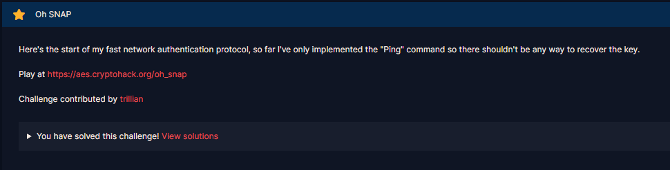

# Oh SNAP

#### Challenges: `Symmetric Ciphers` - Cryptohack - Ngày viết: 24/10/2026

#### 1. Overview

* 
* Bài này thiết kế được lấy cảm hứng từ lỗ hỗng có thật là `CS4538`. Và bài này là bài đầu tiên mà mình sử dụng thủ thuật `Fluhrer, Mantin and Shamir attack` =)))
* `Mục tiêu`: Khôi phục key RC4 của server để thu thập được flag
* `Lỗ hỗng`: `CS4538`
* `Kỹ thuật`: Fluhrer, Mantin and Shamir attack

#### 2. Nền tảng cốt lõi

* Các bạn cần biết quá trình mà `RC4`tạo ra keystream. [Đọc](<https://en.wikipedia.org/wiki/RC4#:~:text=algorithm%20(PRGA).-,Key%2Dscheduling%20algorithm%20(KSA),-edit>)
* Cách thủ thuật `Fluhrer, Mantin and Shamir attack`sử dụng. [Đọc](https://en.wikipedia.org/wiki/Fluhrer,_Mantin_and_Shamir_attack)
  * Về cơ bản, thủ thuật tấn công này dựa vào xác xuất thống kê để khôi phục key
* Link Hackmd do mình vô tình nhặt được, tóm tắt về lỗi bảo mật RC4, cũng như là chỗ mình tham khảo cách giải =))). [Đọc](https://hackmd.io/@Thangcoithongminh/B11o7wkPh)
* Video giải thích chi tiết cách quá trình thực hiện `Fluhrer, Mantin and Shamir attack`. [Xem](https://youtu.be/2o3Hs-JDWLs?t=1640)

#### 3. Phân tích lỗ hỗng

* Mã nguồn server:
* ```Python
  from Crypto.Cipher import ARC4


  FLAG = ?


  @chal.route('/oh_snap/send_cmd/<ciphertext>/<nonce>/')
  def send_cmd(ciphertext, nonce):
      if not ciphertext:
          return {"error": "You must specify a ciphertext"}
      if not nonce:
          return {"error": "You must specify a nonce"}

      ciphertext = bytes.fromhex(ciphertext)
      nonce = bytes.fromhex(nonce)

      cipher = ARC4.new(nonce + FLAG.encode())
      cmd = cipher.decrypt(ciphertext)
      if cmd == b"ping":
          return {"msg": "Pong!"}
      else:
          return {"error": f"Unknown command: {cmd.hex()}"}
  ```
* Server chỉ có 1 điểm endpoint duy nhất là `send_cmd`, chúng ta sẽ gửi ciphertext và nonce lên server. Bằng cách ghép nonce và flag tạo thành key, server giải mã RC4 ciphertext bằng key, rồi trả về plaintext thông qua chỉ mục `error`

#### 4. Ý tưởng khai thác.

* Trong bối cảnh là các server mã hóa dữ liệu và gửi đi trong không gian mạng, server sẽ ghép `iv`với `SecretKey`cố định để làm khóa và mã hóa plaintext và gửi đi ciphertext kèm với `iv`, nếu như không có `iv`,dòng keystream sinh ra từ `SecretKey`sẽ là cố định, hacker có thể tấn công bản rõ đã biết và khôi phục được dòng keystream sinh ra từ key, từ đó giải mã toàn bộ ciphertext.Nhưng có iv thôi vẫn không thể tránh khỏi hacker,`RC4`mắc một lỗ hỗng nghiêm trọng trong quá trình sinh keystream, đó là khả năng khuếch tán quá yếu ở những bước sinh đầu tiên, dẫn đến hacker có thể tìm được mối liên hệ giữa bytes keystream đầu tiên và key nếu `iv`được sử dụng là `weak iv`, và hacker có khôi phục được toàn bộ `SecretKey`chỉ với vài ngàn gói tin sử dụng `weak iv`.
* Bởi vì bài này cho phép ta giao tiếp với server như 1 Oracle, ta dễ dàng có được hàng ngàn gói tin khác nhau với nonce là các `weak iv`, và sử dụng chúng để khôi phục lại `SecretKey`hay chính là Flag trong bài này.
* Ta sử dụng thủ thuật `Fluhrer, Mantin and Shamir attack`, thu thập các mảnh gói tin và thực hiện quá trình bầu phiếu để chọn ra kí tự Key có nhiều lượt phiếu nhất - xác suất cao nhất. Sau đó, ta thu được `SecretKey`- `Flag`

#### 5. Exploit chain

* Quy trình:

  * Tạo 1 `weak iv`có V lần lượt là các giá trị từ 0 - 255, cấu trúc `weak iv` là `[index flag cần tìm + 3, 0xff, V]`
  * Ta gửi lên server ciphertext là bytes `00` và `weak iv`, plaintext trả về sẽ là `ciphertext xor keystream[0] = 0 xor keystream[0] = keystream[0]`, ta thu được bytes đầu tiên của `keystream`
  * Chạy RC4 bước KSA nội bộ và dừng trước`index flag`, ta trả về bytes ký tự key khả năng và bỏ phiếu, lặp lại quá trình cho cả 256 lần.
  * Lấy bytes có vote nhiều nhất làm ký tự key, lặp lại quá trình cho đến khi flag được khôi phục đầy đủ.
* Script: [Đọc](solve.py)
* Kết quả:
* ```
  b'crypto{w'
  b'crypto{w1'
  b'crypto{w1R'
  b'crypto{w1R3'
  b'crypto{w1R3d'
  b'crypto{w1R3d_'
  b'crypto{w1R3d_e'
  b'crypto{w1R3d_eq'
  b'crypto{w1R3d_equ'
  b'crypto{w1R3d_equ1'
  b'crypto{w1R3d_equ1v'
  b'crypto{w1R3d_equ1v4'
  b'crypto{w1R3d_equ1v4l'
  b'crypto{w1R3d_equ1v4l3'
  b'crypto{w1R3d_equ1v4l3n'
  b'crypto{w1R3d_equ1v4l3nt'
  b'crypto{w1R3d_equ1v4l3nt_'
  b'crypto{w1R3d_equ1v4l3nt_p'
  b'crypto{w1R3d_equ1v4l3nt_pr'
  b'crypto{w1R3d_equ1v4l3nt_pr1'
  b'crypto{w1R3d_equ1v4l3nt_pr1v'
  b'crypto{w1R3d_equ1v4l3nt_pr1v4'
  b'crypto{w1R3d_equ1v4l3nt_pr1v4c'
  b'crypto{w1R3d_equ1v4l3nt_pr1v4cy'
  b'crypto{w1R3d_equ1v4l3nt_pr1v4cy?'
  b'crypto{w1R3d_equ1v4l3nt_pr1v4cy?!'
  b'crypto{w1R3d_equ1v4l3nt_pr1v4cy?!}'
  Thoi gian chay:1902.341292142868
  ```
* ```
  crypto{w1R3d_equ1v4l3nt_pr1v4cy?!}
  ```

#### 6. Reference

* ARC4 PyCryptodome: [Đọc](https://www.pycryptodome.org/src/cipher/arc4#module-Crypto.Cipher.ARC4)
* `Fluhrer, Mantin and Shamir attack`: [Đọc](https://en.wikipedia.org/wiki/Fluhrer,_Mantin_and_Shamir_attack)
* `RC4`: [Đọc](<https://en.wikipedia.org/wiki/RC4#:~:text=algorithm%20(PRGA).-,Key%2Dscheduling%20algorithm%20(KSA),-edit>)
* HackMD về lỗ hỗng `CS4538`: [Đọc](https://hackmd.io/@Thangcoithongminh/B11o7wkPh)

#### 7. Ngoài lề

* Như các bạn thấy thời gian chạy script của mình =))), chạy hơn 30 phút (~31.7p) mới có thể giải ra được cờ. Chủ yếu, code của mình đang xử lý tuần tự, và chưa tối ưu cho CPU, phần lớn thời gian của CPU là chờ thời gian server phản hồi. Nói 1 cách đơn giản, khi CPU chạy lệnh gửi lên server để giải mã ciphertext, CPU chỉ ... ngồi chờ gói tin được gửi về, sử lý đoạn code, rồi mới tiếp tục gửi gói tin mới. Điều này dẫn đến 1 hệ quả là thời gian chờ CPU quá nhiều chỉ vì chờ phản hồi từ server.
* Update Script: [Đọc](solveUPDATE.py)
* Kết quả:
* ```
  b'crypto{w'
  b'crypto{w1'
  b'crypto{w1R'
  b'crypto{w1R3'
  b'crypto{w1R3d'
  b'crypto{w1R3d_'
  b'crypto{w1R3d_e'
  b'crypto{w1R3d_eq'
  b'crypto{w1R3d_equ'
  b'crypto{w1R3d_equ1'
  b'crypto{w1R3d_equ1v'
  b'crypto{w1R3d_equ1v4'
  b'crypto{w1R3d_equ1v4l'
  b'crypto{w1R3d_equ1v4l3'
  b'crypto{w1R3d_equ1v4l3n'
  b'crypto{w1R3d_equ1v4l3nt'
  b'crypto{w1R3d_equ1v4l3nt_'
  b'crypto{w1R3d_equ1v4l3nt_p'
  b'crypto{w1R3d_equ1v4l3nt_pr'
  b'crypto{w1R3d_equ1v4l3nt_pr1'
  b'crypto{w1R3d_equ1v4l3nt_pr1v'
  b'crypto{w1R3d_equ1v4l3nt_pr1v4'
  b'crypto{w1R3d_equ1v4l3nt_pr1v4c'
  b'crypto{w1R3d_equ1v4l3nt_pr1v4cy'
  b'crypto{w1R3d_equ1v4l3nt_pr1v4cy?'
  b'crypto{w1R3d_equ1v4l3nt_pr1v4cy?!'
  b'crypto{w1R3d_equ1v4l3nt_pr1v4cy?!}'
  Thoi gian chay:55.38080596923828
  ```
* Script chạy vỏn vẹn gần 1 phút là giải quyết được bài này.
* Về tối ưu, mình đã tối ưu code cũ thành code mới những điểm như sau:

  * Thay vì để CPU xử lý code ở phần gửi request 1 cách tuần tự, tạo ra thời gian chết rất dài cho CPU. Mình đã đổi sang gọi các luồng con nhỏ hơn để gửi request, bằng cách này, trong lúc CPU đang chờ phản hồi từ server ở luồng đang thực thi, CPU sẽ chạy qua luồng mới để chạy lệnh gửi tiếp theo mà không cần phải nhận kết quả rồi mới gửi tiếp như code cũ. Từ cách chạy tuần tự, code mới đã đổi sang chạy đa luồng song song với nhau, không còn thời gian chết của CPU sau mỗi request nữa.
* ##### Cập nhập SolveUpdate (viết vào ngày 28/10/2026)
* Để đưa tốc độ giải lên cực hạn, mình đã điều chỉnh lại code để mở 1 session cho phép tiết kiệm thời gian bắt tay TCP, và mở rộng bể kết nối bằng với số payload. Với nâng cấp này, payloads sẽ được gửi đi 1 cách hàng loạt gần như ngay lập tức không có độ trễ và không tranh nhau tài nguyên session để gây nghẽn
* ```
  b'crypto{w'
  b'crypto{w1'
  b'crypto{w1R'
  b'crypto{w1R3'
  b'crypto{w1R3d'
  b'crypto{w1R3d_'
  b'crypto{w1R3d_e'
  b'crypto{w1R3d_eq'
  b'crypto{w1R3d_equ'
  b'crypto{w1R3d_equ1'
  b'crypto{w1R3d_equ1v'
  b'crypto{w1R3d_equ1v4'
  b'crypto{w1R3d_equ1v4l'
  b'crypto{w1R3d_equ1v4l3'
  b'crypto{w1R3d_equ1v4l3n'
  b'crypto{w1R3d_equ1v4l3nt'
  b'crypto{w1R3d_equ1v4l3nt_'
  b'crypto{w1R3d_equ1v4l3nt_p'
  b'crypto{w1R3d_equ1v4l3nt_pr'
  b'crypto{w1R3d_equ1v4l3nt_pr1'
  b'crypto{w1R3d_equ1v4l3nt_pr1v'
  b'crypto{w1R3d_equ1v4l3nt_pr1v4'
  b'crypto{w1R3d_equ1v4l3nt_pr1v4c'
  b'crypto{w1R3d_equ1v4l3nt_pr1v4cy'
  b'crypto{w1R3d_equ1v4l3nt_pr1v4cy?'
  b'crypto{w1R3d_equ1v4l3nt_pr1v4cy?!'
  b'crypto{w1R3d_equ1v4l3nt_pr1v4cy?!}'
  Thoi gian chay:15.590068817138672
  ```
