# Oracular Spectacular

#### Challenges: `Symmetric Ciphers` - Cryptohack - Ngày viết: 26/10/2026

#### 1. Overview

* 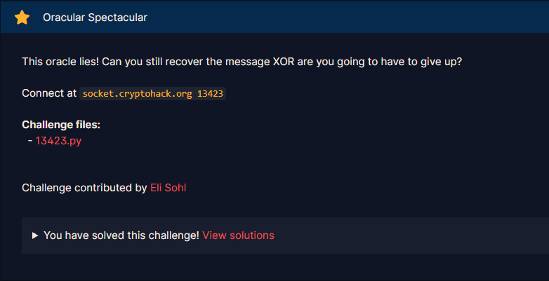
* Đây là bài khó nhất trong chuỗi 3 bài `Pad Thai, The Good, The Pad, The Ugly`và cuối cùng là `Oracular Spectacular`. Mình mất từ buổi trưa đến tối ngày chủ nhật và sáng sớm thứ 2 mình mới giải được =)))). Và đây cũng là bài `150 điểm` đầu tiên mình đã giải được ở nền tảng Cryptohack `>-<`
* `Mục tiêu`: Tấn công Padding Oracle để khôi phục message
* `Kỹ thuật`: Side channel attack - Padding Oracle Attack - Xác suất thống kê  - Thuật toán tối ưu xác suất - Backtracking - DFS

#### 2. Nền tảng cốt lõi

* Trong write-up bài này, tất cả các câu lệnh, thuật toán, chủ yếu được tái sử dụng từ 2 bài `Pad Thai, The Good, The Pad, The Ugly`, các bạn gần như bắt buộc phải giải được 2 bài đó theo cách tối ưu nhất để có thể đủ kiến thức để tối ưu giải bài này.
* Các bạn xem mục lục phần ngoài lề của write-up `Pad Thai`và write-up `The Good, The Pad, The Ugly`có hướng dẫn giải theo cách tối ưu nhất cho 2 bài, bạn xem và giải theo cách tối ưu trước khi giải bài này nhé.
  * `Pad Thai`: [Đọc](../Pad_Thai/write-up.md)
  * `The Good, The Pad, The Ugly`: [Đọc](../The_Good_The_Pad_The_Ugly/write-up.md)
* Trong bài này, cách trình bày, cách giải thích, đều giả định rằng bạn đã giải 2 bài trên và đã sử dụng cách tối ưu nhất.

#### 3. Phân tích lỗ hỗng

* Mã nguồn server: [Đọc](./localhost/13423.py)
* Sự khác biệt duy nhất giữa source code bài này so với bài `The Good, The Pad, The Ugly`là thay toán tử bitwise `or`thành `xor`

#### 4. Ý tưởng khai thác.

* ##### 4.1. Part 1 - Trước khi giải.

  * ###### 1. Phân tích toán học

    * Ở bài `The Good, The Pad, The Ugly`, khi mà kết quả Padding Oracle = False có xác suất là `60%`có kết quả giả là `True`, bằng cách thử 1 payload `k = 20` lần, ta đã giảm tỷ lệ Padding Oracle = False có kết quả giả là True xuống còn `0.0037%`, xác suất để giải đúng được cả 32 bytes để khôi phục message là:

      * Đúng 1 byte: 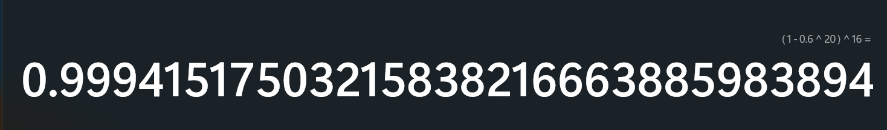
      * Khôi phục được cả 32 bytes, và cả 32 bytes đều đúng: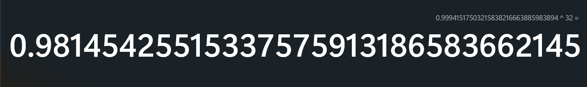
      * Với 100 lần thử thì sẽ có xấp sĩ `98 lần thành công và 2 lần thất bại`
    * Nhưng ở bài này thì hoàn toàn khác. Lúc này kết quả Padding không chỉ bị làm nhiễu mỗi kết quả False, mà ngay ở kết quả True cũng bị làm nhiễu.
    * Ta có 4 trường hợp có thể xảy ra như sau:
    * 
    * Như vậy, nếu như payload cần tìm `(kết quả payload trả về có Padding Oracle = True)` kiểm tra `k` lần, thì % kết quả True sẽ chiếm `40%` tổng số `k` kết quả, ngược lại, nếu như payload sai `(kết quả payload trả về có Padding Oracle = False)`thì % kết quả True chiếm `60%` tổng số `k` kết quả.
    * Nếu ta áp dụng thuật toán chia query cho mỗi payload giống ở bài `The Good, The Pad, The Ugly`, ta chỉ có thể thử `k_max = 23` lần trên mỗi payload thử.
    * 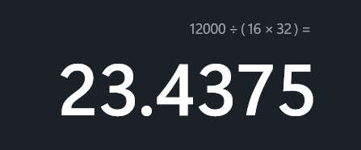
    * Giá trị kỳ vọng trung bình của Payload đúng sẽ là `9.2 True và 13.8 False`, ngược lại 15 Payload sai sẽ có giá trị kỳ vọng trung bình `13.8 True và 9.2 False`. Nếu ta thử `k_max = 23`cho mỗi payload, và chọn payload có số lần True thấp nhất. Xác suất thực sự chọn đúng payload đúng thực sự rất thấp bởi vì số lần thử `k` quá ít, dẫn đến sai số rất nhiều, và xác suất để thuật toán bài `The Good, The Pad, The Ugly`loại bỏ được payload sai và chọn đúng được payload đúng chỉ là:

      * Gọi biến ngẫu nhiên X là số lần xuất hiện True của payload đúng, ta áp dụng công thức Bernouli, ta có hàm xác suất sau:
      * 
      * Gọi biến ngẫu nhiên Y_1,Y_2,...,Y_15 là số lần xuất hiện True của 15 payload sai, tương tự như trên, ta có hàm xác suất cho từng payload là:
      * 
      * Ta xem `score` của từng payload có số lần True xuất hiện trong 23 lần thử, khi đó, `score` của payload đúng phải nhỏ hơn `score` của payload sai `(Y_i > X với mọi i từ 1 - 15)`
      * Khi đó, xác suất chọn đúng được payload đúng (xác suất score payload đúng nhỏ hơn tất cả score payload sai) là:
      * 
      * 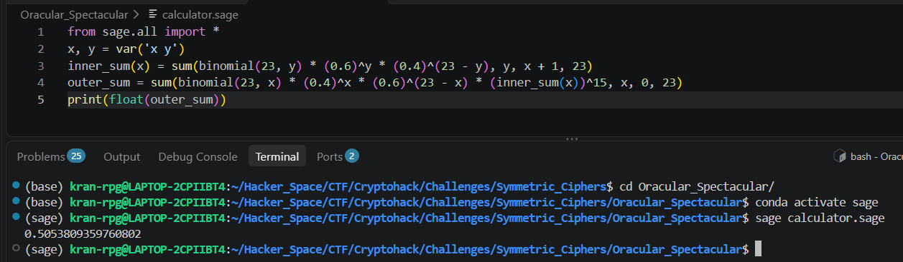
      * Kết quả xác suất xấp sĩ `50.54%`, khi đó, để mà 1 lượt chạy xác định đúng cả 32 bytes của message và lấy được cờ sẽ là:
      * 
      * Gần như bằng `0%`, nên về cơ bản, cách chia đều query cho từng payload để kiểm tra không thể áp dụng ở bài này.
  * ###### 2. Ý tưởng khai thác

    * Ở phần này, mình đã được gemini intern hướng giải với 3 gợi ý bài này như sau:

      * `Gợi ý 1:Thay đổi thuật toán kiểm tra payload theo ngưỡng thay vì chia đều query`
      * `Gợi ý 2:Nếu bytes trước đó chọn sai thì score của 16 payload sau sẽ như thế nào?`
      * `Gợi ý 3:Sử dụng thuật toán quay lui để thử payload tốt thứ 2 nếu như gặp nhánh cụt`
    * Theo gợi ý 1, thay vì chia đều query cho từng payload, ta sẽ tập trung query cho payload có xác suất đúng sau cùng nhất. Theo gợi ý của gemini, mình đã thiết kế lại hàm kiểm tra payload như sau:

      * ```Python
        def check_payload(payload):
        	total = 0
            true_count = 0
            for _ in range(7):
                batch = (json_unpad(payload) + '\n') * 10
                try:
                    res = padding_attack(batch, 10)
                except Exception:
                    return None
                true_count += res.count(True)
                total += 10
                rate = true_count / total
                if total == 10 and rate >= 0.8:
                    return False, rate
                if total == 20 and rate >= 0.65:
                    return False, rate
                if total == 40 and rate >= 0.575:
                    return False, rate
            check = true_count <= 32
            return (check, true_count / total)
        ```
      * Thay vì chia đều query cho từng payload, ta sẽ thử payload đó ở 3 round khác nhau, nếu như ở round đó, xác suất `(score)`vượt ngưỡng cho phép, khả năng cao đó là payload sai và loại ngay lập tức, nếu như payload đúng, xác suất cao payload đó sẽ vượt qua 3 round và được chọn làm bytes đúng.
      * Mình nhờ gemini phân tính xác suất ~~(do mình bị ngu)~~ chọn payload đúng của hàm này thì phản hồi của nó như sau :
      * 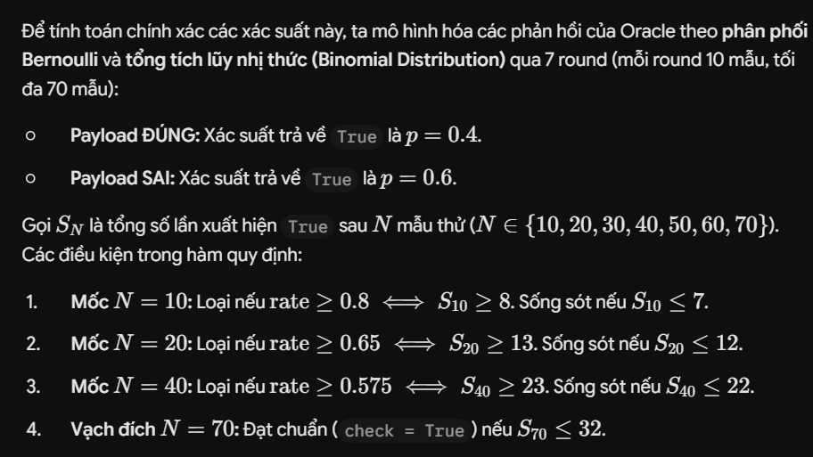
      * 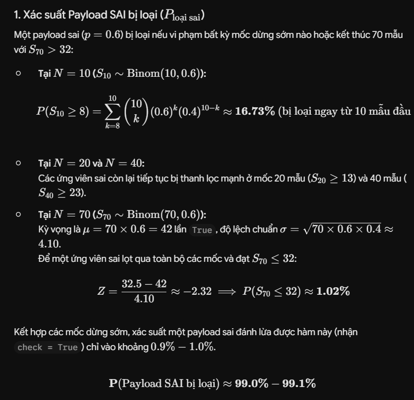
      * 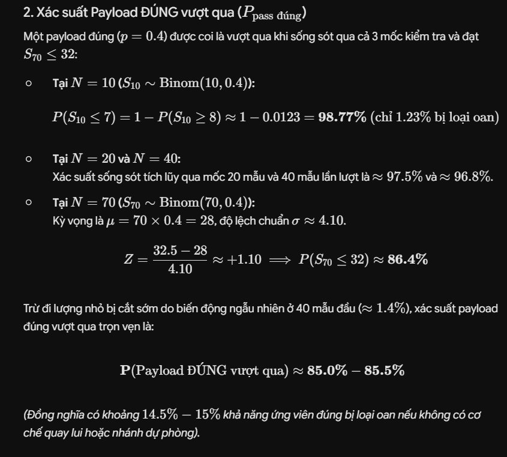
      * 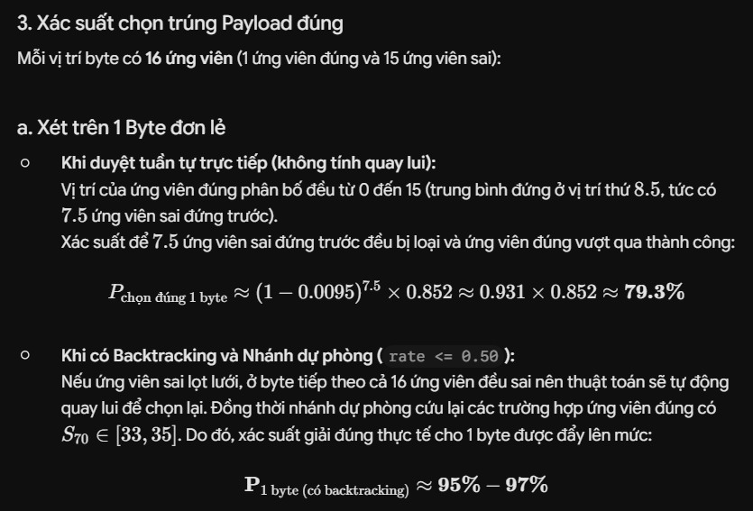
      * Xác suất kiểm tra chọn được payload đúng đã tăng từ `50.54%`lên `79.3%` `(ở phần backtracking mình sẽ giải thích ở gợi ý 3)`
    * Và tiếp theo là gợi ý 2:

      * Đối với gợi ý 2, khi ở bytes trước đó mà ta chọn payload sai để làm kết quả tạo payload ở bytes sau, cả 16 payload này khi gửi lên server kiểm tra sẽ đều có `score` rất cao, bởi vì các payload đó đều không unpad được sau giải mã AES CBC, làm cho phản hồi của Padding Oracle luôn False -> Xác suất True xuất hiện cao -> Score rất cao. Và nhờ chính điều này, chúng ta mới có thể xét điều kiện của backtracking để phát hiện được nhánh cụt và quay trở lại trước đó để chọn payload có score thấp thứ nhì.
    * Cuối cùng, thuật toán được sử dụng để nâng xác suất thành công chọn đúng 1 bytes từ `79.3%`lên xấp sĩ `95% - 97%`đó là thuật toán `dfs`.

      * Mình dựa trên nền tảng source code tấn công Padding Oracle của bài `The Good, The Pad, The Ugly`để đưa nó vào thuật toán `dfs`như sau:
      * ```Python
        def dfs(curr_count, index, curr_know_bytes):
        	nonlocal message
            if curr_count == 16:
                message += curr_know_bytes
                return True
            pos = 15 - curr_count
            list_bytes = [c ^ prev_block[pos] ^ (curr_count + 1) for c in HEX]
            payloads = [b'\x00' * pos + bytes([i]) + xorn(curr_know_bytes[::-1], curr_count + 1) + block_ciphertext[index] for i in list_bytes]
            checked = {}
            for i in range(16):
                try:
                    check, rate = check_payload(payloads[i])
                except Exception:
                    return None
                if check:
                    #print(f"[+] Block {index} - Bytes {curr_count} - i = {i} (rate = {rate})")
                    next_know_bytes = curr_know_bytes + bytes([(curr_count + 1) ^ list_bytes[i]])
                    if dfs(curr_count + 1, index, next_know_bytes):
                        return True
                    #print(f"[+] i = {i} chọn sai")
                elif rate <= 0.5:
                    checked = checked | {rate:i}

            if checked:
                minrate = min(checked.keys())
                next_know_bytes = curr_know_bytes + bytes([(curr_count + 1) ^ list_bytes[checked[minrate]]])
                #print(f"[+] Chạy dự phòng: i = {checked[minrate]} (rate = {minrate})")
                if dfs(curr_count + 1, index, next_know_bytes):
                    return True
            return None 

        dfs(0, index, b'')
        ```
      * Ở đây, khi ta chạy hết vòng for nhưng điều kiện `check`không có payload nào thỏa mãn xác suất, nếu như có payload có xác suất True <= 0.5, ta sẽ chọn min trong số payload đó để chạy nhánh dự phòng nếu như hàm kiểm tra payload đã vô tình loại bỏ nhầm payload đúng. Trong trường hợp mà cả 16 payload có xác suất True `(score)` > 0.5, gần như ta có thể đảm bảo ở payload trước đó ta đã chọn sai và return `None`. Và điều kiện quay lui được sử dụng chính là ở gợi ý 2.
      * Bởi vì có cơ chế quay lui và chọn dự phòng nếu như hàm `check_payload`loại bỏ nhầm payload đúng, đã nâng xác suất chọn đúng payload đúng lên xấp sĩ `95%`
    * Khi đó xác suất để tìm được message và lấy được flag trên lý thuyết là:
    * 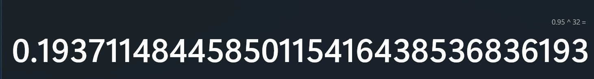
    * `~19.37%`
    * Nhưng thực tế, bài đang giới hạn ta chỉ có 12000 query. Xác suất trên chỉ thực sự đúng khi ta có lượt query vô hạn để thực hiện các phép quay lui và chạy nhánh dự bị. Khi chạy thực tế và treo máy từ đêm chủ nhật đến sáng thứ 2, mình đã thực hiện hơn 150 lần remote đến server nhưng vẫn chưa có lần nào chạy ra cờ, khi mình chỉnh lại code thành bản hoàn thiện như hiện tại và chạy lại, khoảng 50 lần chạy mới có 1 lần chạy đúng, xác suất thực tế chỉ có khoảng `2%`
    * Bởi vì xác suất chạy 1 lần ra cờ rất thấp, nên mình đã chỉnh lại code để có thể chạy nhiều lần remote đến server cùng một lúc bằng cách chạy đa tiến trình =)))), và 1 lần mình chạy 50 tiến trình cùng lúc và sau cỡ 10p là lấy được cờ =)))
  * ###### 3. Exploit chain

    * Quy trình:
      * Gọi các tiến trình con để chạy hàm main.
      * Ở mỗi hàm main, chạy thuật toán và xử lý padding oracle attack trên mỗi phiên độc lập, xác suất để hàm main chạy ra cờ là khoảng `2%`
      * Ngồi chờ và niệm phật rằng bạn may mắn có thể giải ra được message và nhận cờ =)))))
    * Script: [Đọc](solve.py)
    * Logs: [Đọc](logs.txt)
    * ```
      crypto{with_smart_enough_searching_you_can_learn_everything}
      ```
    * May mắn là ngay trong sáng thứ 2 là ngày 26 này, mình đã thử 50 lần đầu tiên và ra ngay được cờ =)))))
* ##### 4.2. Part 2 - Sau khi giải

  * ###### 1. Ý tưởng khai thác.

    * Sau khi giải được bài này, mình đã đọc solution của bài này và phát hiện ra có 1 thuật toán rất tối ưu để giải bài này.
    * Tham khảo từ solution của [Neobeo](https://cryptohack.org/user/Neobeo/)
    * ```Python
      from pwn import *
      from tqdm import trange
      import json

      def msg(js):
          io.sendline(json.dumps(js).encode())
          return json.loads(io.readline())

      def oracle(ct):
          return msg({'option':'unpad','ct':ct.hex()})['result']

      # io = remote('localhost', 13423)
      io = remote('socket.cryptohack.org', 13423)
      io.readline()

      cs = b'0123456789abcdef'
      ct = bytes.fromhex(msg({'option':'encrypt'})['ct'])

      def solve(orig):
          known = []
          for L in trange(16):
              score = [0] * 16
              while (m := max(score)) < 23:
                  i = score.index(m)
                  tmp = bytearray(orig)
                  for j, k in enumerate(known + [cs[i]]):
                      tmp[15 - j] ^= k ^ (L + 1)
                  score[i] += (-1) ** oracle(tmp)
              known.append(cs[score.index(m)])
          return bytes(known)[::-1]

      soln = solve(ct[:32]) + solve(ct[16:])
      print(msg({'option':'check','message':soln.decode()}))
      ```
    * Thuật toán được sử dụng để kiểm tra payload là thuật toán tham lam và được kết hợp với thuật toán thích nghi =)))), ta tập trung phân tích source code ở phần này. Score được sử dụng ở đây khác part 1 nhé.
    * ```Python
      score = [0] * 16
      while (m := max(score)) < 23:
      	i = score.index(m)
          tmp = bytearray(orig)
          for j, k in enumerate(known + [cs[i]]):
              tmp[15 - j] ^= k ^ (L + 1)
          score[i] += (-1) ** oracle(tmp)
      known.append(cs[score.index(m)])
      ```
    * Khi oracle trả về `False`, `score[i] += (-1) ** False = (-1) ** 0 = 1`, `score[i] của payload[i] sẽ được cộng điểm`
    * Khi oracle trả về `True`, `score[i] += (-1) ** True = (-1) ** 1 = -1`, `score[i] của payload[i] sẽ bị trừ điểm`
    * Bây giờ, ta sẽ tính giá trị kỳ vọng của `score`của payload đúng và payload sai để thấy sự khác biệt =)))) ~~`(mình lười nên nhờ gemini phân tích)`~~
    * 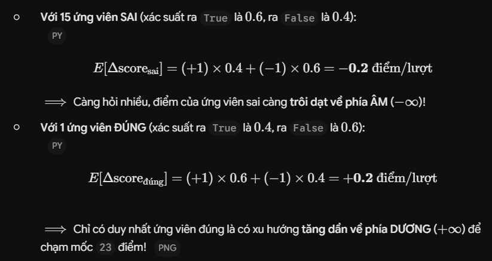
    * Bằng cách luôn chọn payload có score cao nhất để kiểm tra, khi payload cao nhất hiện tại là payload sai, khi hỏi càng nhiều thì score của payload đó có xu hướng tiến về số âm, và 1 khi payload có score cao nhất được chọn là payload đúng, khi được kiểm tra sẽ có xu hướng tiến về phía dương và chạm ngưỡng kiểm tra là `score >= 23`
    * Và xác suất để hàm kiểm tra payload này chọn phải payload sai và xác suất để hàm chạy này giải đúng cả 32 bytes là:
    * 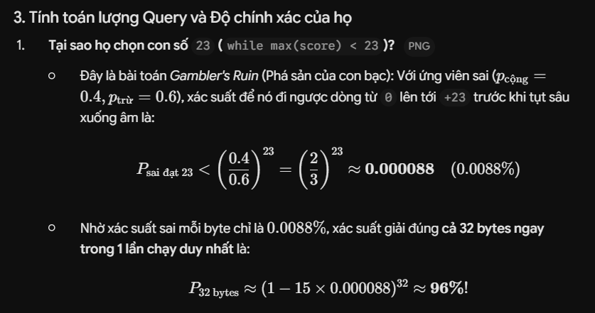
    * Với cách kiểm tra payload mới này, tỷ lệ để 1 tiến trình giải ra cờ đã tăng từ  `2%`lên đến  `96%` =))))))) ~~`(WT?)`~~
  * ###### 2. Exploit chain

    * Mình đã thay đổi hàm `find_block_message`thành thuật toán như trên như sau:
    * ```Python
          def find_block_message(index):
              nonlocal message
              know_bytes = b''
              for count in range(16):
                  pos = 15 - count
                  list_bytes = [c ^ prev_block[pos] ^ (count + 1) for c in HEX]
                  payloads = [b'\x00' * pos + bytes([i]) + xorn(know_bytes[::-1], count + 1) + block_ciphertext[index] for i in list_bytes]

                  score = [0] * 16
                  while (m := max(score)) < 23:
                      i = score.index(m)
                      batch = (json_unpad(payloads[i])  + '\n') * 10
                      res = padding_attack(batch, 10)
                      if res is None:
                          return "Fail to find message"
                      score[i] += sum([(-1) ** check for check in res])
                  know_bytes += bytes([(count + 1) ^ list_bytes[score.index(max(score))]])
              message += know_bytes
      ```
    * Đối với solve của NeoBeo thì mất gần 21-27p mới có thể giải ra cờ. Bằng cách kết hợp các kỹ thuật TCP Pipelining và sử dụng batch để kiểm tra hàng loạt, ngoài ra, mình cho chạy cỡ 10 tiến trình cùng lúc để đảm bảo gần như  `100%`ra được cờ. Mình đã giải ra bài bằng solve mới trong vòng gần `10p`
    * Update Script: [Đọc](SolveUpdate.py)
    * Logs: [Đọc](logsUp.txt)

#### 6. Reference

* Gemini gợi ý và phân tích toán học
* Write-up bài The Good, The Pad, The Ugly: [Đọc](../The_Good_The_Pad_The_Ugly/write-up.md)
* Đánh giá tổng quát bài này: [Đọc](<https://habr.com/ru/articles/862624/#:~:text=%D1%87%D1%82%D0%BE%20%D0%BE%D0%BD%D0%BE%20%D0%BF%D1%80%D0%B0%D0%B2%D0%B8%D0%BB%D1%8C%D0%BD%D0%BE%D0%B5.-,Oracular%20Spectacular,-%D0%95%D1%89%D1%91%20%D0%BE%D0%B4%D0%BD%D0%B0%20%D0%B7%D0%B0%D0%B4%D0%B0%D1%87%D0%B0>) (Các bạn nên dùng phiên dịch bởi vì bài viết bằng tiếng Nga)
* Solution Neobeo

##### 7. Tổng kết

* Sau chuỗi 3 bài `Pad thai`, `The Good, The Pad, The Ugly` và bài `Oracular Spectacular` này, mình đã học được rất nhiều thứ và sau đây mình sẽ tổng kết lại như sau:

  * Mình đã học được cách chạy đa tiến trình `(multiprocess)` và đa luồng `(multithread)` để tối ưu thời gian gửi payload qua socket hoặc là payload qua request
  * Biết cách sử dụng Kỹ thuật TCP Pipelining để tăng tốc độ gửi và nhận trong `socket`
  * Mình đã nắm rõ được cách `Padding Oracle` gây ra lỗ hỗng cho `AES CBC` và cách khai thác nó.

    * Thông qua thao túng trên Ciphertext và IV, ta có thể gửi payload để Padding Oracle làm rò rỉ  byte lỗi đệm trạng thái giải mã trung gian.
    * 
    * Khi ta thu được các trạng thái trung gian, hay là các block ciphertext đã được giải mã AES ECB, ta chỉ cần thực hiện phép xor với ciphertext để khôi phục lại bản rõ ban đầu.
    * 
  * Mình đã được ôn lại những kiến thức xác suất cấp 3 và nâng cấp khả năng giải các bài xác suất của mình để xử lý nhiễu của bài =)))
  * Các công thức toán xác suất cấp 3 được ôn lại như:

    * Công thức Bernouli: Tính xác suất khi có `k` lần thành công trong `n` phép thử
    * Giá trị kỳ vọng `E` của 1 biến ngẫu nhiên
    * Xác suất toàn phần
    * Xác suất có điều kiện
  * Các công thức mới được học như:

    * Binomial: Phân phối nhị thức trong xác suất thống kê để tính xác suất tích lũy
    * *Gambler's Ruin* (Phá sản của con bạc): [Đọc](https://en.wikipedia.org/wiki/Gambler%27s_ruin)
  * Các thuật toán và cấu trúc dữ liệu được ôn lại:

    * DFS - Backtracking - Đệ quy
    * Sàng lọc nhiễu - Thoát sớm
    * Tham lam - Thích nghi
