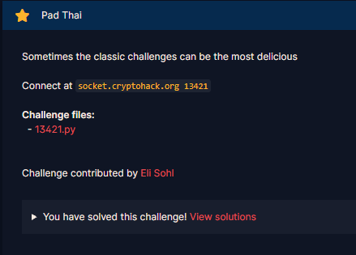
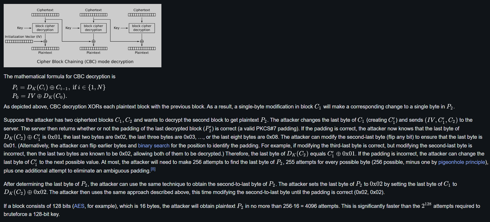
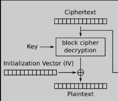

# Pad Thai

#### Challenges: `Symmetric Ciphers` - Cryptohack - Ngày viết: 24/10/2026

#### 1. Overview

* 
* Đây là bài đầu tiên mình sử dụng padding attack trên AES CBC =))))
* `Mục tiêu`: Sử dụng Oracle để kiểm tra padding, dựa vào thông tin để khôi phục message, thu thập flag.
* `Lỗ hỗng`: Lộ Oracle cho phép kiểm tra padding
* `Kỹ thuật`: Side channel attack - AES CBC Padding attack, CBC bytes flip

#### 2. Nền tảng cốt lõi

* Các bạn cần hiểu quá trình khai thác lỗ hỗng Oracle kiểm tra padding của AES CBC: [Đọc](https://en.wikipedia.org/wiki/Padding_oracle_attack)
* Các bạn nên hoàn thành Course Symmetric Cryptography trước khi làm bài này.

#### 3. Phân tích lỗ hỗng

* Mã nguồn server: [Đọc](13421.py)
* Server cho phép ta tương tác 3 option là `encrypt, unpad, check`

  * `encrypt`: Hàm cho ta ciphertext của message
  * `unpad`: Giải mã ciphertext, kiểm tra ciphertext unpad có hợp lệ và trả về kết quả True, False
  * `check`: Kiểm tra message, nếu đúng, ta nhận được cờ.

#### 4. Ý tưởng khai thác

* Ý tưởng cốt lõi của bài này là ta sẽ gửi những bản mã ciphertext lên server để kiểm tra xem có unpad được không. Về chi tiết thuật toán đã được wiki giải thích rất kỹ, nên mình sẽ không giải thích quá kỹ nhé =))))
* 
* 
* Ta sẽ gửi lên ciphertext có độ dài 2 block `IV, C1`để server kiểm tra padding.Ta muốn giải mã `C1` thành `P1`, bằng cách tạo 1 payload `IV'`. Sau khi giải mã ciphertext `C1`thành `D_K(C1)`,`D_K(C1)`xor với `IV`cho ra `P1`, bằng cách thay đổi (lật) bytes cuối cùng của `IV`,  nếu như kết quả phép xor ở bytes cuối cùng cho ra bytes `\x01`, server sẽ trả cho chúng ta kết quả `True`bởi vì lệnh unpad đã được thực thi thành công và chúng ta đã có thẻ tính được `D_K(C1)` bằng mối liên hệ này:
* 
* Và ta có thể tính các bytes còn lại của `C1`, để có thể tìm được bytes tiếp theo của `C1`, ta cũng sẽ thiết kế 1 `IV'`, nhưng lần này, `IV'`cần phải lật 2 bytes cuối của`C1`thành `\x02\x02`. Ở bước trước đó ta đã biết `D_K(C1)`ở bytes cuối cùng nên ta dễ dàng tính được bytes cuối cùng của `IV'`
* 
* Ở bytes thứ 2, tương tự như bước 1 =)))
* 
* Và quá trình lặp lại tương tự trên các bytes còn lại của khối.

#### 5. Exploit chain

* Quy trình:
  * Ta nhận ciphertext của server.
  * Ta thực hiện quy trình tấn công vào kiểm tra Padding để khôi phục lại các bytes message
  * Bởi vì message sau phục hồi chỉ mới được giải mã ECB, ta cần bước 1 bước xor để khôi phục message hoàn toàn.
  * Gửi message lên server
  * Nhận cờ
* Script: [Đọc](solve.py)
* Kết quả:
* ```
  {"flag": "crypto{if_you_ask_enough_times_you_usually_get_what_you_want}"}
  Thoi gian chay: 1085.443380355835
  ```
* ```
  crypto{if_you_ask_enough_times_you_usually_get_what_you_want}
  ```
* Mình mất tận 17p để script giải được bài này =))))

#### 6. Reference

* Padding oracle attack: [Đọc](https://en.wikipedia.org/wiki/Padding_oracle_attack)

#### 7. Ngoài lề

* Mình không chấp nhận việc ngồi chờ 17p mới ra cờ như này =))), nên mình có cải tiến code để chạy chỉ còn 30s là xong.
* Script: [Đọc](SolveUPDATE.py)
* Những kỹ thuật được sử dụng để cải tiến tốc độ hoàn thành bài này như sau:
  * Sử dụng kỹ thuật batch data để gửi hoàn loạt payload cùng lúc - TCP Pipelining, thay vì xử lý tuần tự như code cũ. Điều này dẫn đến thay vì chịu đỗ trễ của từng payload riêng lẻ, độ trễ hoàn loạt payload được dồn vào 1 lần gửi duy nhất, giúp giảm thời gian giải đáng kể.
  * Không gian payload đã giảm từ 256 xuống 16 bằng 1 tính chất đặc biệt khi server sinh `message`.
  * ```Python
    self.message = urandom(16).hex()
    ```
  * Bằng cách tính như này, message chỉ có thể có các ký tự thuộc giá trị hex = `(a,b,c,d,e,f,1,2,3,4,5,6,7,8,9,0)`. Ta có công thức giải mã AES CBC như sau:
  * 
  * 
  * Và giá trị P_curr chỉ có thể nằm trong `(a,b,c,d,e,f,1,2,3,4,5,6,7,8,9,0)`, nên ta chỉ cần gửi 16 payload để kiểm tra.
* Kết quả:
* ```
  {"flag": "crypto{if_you_ask_enough_times_you_usually_get_what_you_want}"}
  Thoi gian chay: 24.59090518951416
  ```
