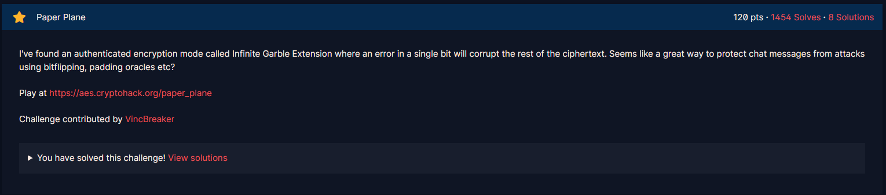
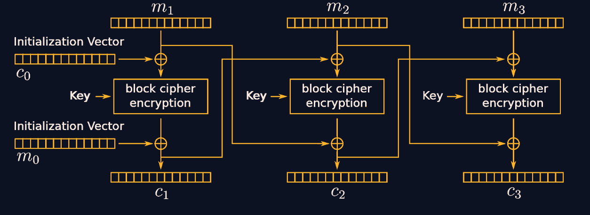
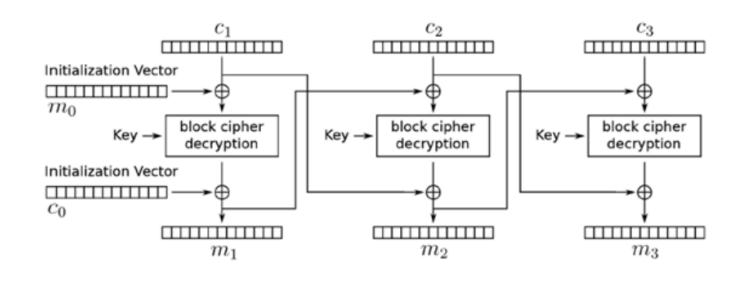

# Paper Plane

#### Challenges: `Symmetric Ciphers` - Cryptohack - Ngày viết: 27/10/2026

#### 1. Overview

* 
* Đây là 1 bài khá là hay, khi mà bài này được lấy cảm hứng từ 1 sự kiện gây ra phẫn nộ trong giới bảo mật đó là telegram sử dụng mã hóa AES IGE - Infinite Garble Extension gây mất an toàn thông tin cá nhân thay vì AES - GCM có tính bảo mật cao hơn :v. Bài này, nếu như các bạn đã làm hết 5 bài trong mục Padding Attack thì thực sự bài này rất là dễ :v
* `Mục tiêu`: Khôi phục flag từ rò rỉ padding oracle
* `Kỹ thuật`: Side channel attack - AES CBC Padding Oracle attack

#### 2. Nền tảng cốt lõi

* Ít nhất thì các bạn nên giải qua bài `Pad Thai`để hiểu hơn cách exploit bài này nhé.
* AES CBC Padding Oracle attack: [Đọc](<https://en.wikipedia.org/wiki/Padding_oracle_attack#:~:text=%5B4%5D-,Padding%20oracle%20attack%20on%20CBC%20encryption,-edit>)

#### 3. Phân tích lỗ hỗng

* Các bạn có thể xem mã nguồn trên web cryptohack :v
* Tóm tắt bên phía server có những hàm và class như sau:
  * `Class AesIge`: Đối tượng class này có chức năng encrypt và decrypt theo mode AES IGE. Nhưng điều đặc biệt nằm ở hàm decrypt. Thay vì trả về plaintext nếu không unpad được thì hàm lại trả về giá trị None
  * `Hàm send_msg`: Hàm phản hồi cho ta thông tin về decrypt ciphertext, nếu giá trị None thì phản hồi `không thể giải mã`, nếu plaintext đã decrypt và unpad thành công, phản hồi `plaintext đã được giải mã`. Nhưng decrypt mặc dù giải mã được, nhưng vẫn phản hồi None trong trường hợp plaintext không thể unpad
* Và đây chính xác là 1 Padding Oracle và ta có thể khai thác chúng để giải mã cờ mà không cần Key
* Và đây là sơ đồ quá trình mã hóa của AES IGE:
* 
* Viết về dạng tổng quát ta có như sau:
* 
* Và so sánh nó với chế độ mã hóa AES CBC =)))
* 
* Chế độ AES IGE đơn giản chỉ là thêm phép xor với khối plaintext trước đó trước khi giải mã ciphertext mà thôi =)))

#### 4. Ý tưởng khai thác

 

* Ta có thể kiểm soát được 3 giá trị là `ciphertext`, `IV_c`, `IV_m` để gửi lên server
* Cách exploit bài này giống gần như hoàn toàn cách ta khai thác lỗ hỗng Padding của AES CBC, nhưng trước khi gửi payload `IV_c`lên server, ta cần phải gửi thêm `IV_m`để đảo ngược phép xor nằm ở khối ciphertext đó trước khi thực hiện padding attack.
* Sau mỗi lần ta khôi phục trạng thái khối ciphertext , ta sẽ giải mã luôn khối đó và sử dụng làm `IV_m`cho khối tiếp theo

#### 5. Exploit chain

* Quy trình:

  * Nhận ciphertext_flag từ server
  * Thực hiện padding attack trên AES IGE, khôi phục lại flag
* Script: [Đọc](solve.py)
* ```
  crypto{h3ll0_t3l3gr4m}
  Thời gian chạy: 82.89
  ```
* ```
  crypto{h3ll0_t3l3gr4m}
  ```

#### 6. Ngoài lề

* Mặc dù lệnh của mình đã được tối ưu về mảng như chạy đa luồng (multithread) để tăng tốc độ gửi request, nhưng ta vẫn phải gửi 256 payloads khác nhau để kiểm tra từng bytes :v
* Ta đã biết rằng flag thường sẽ luôn có định dạng `crypto{...}`, trong đó, nội dung ... thường sẽ được thiết kế Leetspeak, nên ta hoàn toàn có thể khoanh vùng số lượng bytes cần kiểm tra từ 256 xuống chỉ còn bảng chữ cái, số, các ký tự `{}_`và padding của cờ.
* Script mới sẽ cải thiện về mặt toán học, ta biết trước flag có định dạng như nào để thiết kế payloads chính xác và nhanh hơn.
* Ngoài ra, khi chạy lệnh request để gửi ciphertext lên server, hàm request phải thực hiện quá trình bắt tay với server, rồi sau đó mới gửi payload lên server, làm mất rất nhiều thời gian khi cho chạy 100 luồng khác nhau. Để giải quyết vấn đề này, ta tạo 1 session để có thể giữ kết nối và tái sử dụng cho các request gửi lên hàng loạt, ngoài ra, ta cũng phải mở rộng `pool`-`bể kết nối`lên bằng hoặc hơn số lượng luồng để tránh tình trạng các luồng tranh nhau sesion để thực hiện request.
* Update Script: [Đọc](SolveUpdate.py)
* Thời gian giảm từ `~83s`xuống còn `~11s`
* ```
  crypto{h3ll0_t3l3gr4m}
  Thời gian chạy: 10.97
  ```
