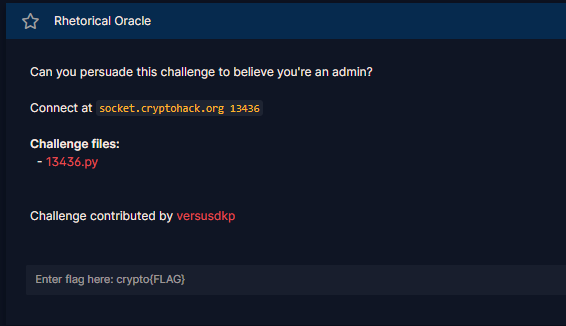
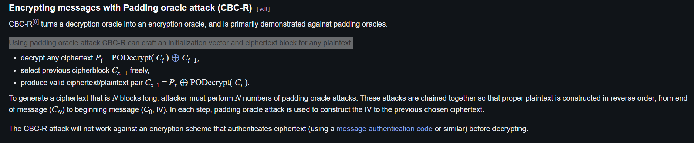

# Rhetorical Oracle

#### Challenges: `Symmetric Ciphers` - Cryptohack - Ngày viết: 24/10/2026

#### 1. Overview

* 
* Đây là bài thứ 2 tiếp tục chuỗi lỗ hỗng Padding AES CBC. Nếu như bài trước đó là `Pad Thai`, ta sử dụng Padding Oracle để tính toán tấn công kênh đề, thu được Plaintext, thì ở bài nà, chúng ta phải làm điều ngược lại =))). Ta sẽ biến Padding Orcale AES CBC Decrypt thành Padding Orcale AES CBC Encrypt, và cho phép ta tạo ra `IV` và `ciphertext`của bất kỳ plaintext nào mình muốn.
* `Mục tiêu`: Chiếm quyền Admin để lấy được flag
* `Lỗ hỗng`: Lộ Oracle cho phép kiểm tra Padding
* `Kỹ thuật`: Side channel attack - AES CBC Padding attack, CBC bytes flip, CBC-R

#### 2. Nền tảng cốt lõi

* Sử dụng CBC- decrypt như CBC-encrypt để tạo ciphertext,iv bất kỳ plaintext. [Đọc](<https://en.wikipedia.org/wiki/Padding_oracle_attack#cite_note-9:~:text=128%2Dbit%20key.-,Encrypting%20messages%20with%20Padding%20oracle%20attack%20(CBC%2DR),-edit>)
* Các bạn nên hoàn thành Course Symmetric Cryptography trước khi làm bài này.
* Bạn nên giải bài sử dụng Padding Oracle attack cơ bản trước khi giải bài này nhé, mình đề xuất bài `Pad Thai`trong challenges `Symmetric Ciphers`

#### 3. Phân tích lỗ hỗng

* Mã nguồn server: [Đọc](13436.py)
* Server cung cấp cho ta 1 token, trong đó chứa ciphertext của file json chứa `user_id`của người dùng và được mã hóa bằng AES CBC.
* Để có thể lấy được flag, ta cần gửi 1 token, khi server giải mã token sẽ cho ra file json trong đó, chỉ mục `user_id`bằng 1 trong 2 giá trị sau thì ta sẽ có quyền admin để lấy được flag:
  * `0656d38b8cb0b41b82ecc9859cb7c03e53c7c6610bdce9ea14d30d1a33c80204`
  * `3cc87cad6be102200df733cfa33e02889ce798a88470f3aa2e59bebcaee054b3`
* Ở mỗi lần gửi json file chứa chỉ mục ciphertext, server sẽ trả về kết quả padding.

#### 4. Ý tưởng khai thác.

* Như đã phân tích ở trên, ta càn gửi 1 giá trị token, khi giải mã token và load json file, nếu `user_id` bằng 1 trong 2 giá trị trên thì ta sẽ lấy được cờ. Và mỗi lần giải mã ciphertext, server sẽ trả về cho chúng ta kết quả của padding. Và đây chính là thủ thuật khai thác thứ 2 mà wikipedia đã nhắc tới =))))
* 
* Trên wikipedia giải thích khá là ngắn gọn và có 1 chút sai sót nên mình sẽ giải thích kỹ ở phần này.
* Bản chất quá trình giải mã AES CBC như sau:
* 
* Viết 1 cách tổng quát quá trình mã hóa sẽ là như sau:, để tiện trong quá trình giải thích, mình gọi  là trạng thái trung gian hay là trạng thái của plaintext trước khi xor trong CBC
* Ta có thể suy ra được 
* Và điểm mấu chốt là việc để lộ Padding Oracle cho phép ta thực hiện Padding Oracle attack và khôi phục `I_i` của bất kỳ `C_i` nào mà không cần biết khóa của server.
* Ta tính được `I_i`, ta muốn server giải mã `C_i`ra một `P_i`bất kỳ, ta chỉ cần đặt block trước `C_i`là  là được.
* Bằng cách lặp lại quá trình cho đến khi `C_0 = IV`thì ta đã tạo ra được  mà khi ghép các khối lại gửi lên server, ta sẽ giải mã ra được  mà ta mong muốn.
* Bằng cách tạo plaintext là json file với `user_id` là id của `admin`, ta tìm ra được  và gửi lên server để lấy được cờ.

#### 5. Exploit chain

* Quy trình:
  * Viết hàm tự động thực hiện Padding Oracle attack để khôi phục trạng thái trung gian của Ciphertext
  * Bắt đầu chế tạo các khối Ciphertext và khối IV sao cho giải mã ra Plaintext: `{"user_id":"0656d38b8cb0b41b82ecc9859cb7c03e53c7c6610bdce9ea14d30d1a33c80204"}`
  * Gửi ciphertext giả lên server để đánh lừa, chiếm quyền admin
  * Nhận cờ
* Script: [Đọc](solve.py)
* Kết quả:
* ```
  {"flag": "crypto{5urpr151n61y_fru17fu1_c0n53qu3nc35}"}
  Thoi gian chay: 2795.490621805191
  ```
* ```
  crypto{5urpr151n61y_fru17fu1_c0n53qu3nc35}
  ```
* Mất tận `~47p` để giải được bài này =))))

#### 6. Reference

* Padding Oracle attack CBC-R: [Đọc](<https://en.wikipedia.org/wiki/Padding_oracle_attack#cite_note-9:~:text=128%2Dbit%20key.-,Encrypting%20messages%20with%20Padding%20oracle%20attack%20(CBC%2DR),-edit>)
* Tham khảo code từ bài Pad Thai: [Đọc write-up](../Pad_Thai/write-up.md)

#### 7. Ngoài lề

* Ở bài này, mình cũng sẽ tối ưu tốc độ giải bài này.
* Về ý tưởng tối ưu thì mình copy hoàn toàn từ [write-up](../Pad_Thai/write-up.md) này qua :v, nên các bạn qua đây xem nhé
* Script Update: [Đọc](SolveUPDATE.py)
* ```
  {"flag": "crypto{5urpr151n61y_fru17fu1_c0n53qu3nc35}"}
  Thoi gian chay: 536.6639266014099
  ```
* Với code mới, mình tốn `~9p`để giải được bài này.
