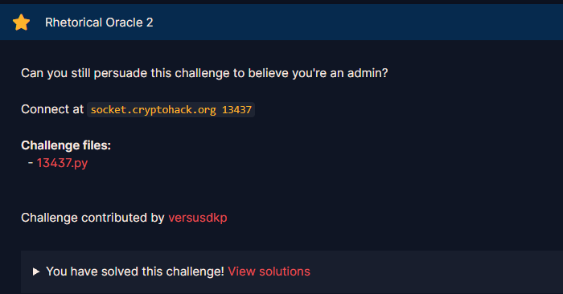
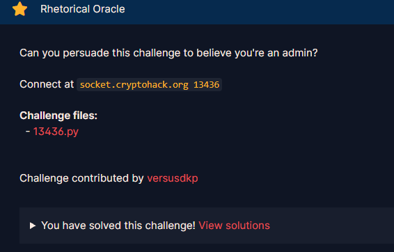
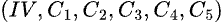
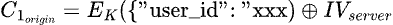
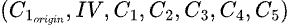

# Rhetorical Oracle 2

#### Challenges: `Symmetric Ciphers` - Cryptohack - Ngày viết: 27/10/2026

#### 1. Overview

* 
* Đây là bài 150 điểm thứ 2 của mình trên cryptohack =)))), và bài này thực sự là dễ hơn rất nhiều so với bài trước đó là Oracular Spectacular.
* `Mục tiêu`: Chiếm quyền admin để đọc flag
* `Lỗ hỗng`: Lộ Oracle cho phép kiểm tra padding
* `Kỹ thuật`: Side channel attack - Padding Oracle CBC attack, CBC bytes flip, CBC-R, Ghi đè dữ liệu cũ bằng dữ liệu mới

#### 2. Nền tảng cốt lõi

* Trước khi giải bài này, các bạn nên giải qua phần 1 của bài này trước là bài Rhetorical Oracle
* 
* Ở write-up này, mình sẽ không đi sâu vào cách khai thác lỗ hỗng Padding Oracle và cách chúng ta thực hiện CBC-R. Và mình sẽ mặc định rằng bạn đã biết thực hiện Padding Oracle attack và thực hiện được CBC-R để giải thích cách chúng ta vượt qua bài này nha =))))
* Các bạn tìm hiểu thêm về chế độ decode`unicode_escape`: [Đọc ](https://mojoauth.com/dev-guides/unicode-escaping-in-python)
* Hiểu một cách đơn giản, unicode_escape là chế độ cho phép encode các kí tự đặc biệt như emoji , tiếng việt có dấu, tiếng hàn, tiếng trung,.... Và chế độ decode cho phép giải mã được các kí tự mã hóa đặc biệt của emoji, tiếng việt ,...
* Các bạn tìm hiểu thêm về chế độ strict của `loads json function`: [Đọc](https://stackoverflow.com/questions/77283974/what-specification-is-used-for-pythons-json-dumps-strict)
* Hiểu một cách đơn giản, chế độ strict mặc định là True, khi chuyển sang chế độ False, mọi kí tự không in được hay raw bytes sẽ cho phép json tải được mà không bị lỗi

#### 3. Phân tích lỗ hỗng

* Mã nguồn của server: [Đọc](13437.py)
* Sự khác biệt lớn nhất giữa phần 1 và phần 2 là bài này thay vì cho ta được tùy biến `IV`, thì ở phần 2 này, bài đã không cho phép ta gửi tùy biến `IV` nữa và `IV` được sử dụng giống nhau trong tất cả các lượt kiểm tra padding.
* Và server đã đổi cách decode từ `ascii` thành `unicode_escape`, và chế độ loads của json set giá trị `strict = False`, và chính 2 sự thay đổi cách decode và cách json được loads đã tạo ra lỗ hỗng có thể khai thác ở bài này.

#### 4. Ý tưởng khai thác

* Ý tưởng chính là ta vẫn sẽ tạo các khối ciphertext giả để đánh lừa hệ thống và chiếm quyền admin, nhưng có một chút thay đổi khi gửi payload lên.
* Bởi vì `IV`của server là cố định nên ta không thể thao tác `IV`để mà khi decrypt `C_1` thành `I_1` và `I_1` xor `IV` để tạo `P_1` là cụm đầu của json : `{"user_id": "xxx` của admin được.
* Và `IV`chỉ tham gia giải mã AES CBC ở khối đầu tiên !!
* Có nghĩa là các khối khác khối đầu tiên khi gửi lên server sẽ đều giải mã đều thành công =)))
* Vậy nếu ta áp dụng nguyên cách giải ở phần 1 vào phần 2 này. Lúc này payload sẽ có dạng (độ dài của json là 80 kí tự nên có 5 khối ciphertext): 
* Khi được server giải mã, cấu trúc json sẽ là (IV lúc này được xem như C_0 bởi vì server không đọc IV):
* `[IV xor IV_server = 16 bytes rác]{"user_id": "0656d38b8cb0b41b82ecc9859cb7c03e53c7c6610bdce9ea14d30d1a33c80204"}`
* Bởi vì hàm loads của json đang đặt chế độ `strict = False`nên có thể loads được các bytes rác và sẽ không bị văng lỗi, nhưng muốn loads được thì cấu trúc json phải là cấu trúc chuẩn là `{...}`. Bởi vì 16 bytes rác nằm ngoài dấu `{}`nên server cũng sẽ bị văng lỗi
* Vậy câu hỏi đặt ra là, làm sao để payload gửi lên, khi decrypt phải là 1 cấu trúc json hoàn chỉnh -`{key1:value1, key2:value2,...}`và trong đó key user_id có values phải là token của admin?(Lưu ý là có bytes rác, loads vẫn sẽ chạy được)
* Câu trả lời cho câu hỏi này, là ta sẽ sử dụng lại token mà server cho ở lúc đầu kết nối socket đến server.
* Bằng cách lấy khối ciphertext đầu tiên của token là 
* Khi để khối đầu tiên token ở đầu payload , server sẽ giải mã ra `{"user_id": "xxx`. Ta chỉnh sửa payload hiện tại thành payload mới là `","user_id":"0656d38b8cb0b41b82ecc9859cb7c03e53c7c6610bdce9ea14d30d1a33c80204"}`, khi đó payload sẽ có dạng: , và khi gửi lên server để giải mã, nó sẽ có cấu trúc như sau:
* ```Python
  Khối 1:{"user_id": "xxx
  Khối 2:[16 bytes rác]
  Khối 3:","user_id":"065
  ...
  Khối 7:d30d1a33c80204"}
  ```
* Giá trị user_id ở đầu khối khi đến khối thứ 3 đã bị đóng lại và user_id ở các khối còn lại có giá trị token admin sẽ ghi đè lên giá trị token ban đầu. Và BÙM. Bạn đã đánh lừa hệ thống thành công =)))

#### 5. Exploit chain

* Quy trình:
  * Vẫn tạo ra IV và ciphertext giả
  * payload được thêm vào đầu dãy 16 bytes đầu của token
  * Gửi payload
  * Nhận cờ
* Script: [Đọc](solve.py)
* ```
  {"flag": "crypto{m057_1n73r3571n6_3xp10175}"}
  Thoi gian chay: 517.8314802646637
  ```
