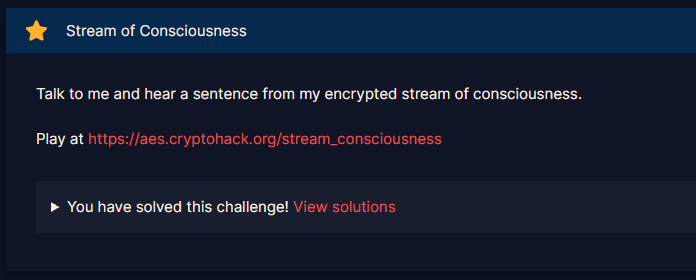
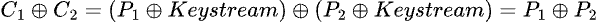
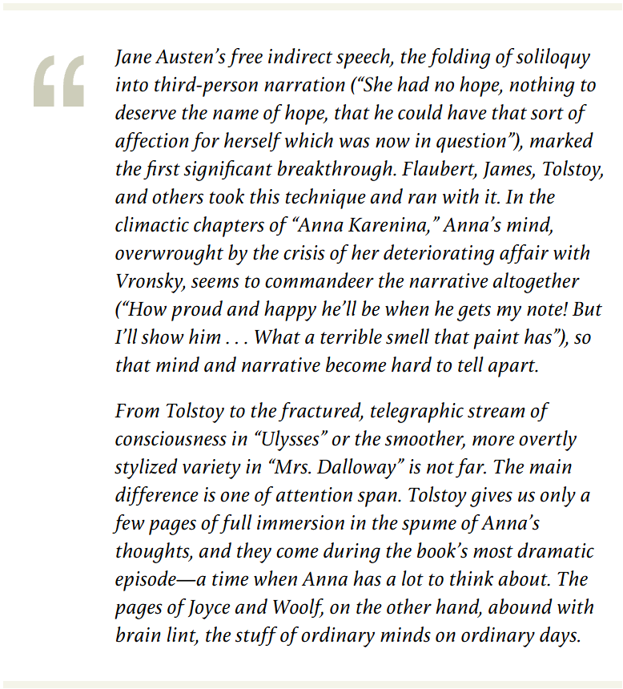
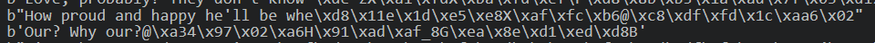

# Stream of Consciousness

#### Challenges: `Symmetric Ciphers` - Cryptohack - Ngày viết: 23/10/2026

#### 1. Overview

* 
* Đây là 1 bài điển hình và cũng như là lỗi phổ biến khi mã hóa dữ liệu của các loại mã hóa dòng - stream cipher khi tái sử dụng lại các giá trị như `key, iv, nonce ,...`
* `Mục tiêu`: Khôi phục lại plaintext
* `Lỗ hỗng`: Tái sử dụng `key` và `nonce`,lỗ hỗng `Many-Time Pad`
* `Kỹ thuật`: Dfs backtracking và duyệt từng kết quả

#### 2. Nền tảng cốt lõi

* Các bạn cần hiểu kỹ thuật backtracking trong đồ thị. [Đọc](https://wiki.vnoi.info/vi/algo/basic/backtracking)
* Các bạn cần hiểu hiểu cách hoạt động của dfs. [Đọc](https://wiki.vnoi.info/algo/graph-theory/Depth-First-Search-Tree.md)
* AES CTR: [Đọc](<https://en.wikipedia.org/wiki/Block_cipher_mode_of_operation#:~:text=%5B29%5D-,Counter%20(CTR),edit,-CTR>)

#### 3. Phân tích lỗ hỗng

* Mã nguồn server:
* ```Python
  from Crypto.Cipher import AES
  from Crypto.Util import Counter
  import random


  KEY = ?
  TEXT = ['???', '???', ..., FLAG]


  @chal.route('/stream_consciousness/encrypt/')
  def encrypt():
      random_line = random.choice(TEXT)

      cipher = AES.new(KEY, AES.MODE_CTR, counter=Counter.new(128))
      encrypted = cipher.encrypt(random_line.encode())

      return {"ciphertext": encrypted.hex()}
  ```
* Khi gửi request lên server, server sẽ trả cho ta ngẫu nhiên 1 plaintext bị mã hóa AES CTR. Với key và nonce được sử dụng giống nhau cho mỗi plaintext

#### 4. Ý tưởng khai thác

* Bởi vì AES CTR đã tái sử dụng key và nonce cho mỗi plaintext, nên dòng keystream được sinh ra sẽ giống nhau. Nên chỉ với 2 ciphertext được mã hóa AES CTR chung key và nonce, ta dễ dàng đưa nó lại về dạng 2 plaintext xor với nhau.
* 
* Ở bước đầu tiên, mình cần phải tìm được ciphertext của flag
* Ý tưởng là mình sẽ lấy ngẫu nhiên 2 ciphertext trong tất cả ciphertext server gửi về, bằng cách thực hiện phép xor ở trên, kết quả trả về vẫn chưa hoàn chỉnh để biết nội dung flag. Để xác định được flag, mình tiếp tục xor kết quả phép xor ở trên với format cờ là `crypto{`, nếu kết quả 7 ký tự đầu trả về có thể đọc được, thì 1 trong 2 ciphertext chính là ciphertext của flag. Mình đã thử mọi cặp và thấy được có các plaintext đã đọc được 7 ký tự đầu như là `Perhaps`và `Would I`. Bằng cách xét phép xor trên và xor với format cờ, việc xác định ciphertext flag chỉ là lấy ciphertext xuất hiện ở cả 2 trường hợp trên.
* Thêm 1 điều nữa, với kết quả của 2 phép xor liên tiếp ở trên, ta đã biết chính xác là các plaintext ngoài cờ là các câu tiếng anh.
* Ta gọi hàm `dfs()` để tìm mọi cờ khả thi kết thúc bằng ký tự `}`. Điều kiện xuất hiện các nhánh tiếp theo của ký tự cờ là khi thực hiện phép 2 phép xor ở trên, kết quả trả về phải nằm trong bảng chữ cái tiếng anh và các dấu câu cơ bản của câu từ trong tiếng anh.

#### 5. Exploit chain

* Quy trình:
  * Ta xác định ciphertext của flag và tìm kiếm các ciphertext còn lại ngoài ciphertext của cờ
  * Script tìm ciphertext của cờ: [Đọc](findflag.py)
  * Sau đó, ta bắt đầu tìm mọi cờ kết thúc bằng `}` , điều kiện để được chọn làm ký tự `(hay là nhánh dfs)` trong cờ là khi xor ciphertext flag với ciphertext bất kỳ, nếu như xor tiếp tục với plaintext cờ giả định mà trả ra kết quả là 1 chữ cái tiếng anh thì được chọn
  * Bởi vì có nhiều cờ khác nhau, ta bắt đầu duyệt bằng tay để khi thực hiện 2 phép xor, kết quả trả về là 1 câu tiếng anh đầy đủ nghĩa.
* Script: [Đọc](solve.py)
* Có 288 flag khác nhau đạt yêu cầu , mình sẽ duyệt tay để tìm ra flag đúng nhất.
* Kết quả:
* ```
  Flag: b'crypto{k3y57r34m_r3u53_15_f474l}'
  b'Dolly will think that I\'m leavin\xd1\x11lX\xb6\xea^\xb4\xe1\xf2\r\xd9\x8a\xe0\x11\xbf=G\x99t\x9e?\\*^"\xac*\xceZ;\xbc\xf42\xd4eeK\xc1L\xd7!\x14g}O\x1c\xed_L@a\xab\xb3\xdb\xba\x10B\x01\x1dm\xab\xe4{)H\xdb?'
  b'These horses, this carriage - ho\xc1\x11DX\xa9\xe0\\\xaf\xe7\xf3\r\xdc\x86\xe0\x16\xb25\x03\xd0{\xd0/\x147Ec\xbbk\xc8@7\xaf\xf61\x9b: \x1f\xe0\t\xc3s\x15v}]\x05\xf3\x1aHP2\xf2\xf6\x99\xa6\nB<U{\xe3\xf2e*\x06\xd2t\xff\xe5\xe6\xd9\xf4T\x9a\x86\xbf\xf3C\xd3"N\x9b(\x1e\xc2\r'
  b'And I shall ignore it.\xa1\xe7q!Z^\xe4\x85Bm'
  b'Three boys running, playing at h\xd9C~\x1d\xb6\xa3\x1d\x88\xea\xe4T\xde\x85\xfb\x12\xff'
  b'Perhaps he has missed the train \xd7_iX\xac\xfc\x1d\xb9\xee\xf5F\x91\x9d\xeaS\xb0<T\x975\xa7:\x12*\x16.\xb7x\xdf\x126\xbb\xfc=\xd7~a\x1f\xe1\x03\xd4u'
  b'I shall lose everything and not \xd1TyX\xad\xe6P\xfb\xed\xf7N\xda\xd1'
  b"The terrible thing is that the p\xd7ByX\xa6\xeeS\xfc\xfb\xb6O\xd4\xdf\xe7\x1c\xac=\x03\xd6`\x84{\x1e'\x16*\xacy\x9a@1\xa1\xe5'\x95"
  b'As if I had any wish to be in th\xd3\x11\x7f\x11\xa2\xe7I\xfa\xaf\xdf\r\xd2\x9e\xfdT\xaar'
  b'But I will show him.|$\xcd\xf1\xb3\xfc\xbf\xf5\xfbw|T'
  b"It can't be torn out, but it can\x96ShX\xac\xe8S\xb4\xfd\xf3I\x9f"
  b'What a lot of things that then s\xd3T`\x1d\xa1\xafI\xb4\xaf\xfbH\x91\x8c\xfcS\xb32Q\xcfp\x9c7\x13+Ec\xb9d\xde\x12+\xa0\xf0 \xcfvi\x05\xe9\x0e\xd61K35]\x1f\xfa\x1aB\\"\xa6\xbb\x9e\xf3\x17\x0c\x06\x1co\xe5\xfao/E\xdd\x7f\xfd\xac\xb4\x98\xe9U\xdf\xd2\xa3\xfe\x06\xcajF\x92.\x04\x8cj\xfc/R\xe8\xd1\x06\xda\x91\xaf)<\t\x0c\xd9\x8f\x9b\xe9;\x9b\xe69~\x90v\x1c\xbc\xaa~PJb^\xc1n\x1c\xd7oW\xc44'
  b"Why do they go on painting and b\xc3Xa\x1c\xac\xe1Z\xfb\xee\xfaA\x91\x8b\xfb\x16\xfe'J\xd4p\xcf"
  b'Would I have believed then that \xff\x11n\x17\xb0\xe3Y\xfb\xfd\xf3L\xd2\x97\xb3\x00\xab0K\x99q\x95+\x086Ec\xb7l\x9aZ+\xa3\xf88\xd2vt\x02\xe7\x02\x85'
  b"No, I'll go in to Dolly and tell\x96Yh\n\xe5\xfcI\xa9\xee\xffJ\xd9\x8b\xb3\x1c\xab'"
  b'What a nasty smell this paint ha\xd2\x1f'
  b"I shall, I'll lose everything if\x96YhX\xa1\xe0X\xa8\xe1\xb1Y\x91\x9c\xfc\x1e\xbbsA\xd8v\x9bu"
  b'Dress-making and Millinery\xe1\x89\xc6\xa1\x8b8'
  b"Love, probably? They don't know \xde^zX\xa1\xfdX\xba\xfd\xef\r\xd8\x8b\xb3\x1a\xad\x7f\x03\xd1z\x87{\x14+[*\xb4c\xdbF7\xa0\xf6z\x959 \x1f\xe0\t\x9a\x15\x11v3I\x0c\xbf[N]a\xaa\xbe\x92\xbf\x1a\x10\x10\x1b&"
  b"How proud and happy he'll be whe\xd8\x11e\x1d\xe5\xe8X\xaf\xfc\xb6@\xc8\xdf\xfd\x1c\xaa6\x02"
  b'Our? Why our?@\xa34\x97\x02\xa6H\x91\xad\xaf_8G\xea\x8e\xd1\xed\xd8B'
  b"I'm unhappy, I deserve it, the f\xd7Da\x0c\xe2\xfc\x1d\xb6\xe6\xf8H\x9d\xdf\xf1\x06\xaasj\x9ex\xd0.\x126W3\xa8s\x9aS2\xa2\xb1 \xd3r \x18\xe9\x01\xdfxG{8P\x19\xbfWE\x17"
  ```

* ```
  crypto{k3y57r34m_r3u53_15_f474l}
  ```

#### 6. Ngoài lề.

* Tên đề bài là Stream of consciousness, các bạn đọc định nghĩa tại đây. [Đọc](https://en.wikipedia.org/wiki/Stream_of_consciousness)
* Các câu từ tiếng anh được sử dụng trong bài này được trích từ tiểu thuyết ***Anna Karenina** (1877) của văn hào Nga  **Leo Tolstoy** . [Đọc](https://firstthings.com/stream-of-consciousness-plot-and-the-mind-of-god/)*
* 
* Nội dung trong ngoặc là `How proud and happy he'll be when he gets my note!`chính là câu đầy đủ của ciphhertext này! =)))
* 
* Ta đã biết plaintext là `How proud and happy he'll be when he gets my note!`và ciphertext của nó, ta dễ dàng khôi phục lại dòng keystream được sinh ra trong hàm mã hóa. Dùng chính keystream ta vừa tìm được để giải mã ciphertext flag
* Script giải: [Đọc](solve1.py)
* Kết quả:
* ```
  b'crypto{k3y57r34m_r3u53_15_f474l}\xd5Ct\x08\xb1\xe0F\xb0\xbc\xef\x18\x86\x8d\xa0G\xb3\x0cQ'
  ```
