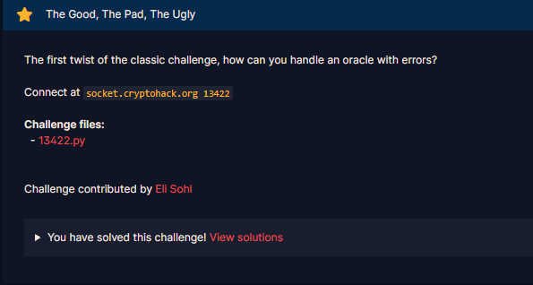
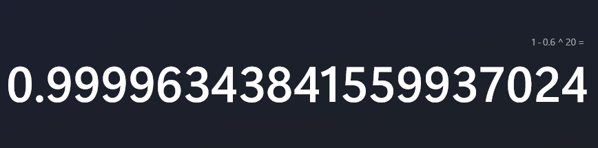
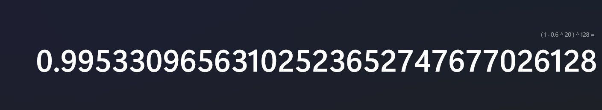
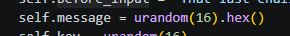
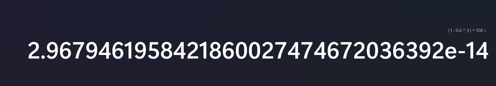
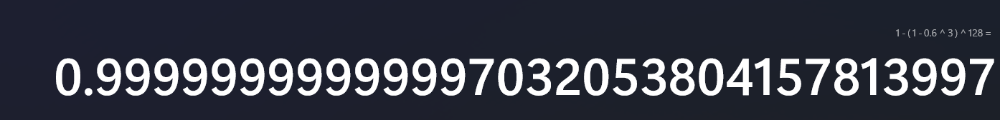
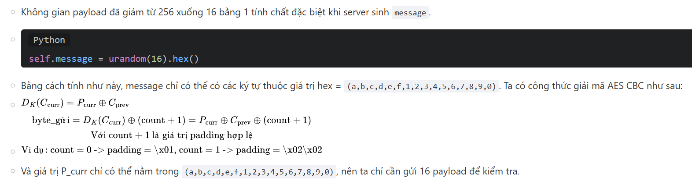
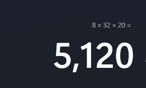

# The Good, The Pad, The Ugly

#### Challenges: `Symmetric Ciphers`- Cryptohack - Ngày viết: 25/10/2026

#### 1. Overview

* 
* Bài này về cơ bản được thừa hưởng toàn bộ hướng giải từ bài `Pad Thai`, tuy nhiên, có 1 sự thay đổi nhỏ khiến cho bài này trở nên khó hơn nhiều để giải quyết nó :v
* `Mục tiêu`: Tấn công Padding Oracle để đọc được message
* `Lỗ hỗng`: Để lộ AES CBC Padding Orcale
* `Kỹ thuật`: Side channel attack - Padding Oracle Attack - Xác suất thống kê.

#### 2. Nền tảng cốt lõi

* Bài này bởi vì đặc biệt hướng giải giống hoàn toàn với bài `Pad Thai`, các bạn giải qua bài này trước khi giải bài này nhé. Ngoài ra, để giải quyết được bài này, các bạn đọc phần `Ngoài lề` trong write-up mình viết giải bài `Pad Thai`để có ý tưởng giải nhé. [Đọc](../Pad_Thai/write-up.md)

#### 3. Phân tích lỗ hỗng

* Mã nguồn server: [Đọc](13422.py)
* Mình giả sử rằng là các bạn đã giải qua bài `Pad Thai` rồi, nên mình sẽ không phân tích sâu vào cách thực hiện Padding Oracle attack ở bài này.
* Điểm khác biệt cốt lõi so với bài `Pad Thai`là bài này đã làm nhiễu kết quả đầu ra:
* ```Python
  {"result": good | (rng.random() > 0.4)}
  ```
* Và server cũng giới hạn số lượng `quote`lại còn 12000 lượt, không còn vô hạn lần như bài `Pad Thai`nữa.

#### 4. Ý tưởng khai thác.

* Về vấn đề làm nhiễu đầu ra. Trong trường hợp `result`trả về giá trị `True`thì dù kết quả của `(rng.random() > 0.4)`đúng hay sai gì thì kết quả trả ra luôn `True`
* Trong trường hợp `result`trả về giá trị `False`, thì sẽ có 60%, kết quả trả ra sẽ bị làm giả là kết quả `True`, và 40% là trả về kết quả thật là `False`.
* `True | True,False` -> 100% `True`
* `False | True, False` -> 40% `False`
* Vì vậy, vấn đề ta cần giải quyết là làm sao để xác định bytes kiểm tra là `True`hay `False`?
* Để giải quyết, trên 1 bytes kiểm tra, ta sẽ gửi lặp lại ciphertext và iv nhiều lần để kiểm tra. Vì vậy nếu gửi lặp lại `k`lần, xác suất của từng trường hợp như sau:
* 
* Với `k = 20`, xác suất để có ít nhất 1 lần False khi gửi 20 payload đối với Padding có kết quả False là lên đến `0.9999` :))))
* Số lượng payload trung bình cho 1 bytes plaintext là 128 payload
* Vậy xác suất để ta khôi phục lại bytes plaintext mà cả 128 payload đều không bị làm giả kết quả (Có nghĩa là Padding False nhưng trả về True) là:
* 
* `0.995`
* Nhưng ta gặp 1 trở ngại rất lớn là số lượng query có thể sử dụng chỉ có 12000 lượt.
* Cùng làm thử phép tính nhé `=))))`
  * 
  * message khai báo lấy 16 bytes ngẫu nhiên, sau đó chuyển về kí tự hex nên độ dài lên 32 bytes, vì vậy, số bytes plaintext ta cần tìm lại là 32 bytes
  * Với mỗi bytes plaintext, ta thực hiện 256 payload khác nhau để tấn công Padding Oracle để khôi phục plaintext, cho trung bình ta thực hiện 128 payload để thu thập được 1 bytes plaintext
  * Khi đó tổng số lượng query ta cần sử dụng là `(32 * 128 * k)`, với số lượng query là 12000, số lần thử `k`tối đa mà ta có thể làm chỉ là `3`, với `k`bằng `3`, xác suất ta khôi phục được bytes plaintext sẽ là:
  * 
  * Khó nhìn quá, đối sang xác suất để kết quả bytes plaintext trả về là sai là:
  * 
  * Vậy với `k = 3`, gần như 100% kết quả bytes plaintext trả về là rác =))))
* Để giải quyết vấn đề thiếu hụt quote trầm trọng, nếu các bạn đã giải bài `Pad Thai`theo mục ngoài lề của mình, chắc các bạn cũng đã biết câu trả lời =)))). Nhưng mình sẽ giải thích lại ở bài này.
* Vấn đề thiếu hụt query chủ yếu đến từ lượng payload kiểm tra 1 bytes plaintext là quá nhiều. Nhưng có 1 điều ta đã bỏ qua đó chính là format của plaintext =))))
* 
* Message chỉ chứa các kí tự từ (a-f0-9) !!!
* Nó làm giảm không gian tìm kiếm và payload từ 256 xuống chỉ có 16 lần cho 16 kí tự hex.
* 
* Với số lượt payload trung bình giảm từ 128 xuống còn 8 payload mỗi bytes, với `k = 20`, lượng query cần sử dụng là:
* 
* Ta dư tận 7 ngàn lượt query để giải được bài này =))))))
* Tóm tắt lại ý tưởng giải như sau:
  * Với mỗi payload, ta sẽ gửi 20 lần để kiểm tra.
  * Nếu trong list các kết quả trả về có giá trị` False`. Padding Oracle trả về chắc chắn là `False` (Xác suất đúng là `1`)
  * Nếu tất cả các phần tử trong kết quả trả về đều là `True`. Khi đó Padding Oracle trả về là giá trị `True`(Có xác suất đúng là `0.9999`)
  * Và ta giải bài này như cách bình thường sau đó :v

#### 5. Exploit chain

* Quy trình:

  * Ta nhận ciphertext của server.
  * Ta thực hiện quy trình tấn csông vào kiểm tra Padding `k lần` để khôi phục lại các bytes message chỉ với 16 payload đã được tối ưu hóa
  * Bởi vì message sau phục hồi chỉ mới được giải mã ECB, ta cần bước 1 bước xor để khôi phục message hoàn toàn.
  * Gửi message lên server
  * Nhận cờ
* ```
  {"flag": "crypto{even_a_faulty_oracle_leaks_all_information}"}
  Thoi gian chay: 204.92001295089722
  ```
* ```
  crypto{even_a_faulty_oracle_leaks_all_information}
  ```
* Mặc dù đã cố gắng tối ưu nhưng thời gian giải vẫn khá dài là `>3p`

#### 6. Reference

* Tham khảo thuật toán, cách tối ưu từ bài Pad Thai của mình: [Đọc](../Pad_Thai/write-up.md)
