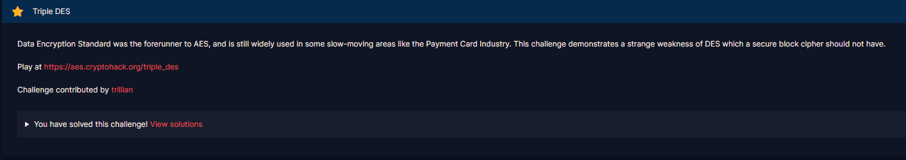

# Triple DES

#### Challenges: `Symmetric Ciphers` - Cryptohack - Ngày viết: 21/10/2026

#### 1. Overview

* 
* Ở thử thách này, chúng ta sẽ đi tìm mổ sẻ và tìm hiểu lỗi của thuật toán mã hóa tiền thân AES là DES/3DES.
* `Mục tiêu`: Khôi phục ciphertext được mã hóa 3DES
* `Lỗ hỗng`: Flag được mã hóa do key gửi lên
* `Kỹ thuật`: Sử dụng weak key cho mã hóa 3DES

#### 2. Nền tảng cốt lõi

* Các bạn cần hiểu được 3DES hoạt động như thế nào.
* Triple DES: [Đọc](https://en.wikipedia.org/wiki/Triple_DES)
* Weak key in DES: [Đọc](https://en.wikipedia.org/wiki/Weak_key#Weak_keys_in_DES)
* Điểm cần nhớ trong phần nền tảng là Triple DES có 2 chế độ đầu vào key là 16 bytes (2 key) và 24 bytes (3 key)

#### 3. Phân tích lỗ hỗng

* Mã nguồn của server
* ```Python
  from Crypto.Cipher import DES3
  from Crypto.Util.Padding import pad
  import os


  IV = os.urandom(8)
  FLAG = ?


  def xor(a, b):
      # xor 2 bytestrings, repeating the 2nd one if necessary
      return bytes(x ^ y for x,y in zip(a, b * (1 + len(a) // len(b))))


  @chal.route('/triple_des/encrypt/<key>/<plaintext>/')
  def encrypt(key, plaintext):
      try:
          key = bytes.fromhex(key)
          plaintext = bytes.fromhex(plaintext)
          plaintext = xor(plaintext, IV)

          cipher = DES3.new(key, DES3.MODE_ECB)
          ciphertext = cipher.encrypt(plaintext)
          ciphertext = xor(ciphertext, IV)

          return {"ciphertext": ciphertext.hex()}

      except ValueError as e:
          return {"error": str(e)}


  @chal.route('/triple_des/encrypt_flag/<key>/')
  def encrypt_flag(key):
      return encrypt(key, pad(FLAG.encode(), 8).hex())
  ```
* Server tương tự như 1 oracle cho phép ta tương tác get gửi plaintext và key để nhận lại ciphertext, ngoài ra, ta có thể gửi key lên để encrypt flag và trả về ciphertext của flag
* Nếu như chỉ là mã hóa 3DES bằng key ta gửi lên thì chỉ cần code giải mã là xong, nhưng server trước khi mã hóa và sau khi mã hóa đã xor dữ liệu với 1 vector ngẫu nhiên dài 8 bytes (64 bits) làm cho ta không thể giải mã được flag

#### 4. Ý tưởng khai thác.

* Lúc đầu mình có nghĩ đến việc bruteforce, nhưng để brute force được iv có khoảng 2^64 iv khác nhau, tương đương không gian giá trị của iv lên đến 18,446,744,073,709,551,616 giá trị khác nhau, việc brute force là bất khả thi với máy của mình =))))
* Sau 1 lúc research thì mình tìm thấy được 1 lỗ hỗng nghiêm trọng của DES và 3DES cũng mắc phải đó là weak key
* Có 4 weak key khác nhau và chúng có đặc tính là `E_k = D_k`, có nghĩa là quá trình mã hóa hoạt động giống như quá trình giải mã, khi đó, nếu ta encrypt dữ liệu bằng weak key, ta chỉ cần encrypt 1 lần nữa là ciphertext sẽ quay trở lại plaintext gốc
* Bởi vì thư viện pycryptodome build 3DES chống các khóa giống như nên ta cần phải sử dụng 2 weak key DES khác nhau để tạo payload

#### 5. Exploit chain

* Quy trình:

  * Tạo weak key 3DES bằng cách ghép 2 weak key DES
  * Gửi key lên server để mã hóa flag
  * Gửi ciphertext của flag và key lên server để tiếp tục mã hóa, bởi vì key cấu thành từ các weak key, quá trình mã hóa này tương tự như quá trình giải mã, nên ciphertext trả về sẽ là plaintext của flag
* Script: [Đọc](solve.py)
* ```
  crypto{n0t_4ll_k3ys_4r3_g00d_k3ys}
  ```
* Khi đó luồng hoạt động của server sẽ như sau:

  * Khi gửi key lên server, ciphertext của flag sẽ có dạng:
  * 
  * Khi ta gửi C và key lên server để tiếp tục mã hóa, qua trình sẽ là như sau:
  * 
  * Bởi vì k1,k2 là những weak key, nên E = D, nên các lớp mã hóa sẽ tự động triệt tiêu nhau.
  * 

#### 6. Reference

* Weak key in DES: [Đọc](https://en.wikipedia.org/wiki/Weak_key#Weak_keys_in_DES)
