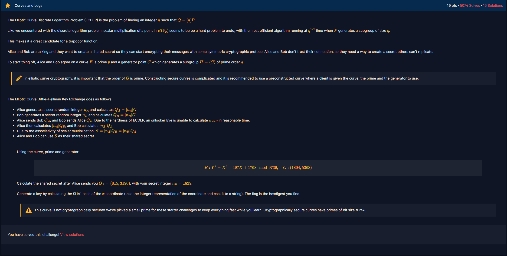

# Curves and Logs

#### Course: `Elliptic Curves` - Cryptohack - Ngày viết: 11/12/2026

#### 1. Overview

* 
* `Mục tiêu`: Tính mã băm của $x_S$

#### 2. Exploit  chain

* Về cơ bản, ta chỉ cần tính $S$, sau đó trích xuất $x$ và tính mã băm $sha1$ là được.
* Script: [Đọc](solve.py)
* ```
  crypto{80e5212754a824d3a4aed185ace4f9cac0f908bf}
  ```
