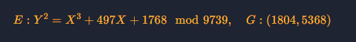

# Efficient Exchange

#### Course: `Elliptic Curves` - Cryptohack - Ngày viết: 11/12/2026

#### 1. Overview

* 
* `Mục tiêu`: Giải mã ciphertext

#### 2. Exploit chain

* Mục đích của bài này là cho ta thấy rằng, thực tế, khóa công khai $Q_A$ chỉ cần gửi chỉ số $x$ đi là đủ để ta tìm được khóa chung $S$
* Quy trình:
  * Thay $x(Q_A) = 4726$ vào  để tìm được $y^2 = value$
  * Ta tìm ra $y$ có 2 giá trị là $y = \pm \sqrt(value)$, nhưng tọa độ $x$ vẫn không hề thay đổi với bất kỳ giá trị $y$ nào.
  * Ta lấy $y$ bất kỳ, tạo thành điểm $Q_A = (x, y)$, sau đó ta tính khóa chung $S$
  * Giải mã ciphertext bằng decrypt_flag trong file `decrypt.py`
* Script: [Đọc](solve.py)
* ```
  crypto{3ff1c1ent_k3y_3xch4ng3}
  ```
