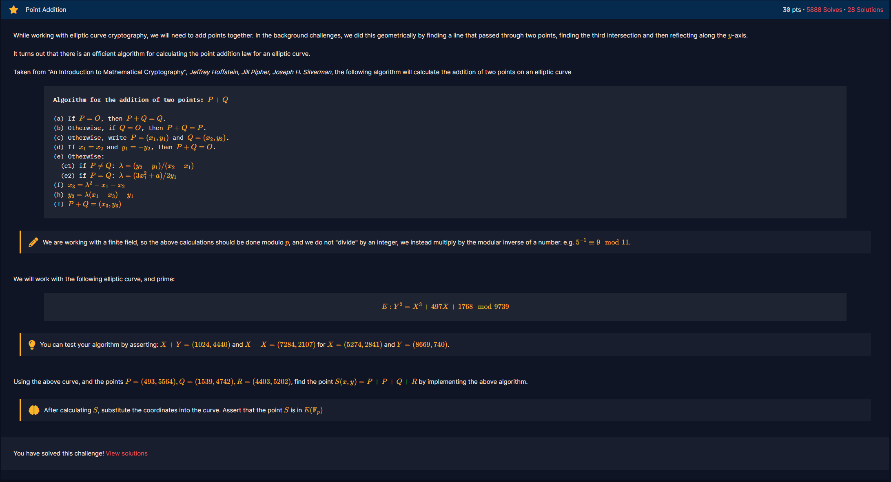

# Point Addition

#### Course: `Elliptic Curves` - Cryptohack - Ngày viết: 11/12/2026

#### 1. Overview

* 
* `Mục tiêu`: Viết thuật toán khởi tạo đường cong Elliptic và tìm $S(x,y) = P + P + Q + R$

#### 2. Exploit chain

* Có 2 cách để giải bài này.
* Cách 1 là ta trực tiếp sử dụng đối tượng `EllipticCurve`của sagemath để khởi tạo đường cong Elliptic.
* Cách 2 là ta sẽ tự code class Elliptic và class Point. Trong class Point, ta viết hàm `__add__`để thực hiện phép cộng đối với 2 điểm giống như thuật toán.
* Script: [Đọc](solve.py)
* ```
  crypto{4215,2162}
  ```
