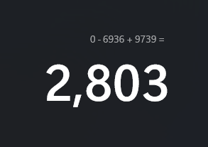

# Point Negation

#### Course: `Elliptic Curves` - Cryptohack - Ngày viết: 11/12/2026

#### 1. Overview

* 
* `Mục tiêu`: Tìm $Q$ sao cho $P + Q = O$

#### 2. Exploit chain

* Ở bài trước đó có nhắc đến tính chất các điểm nằm trên đường cong Elliptic, để mà $P + Q = O$ thì $Q = (x_P, -y_P)$, ta dễ dàng tính được $Q(8045, -6936)$, Bởi vì đường cong nằm trên trường hữu hạn $F_{9739}$ nên:
* 
* ```
  crypto{8045,2803}
  ```
