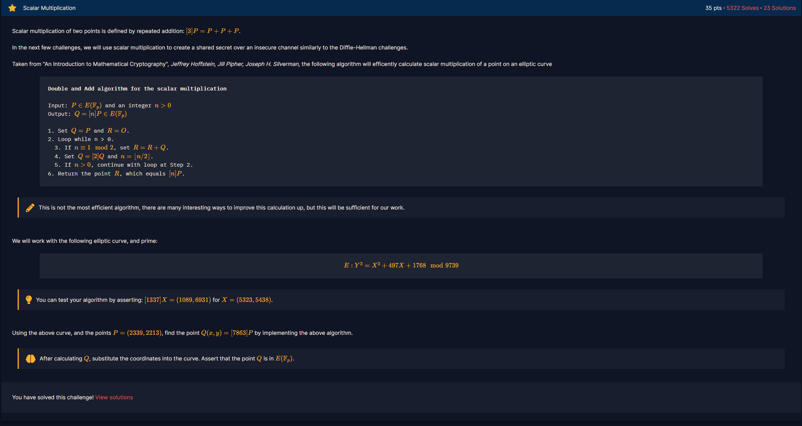

# Scalar Multiplication

#### Course: `Elliptic Curves`- Cryptohack - Ngày viết: 11/12/2026

#### 1. Overview

* 
* `Mục tiêu`: Tìm tích vô hướng **Q**(**x**,**y**)**=**[**7863**]**P**

#### 2. Exploit chain

* Tương tự với bài trước đó, ta có 2 cách giải cho bài này.
* Cách 1: Sử dụng sagemath có sẵn
* Cách 2: Viết thêm hàm `__mul__`và viết thuật toán như trong ảnh, tương tự với`__rmul__`
* Script: [Đọc](solve.py)
* ```
  crypto{9467,2742}
  ```
