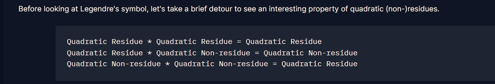

# Adrien's Signs

#### Course: `Modular Arithmetic`

#### 1. Overview

* Đây là bài tập ứng dụng các kiến thức trước đó trong course để giải quyết =))))
* `Mục tiêu`: Giải mã ciphertext bằng list các số đã bị mũ `e` 1 cách ngẫu nhiên
* `Lỗ hỗng`: Tính chất các số `a,p` trong encrypt

#### 2. Nền tảng cốt lõi

* Các bạn cần hoàn thành các phần trước đó của course trước khi làm bài này nhé

#### 3. Phân tích lỗ hỗng

* Trong source code có cung cấp cho ta 2 số tạo nên quá trình mã hóa là `a và p`
* Tiếp theo trong file output có chứa list các số được tạo ra bằng cách lấy `n` hoặc `-n` tùy vào trạng thái bit của flag và `n` được tính bằng cách lấy `a^e mod p` với `e` là 1 số bất kỳ
* Khi phân tích 2 số `a,p`, mình phát hiện ra rằng `a là số có thặng du bậc 2 module p` và `p là một số chia cho 4 dư 3`

#### 4. Ý tưởng khai thác

* Đối với 1 số có thặng dư bậc 2, dù có mũ e lên bao nhiêu lần cũng là số thặng dư bậc 2. Ở trong các bài trước chúng ta đã được nhắc tới điều này!
* 
* Theo như ở trên đã phân tích, ta biết rằng kí hiệu legendre của `a` = 1, nên ta có:
* $$
  (a/p) = 1\to (n/p) = (a/p)^{e} = (a/p)*(a/p)*... = 1*1*... = 1
  $$
* Nên để nhận biết được bit 1, thì số trong list phải là số có thặng dư bậc 2
* Đối với bit 0 thì trong dãy sẽ được đưa vào số đối `n` hay là `-n` thì ta có:
* $$
  (n/p) = 1 \to (-n/p) = (n/p)*(-1/p)= 1 * (-1)^{\frac{(p-1)}{2}}
  $$
* Như ta đã được biết thì `p là một số nguyên tố chia 4 dư 3`, nên:
* $$
  p = 3 \text{ (mod 4)} \to p = 3 + 4k\to (-n/p) = 1 * (-1)^{\frac{3+4k-1}{2}} = 1*(-1)^{2k + 1} = 1*(-1)^{2k} * (-1) = 1*1*-1 = -1
  $$

* Vậy thì số `-n` LUÔN LUÔN không phải là số có thặng dư bậc 2
* Cách để chúng ta phân biệt bit `0` và `1` rất đơn giản, nếu số đó có thặng dư bậc 2 là bit 1, nếu các trường hợp khác là bit 0

#### 5. Exploit chain

* Quét qua list, kiểm tra các số có thặng dư bậc 2 hay không bằng kí hiệu legendre, nếu có ta có bit `1`, nếu không là bit `0`
* Script: [Đọc](solve.py)
* #### Flag: crypto{p4tterns_1n_re5idu3s}
