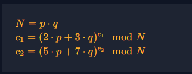

# Modular Binomials

#### Course: `Modular Arithmetic`

#### 1. Overview

* Đây là 1 trong những bài mà mình nghĩ đã rất nhiều bạn bị đánh lừa thị giác khi đổi từ đại số sang trường số module :v
* `Mục tiêu`: Giải mã `p,q` của `N`
* `Kỹ thuật`: Modulo Reduction

#### 2. Nền tảng lý thuyết

* Hoàn thành các bài trước đó của Course

#### 3. Phân tích/Ý tưởng khai thác/ Exploit chain

* 
* Lúc đầu mình đã nghĩ mình chỉ cần khôi phục `2p + 3q` và `5p + 7q` , sau đó giải hệ là ra, hoặc đưa vào nghiệm bậc 2 p,q rồi giải nghiệm là ra. Nhưng không, hướng đi này hoàn toàn bất khả thi
* Tới bước 2 mình nghĩ đến khóa d để khôi phục lại bản gốc, nhưng muốn tính được khóa d, ta lại cần `p,q` để tính `Totient` =))). RẤT MÂU THUẪN
* Sau 1 đoạn tìm hiểu cũng như hỏi hint thì mình đã nhìn ra hướng đi như sau:

  * Ta có thể chiếu phép chia đồng dư từ vành Z_N xuống 2 trường con của `N` là `F_p` và `F_q`
  * Khi đó ta có:

$$
\begin{aligned}
&c_1 = (2p + 3q)^{e_1} \bmod N \\
&\to (2p + 3q)^{e_1} - c_1 = 0 \bmod N \\
&\to (2p + 3q)^{e_1} - c_1 = k * p * q \bmod N \\
&\to (2p + 3q)^{e_1} - c_1 = 0 \bmod q \\
&\to c_1 = (2p)^{e_1} \bmod q
\end{aligned}
$$

  * Tương tự tới `c2`, ta có:

$$
\begin{aligned}
&c_2 = (5p + 7q)^{e_2} \bmod N \\
&\to c_2 = (5p)^{e_2} \bmod q
\end{aligned}
$$

  * Ta mũ `e1` `c2` và mũ `e2` `c1`, ta được:

$$
\begin{aligned}
&c_1 = (2p)^{e_1} \bmod q \\
&\to c_1^{e_2} = (2p)^{e_1e_2} \bmod q \\
&\to p^{e_1e_2} = c_1^{e_2} * (2^{e_1e_2})^{-1} \bmod q \\[4pt]
&c_2 = (5p)^{e_2} \bmod q \\
&\to c_2^{e_1} = (5p)^{e_1e_2} \bmod q \\
&\to p^{e_1e_2} = c_2^{e_1} * (5^{e_1e_2})^{-1} \bmod q
\end{aligned}
$$

  * Ta khử `p^e1e2` để cô lập `q`:

$$
\begin{aligned}
&c_1^{e_2} * (2^{e_1e_2})^{-1} = c_2^{e_1} * (5^{e_1e_2})^{-1} \bmod q \\
&\to c_1^{e_2} * 5^{e_1e_2} = c_2^{e_1} * 2^{e_1e_2} \bmod q \\
&\to c_1^{e_2} * 5^{e_1e_2} - c_2^{e_1} * 2^{e_1e_2} = 0\bmod q \\
&\to c_1^{e_2} * 5^{e_1e_2} - c_2^{e_1} * 2^{e_1e_2} = k * q
\end{aligned}
$$

  * Và cuối cùng ta chỉ cần tìm ước chung lớn nhất giữa N và kết quả biểu thức trên là được
  * Script: [Đọc](solve.sage)
  * Flag
  * ```
    crypto{112274000169258486390262064441991200608556376127408952701514962644340921899196091557519382763356534106376906489445103255177593594898966250176773605432765983897105047795619470659157057093771407309168345670541418772427807148039207489900810013783673957984006269120652134007689272484517805398390277308001719431273,132760587806365301971479157072031448380135765794466787456948786731168095877956875295282661565488242190731593282663694728914945967253173047324353981530949360031535707374701705328450856944598803228299967009004598984671293494375599408764139743217465012770376728876547958852025425539298410751132782632817947101601}
    ```
