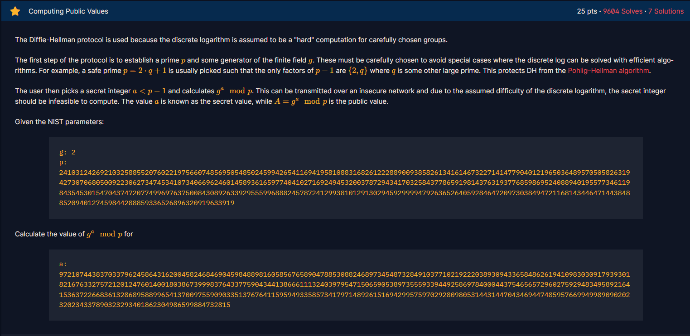

# Computing Public Values

#### Course:`Public-Key Cryptography`- Cryptohack - Ngày viết: 21/10/2026

#### 1. Overview

* 
* Ở bài này, chúng ta sẽ bắt đầu bước vào cách mà giao thức Diffie-Hellman hoạt động, ở bài này chúng ta sẽ thực hiện quá trình mã hóa dữ liệu `g`và cách sinh số nguyên tố `p` và cách tạo khóa bí mật `a`.

#### 2. Exploit chain

* Ta tính `g^a mod p`
* Script: [Đọc](solve.py)
* ```
  1806857697840726523322586721820911358489420128129248078673933653533930681676181753849411715714173604352323556558783759252661061186320274214883104886050164368129191719707402291577330485499513522368289395359523901406138025022522412429238971591272160519144672389532393673832265070057319485399793101182682177465364396277424717543434017666343807276970864475830391776403957550678362368319776566025118492062196941451265638054400177248572271342548616103967411990437357924
  ```
