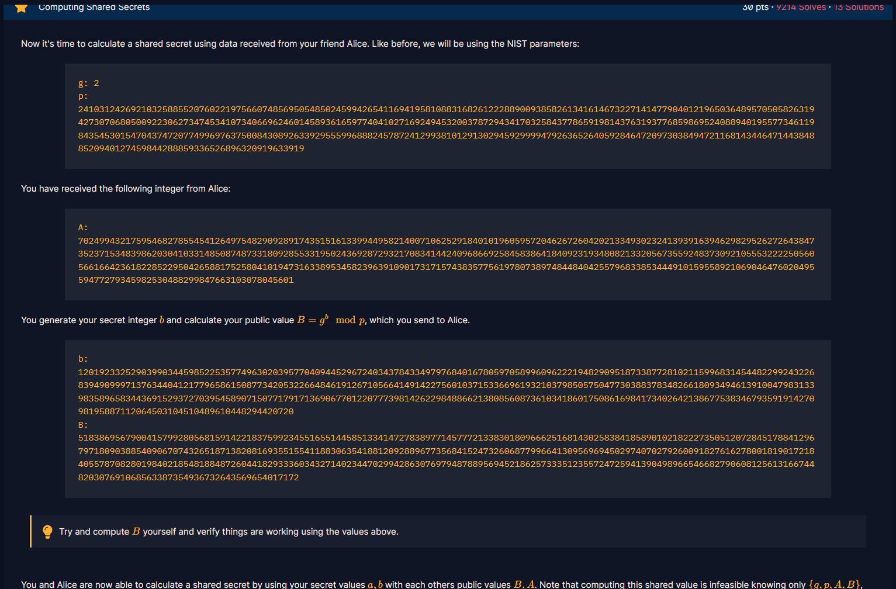

# Computing Shared Secrets

#### Course: `Public-Key Cryptography` - Cryptohack - Ngày viết: 21/10/2026

#### 1. Overview

* 
* Đây là bài chúng ta sẽ đi tìm khóa chung của giao thức Diffie Hellman
* `Mục tiêu`: Tính khóa chung

#### 2. Nền tảng cốt lõi

* Các bạn cần phải biết cách giao thức Diffile Hellman hoạt động và cách chia sẻ chung key mà không bị bên thứ 3 phát hiện.
* Tham khảo Diffile Hellman: [Đọc](https://github.com/Nhan-Laptop/WCO4/blob/main/5_Diffie_Hellman/README.md)

#### 3. Exploit chain

* Ta đã nhận `A` từ Alice, khóa chung được tính bằng cách `A^b mod p`
* Script: [Đọc](solve.py)
* ```
  1174130740413820656533832746034841985877302086316388380165984436672307692443711310285014138545204369495478725102882673427892104539120952393788961051992901649694063179853598311473820341215879965343136351436410522850717408445802043003164658348006577408558693502220285700893404674592567626297571222027902631157072143330043118418467094237965591198440803970726604537807146703763571606861448354607502654664700390453794493176794678917352634029713320615865940720837909466
  ```
